# Software Architecture Guidelines

| Field | Value |
|---|---|
| Version | 1.0 |
| Date | 2026-10-02 |
| Status | Draft for review |
| Scope | All new software built by the company; migration of the existing Delphi/C++ product suite |
| Change history | `git log -- docs/research/software-architecture-guidelines.md` |
| Decision records | `docs/research/adr/` (see section 18) |

This document has three parts in one: the principles every new project must follow (section 4), one recommended target topology with named components (sections 5 to 15), and a migration roadmap from the current Delphi/C++ suite to that target (section 16). Alternatives that were assessed and rejected are kept next to each decision so the reasoning survives the people who made it.

Polish legal and domain terms are kept in Polish where the Polish term is the thing being referred to (RODO, KRI, CUW, umowa powierzenia przetwarzania, Wezel Krajowy).

---

## 1. Executive summary

### 1.1 The problems

- Thousands of on-site installations, each a Firebird server plus desktop exe applications, with no central knowledge of what version runs where and no health signal. Updates frequently need a support engineer on site.
- Database schema updates are SQL scripts with no enforcement and no reporting. A site can silently run any combination of application version and schema version.
- Desktop exe applications carry the whole business logic and can be reverse engineered. Competitors can be installed on the same servers and can read the same databases.
- Municipalities own the data and increasingly want to hand it to third parties (citizen portals). Today the only way is raw database access, which is slow for reads, harms operator performance, and exposes the internal schema.
- No bug reporting mechanism collects context with a report. Support handles up to a hundred tickets a day with no telemetry.
- Authentication is per application with its own user tables; there is no modern, shared authentication component.

### 1.2 The target in one picture

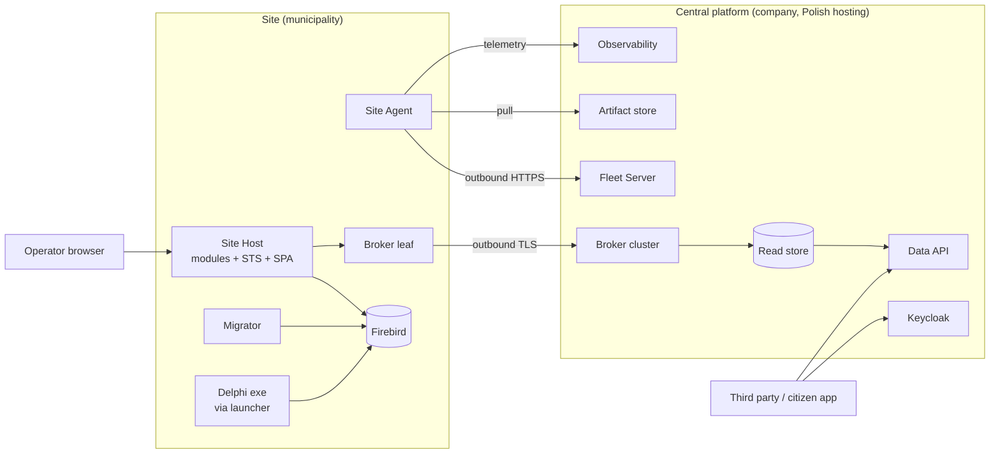

### 1.3 Key decisions

1. One on-site platform: one host process (Site Host) with modules, one agent (Site Agent), one identity component (on-site STS). Not one service per application.
2. Two supported deployment shapes, one build: Tier S (self-contained .NET services on the customer's Windows machine) and Tier M (a company-shipped Linux VM image running containers). The agent is the only component that knows which tier it runs on.
3. Sites are autonomous and outbound-only. Everything central is off the operator's critical path. No VPN on the agent or data-sync path; VPN only for audited support access.
4. Own thin fleet agent in .NET that supervises off-the-shelf components. Deliverable 1 is fleet management of the existing Delphi fleet, before any new module.
5. Migrations are run by the agent as a release step, with backup, lock, recorded version and central report. SQL scripts first (covers Delphi apps), EF Core migration bundles as the target.
6. Data exposure by CQRS: trigger-based outbox on site, versioned contract events, outbound broker leaf node, one central PostgreSQL read store with tenant row-level security, a Data API with municipality consent and third-party licensing.
7. Identity: OpenIddict embedded in the Site Host for operators, Keycloak centrally for support staff now and citizens and third parties later. Tokens carry identity only; the existing per-application authorization tables stay and are read by the applications.
8. Security posture: contracts plus an attractive API are the primary defence; encryption, credential rotation and least privilege raise the cost of misuse; no spend on obfuscation.
9. Boring, self-hosted open source by default, sized for two DevOps engineers: Docker Compose on VMs centrally, Kubernetes deferred.

### 1.4 Phases

| Phase | Content | Size |
|---|---|---|
| 0 | Prerequisites: code signing certificate, central hosting, GitLab pipelines, ADR practice | S |
| 1 | Fleet: Site Agent, Fleet Server, enrollment, inventory, migrator for existing SQL scripts, telemetry | L |
| 2 | Platform: Site Host, on-site STS with site user registry, module SDK, Next.js static SPA shell, ACRU moved onto the host | L |
| 3 | Data: outbox, contract events, broker leaf, central read store, Data API with consent | L |
| 4 | Strangler: first Delphi module replaced, Delphi login switched to the STS, EF Core migrations | XL (per module M) |
| 5 | Citizens and third parties at scale: Keycloak federation with Wezel Krajowy, Kubernetes if traffic requires it | M |

---

## 2. Current state

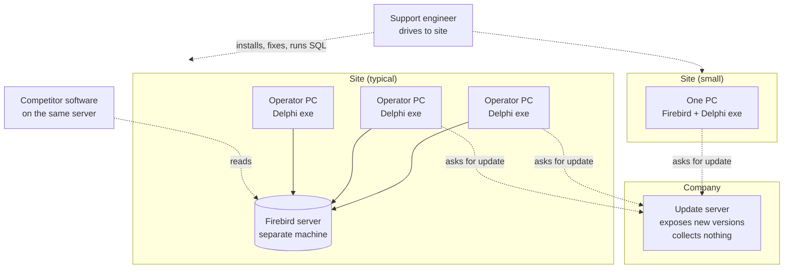

What exists and is kept as a pattern:

- ACRU (Asystent CRU) is already a .NET WebApi plus scheduler plus Next.js frontend plus its own Firebird database (CruDb), installed on site next to the RU Delphi application, integrating through database event tables (`ACRU_EVENTS`) and a versioned SQL migrator for the RU database (`RuDatabaseMigrator`). This is the seed of the Site Host and of the outbox pattern.
- ACRU already uses the database server clock as the only clock (`FirebirdAnchoredTimeProvider`), because operator PC clocks are unreliable. This becomes a platform rule.

What does not exist: site identity, inventory, health, enforced migrations, shared authentication, bug reporting with context, any API to the data.

---

## 3. Constraints and assumptions

| Area | Constraint or assumption | Source |
|---|---|---|
| Sites | Thousands of multi-user sites with a dedicated server, a few large sites, many small sites where the server is also an operator PC. Tens of thousands of operators. | Given |
| Hardware ownership | The company owns no on-site machine. Municipality IT administers the box. The company sometimes holds credentials. | Given |
| Operating systems | Mostly Windows (Server and Pro), some Linux. | Given |
| Network | Outbound HTTPS almost always available. Inbound never assumed. Some sites have authenticated proxies. | Given |
| Offline | Operators must work indefinitely without internet. Citizen-facing services may require connectivity. | Given |
| Database | Firebird 3, dialect 3, enforced on municipality admins. Older versions exist in the field. | Given |
| Legal | Municipalities own the data. Copying data centrally requires a processing agreement (umowa powierzenia przetwarzania) per municipality and a risk assessment. Not universal. | Given |
| Threat | Competitors may get legal DB access from the municipality, may run with local admin on the same server, and may reverse engineer binaries. | Given |
| Team | 10 Delphi developers, 10 new-stack developers, 5 support engineers plus third-party distributors, 2 DevOps engineers, municipality IT admins. | Given |
| Releases | No cadence today; releases are driven by law changes and feature requests. Up to 100 support tickets per day. | Given |
| Tooling budget | Self-hosted open source by default. GitLab exists. Paid SaaS only where self-hosting is a clear burden. | Given |
| Commercial | Time-limited update subscription. A license key exists per customer; its format is to be documented. Licenses forbid third-party DB access, but customers want to grant data access to third parties. | Given |
| Identity | Operators and support staff now; citizens and third-party systems later. Each application has its own users table; authorization per application in custom tables works and is kept. | Given |
| Pace | Strangler migration, much faster than five years. Business may push for faster. | Given |

---

## 4. Principles

Every new project is checked against this list in its first architecture review. A principle can be broken only by an ADR that says why.

1. **The site is autonomous.** Everything an operator needs runs on site and works with no internet for an unbounded time. Central services add capability; they never gate the critical path.
2. **Outbound only.** No component ever assumes an inbound connection to a site. If central needs something from a site, the site pushes it or the site opens the connection.
3. **One artifact, one contract.** A release is one signed, versioned bundle. The Site Agent is the only thing that installs software on a site, and it does so through one contract that every module obeys.
4. **Everything is versioned and reported.** Application version, schema version, OS patch level, component health, last successful backup. If it is not reported to the Fleet Server, it does not exist.
5. **One host, many modules.** New functionality is a module inside the Site Host, not a new process, unless an ADR proves a resource reason. Modules are separate assemblies with enforced boundaries.
6. **Data stays on site by default.** Copies leave the site only as a curated, versioned contract, only with municipality consent, only to a tenant-isolated store that can be purged per tenant.
7. **Identity in the token, permissions in the application.** The STS says who. The application decides what, from its own tables, through the shared authorization library.
8. **Contracts over schemas.** Central components never depend on a site database schema. Events and APIs are versioned contracts (OpenAPI, AsyncAPI); schemas are private to the site.
9. **Boring technology, sized for two DevOps engineers.** Prefer one tool per concern, self-hosted, with a large community. Add a technology only when an existing one cannot do the job.
10. **Raise the cost, rely on the contract.** Technical protection of on-site data and binaries is a deterrent. Legal access cannot be prevented technically; it is channelled through the API by contract and pricing.
11. **Observability by default, no personal data leaves the site.** Every component emits structured logs, metrics and traces through OpenTelemetry. Personal data is scrubbed at the source.
12. **Migrations are code, applied by machine.** No human runs SQL on a site. A schema change is a versioned migration applied by the Migrator under agent control, with backup and report.
13. **The database server clock is the only clock.** Any value stored in or compared with the database is taken from the server clock through `TimeProvider`, never from a PC clock.

---

## 5. Target architecture

### 5.1 Components

**On site**

| Component | Responsibility | Runtime |
|---|---|---|
| Site Agent | Site identity and enrollment, heartbeat and inventory, artifact pull and verification, install, upgrade, rollback, Migrator orchestration, secret storage, supervision of bundled components, self-update through a separate updater, on-demand support VPN node | Self-contained .NET service (Windows Service or systemd) |
| Site Host | One ASP.NET Core process: modules, on-site STS (OpenIddict), static SPA files, outbox publisher, local API for Delphi apps, background jobs (Quartz) | Self-contained .NET service, or container on Tier M |
| Migrator | Applies versioned migrations (SQL scripts now, EF Core bundles later) to every on-site database, with backup, lock, version table and report | CLI invoked by the Site Agent |
| Firebird | System of record for all applications during coexistence | Existing install, standardized by the agent |
| Broker leaf | Durable store-and-forward of contract events to the central broker | NATS server in leaf mode (candidate) |
| Telemetry collector | Receives OpenTelemetry from all local components, scrubs, batches, ships outbound | OpenTelemetry Collector |
| Launcher share | Delphi exe bundles served to operator PCs from the site server | File share plus tiny launcher exe |
| Site user registry | Site-level users table owned by the STS, mapped to each application's own users table | Firebird database owned by the Site Host |

**Central**

| Component | Responsibility | Runtime |
|---|---|---|
| Fleet Server | Site registry, enrollment, inventory, health, rollout rings, pins and windows, subscription enforcement, portal for support staff and distributors | ASP.NET Core plus PostgreSQL |
| Artifact store | Signed release bundles, VM images, Delphi exe bundles | GitLab package registry plus object storage |
| Release pipeline | Build, test, Authenticode sign, manifest sign, publish | GitLab CI |
| Keycloak | Identity for support staff and distributors now; citizens (Wezel Krajowy) and third-party clients later | Keycloak |
| Broker cluster | Receives events from leaf nodes, feeds projections | NATS JetStream cluster (candidate) |
| Projection service | Builds the read store from contract events, per tenant | .NET worker |
| Read store | Tenant-isolated read model | PostgreSQL with row-level security |
| Data API | Versioned public API for third parties, consent, rate limits, audit, usage metering | ASP.NET Core behind a reverse proxy |
| Observability | Metrics, logs, traces, dashboards, alerting | Prometheus, Loki, Tempo (optional), Grafana |
| Error reporting | Exceptions and operator problem reports, linked to GitLab issues | GlitchTip (Sentry-compatible) |
| Support VPN control plane | Coordinates on-demand WireGuard sessions to sites | Headscale or NetBird (assessed in 8.9) |
| Backup storage | Encrypted off-site copies of site backups, opt-in | Object storage |

### 5.2 Tier S: Windows services on the customer's machine

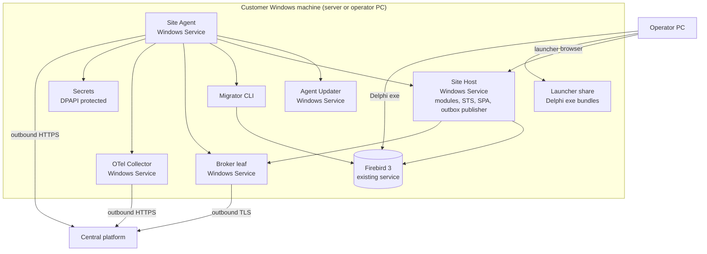

Resource budget for the smallest site (server is an operator PC): Site Agent plus Updater under 100 MB RAM, Site Host 300 to 500 MB, broker leaf under 50 MB, collector under 100 MB. Total under 1 GB on top of Firebird. If a module cannot fit, it is wrong for Tier S, not the other way round.

### 5.3 Tier M: company-shipped Linux VM with containers

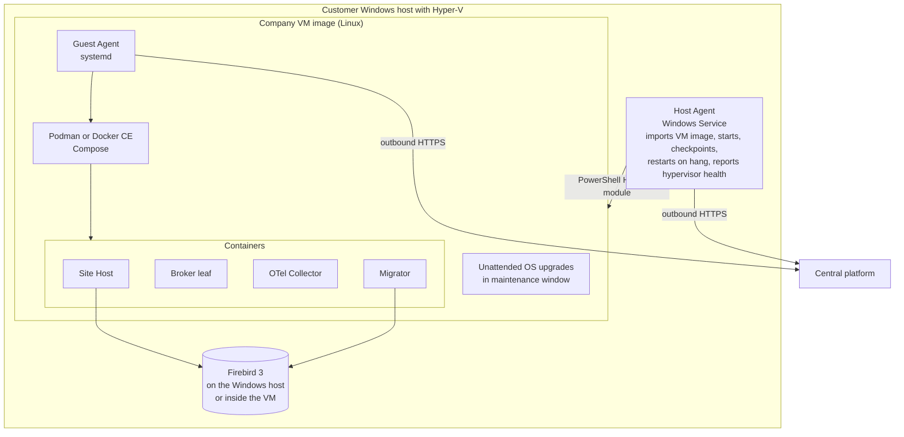

Rules for Tier M:

- Hyper-V is mandated on Windows hosts that want Tier M (available on Windows Server, Windows 10/11 Pro, Enterprise and Education; not on Home). The Host Agent uses the Hyper-V PowerShell module (`Import-VM`, `Start-VM`, `Checkpoint-VM`, `Get-VMIntegrationService` heartbeat) under local admin.
- On any other hypervisor or on a Linux host, municipality IT imports the image and only the Guest Agent exists. The site loses auto-provisioning and host-level restart, nothing else.
- The Guest Agent is the same binary as the Tier S agent compiled for Linux. Everything business-relevant is managed by the Guest Agent, so the two tiers share one operational model.
- Where Firebird lives is a per-site choice recorded in the inventory: on the Windows host (Delphi apps keep their connection strings) or inside the VM (recommended for new sites and for sites where all exe clients can be repointed).

### 5.4 Central platform

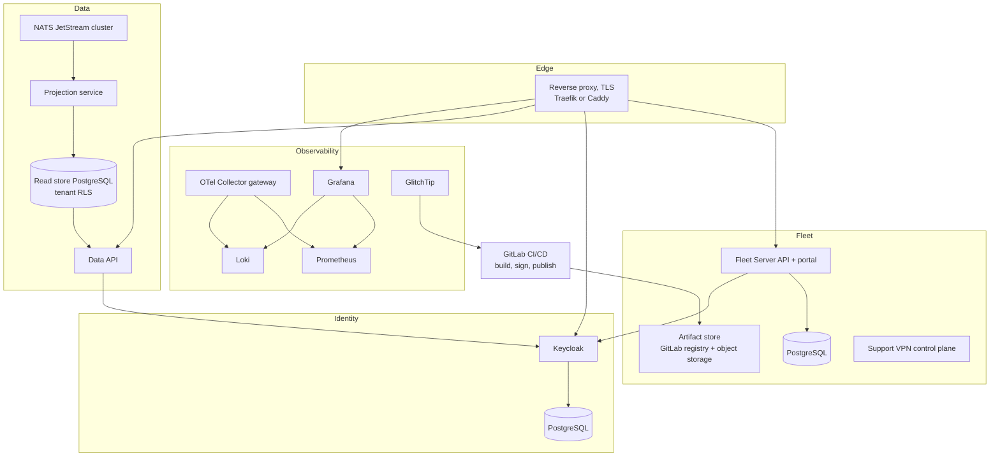

Hosting: Docker Compose on a few VMs at a Polish provider, all configuration in GitLab, nightly backups to object storage in a second location, infrastructure changes through merge requests. Kubernetes is deferred until the Data API carries citizen-scale traffic; the Compose definitions are written so the move is mechanical.

### 5.5 Module anatomy

A module is a set of assemblies composed into the Site Host at build time:

```
Company.Platform.Host                 the one process; references every module
Company.Modules.<Name>.Contracts      public API of the module to other modules (interfaces, DTOs, events)
Company.Modules.<Name>.Application    use cases, validators, orchestration
Company.Modules.<Name>.Domain         enums, value objects, repository interfaces
Company.Modules.<Name>.Persistence    EF Core DbContext, configurations, migrations
Company.Modules.<Name>.Legacy         raw-SQL repositories against the Delphi-owned tables
Company.Modules.<Name>.Web            endpoints, DTOs, mappers
Company.Modules.<Name>.Spa            Next.js static export, served under /modules/<name>/
```

Rules:

- A module references another module only through its `Contracts` assembly. An architecture test (NetArchTest or similar) fails the build on any other reference.
- A module owns one database schema (its own Firebird database today, as ACRU does with CruDb). It reads Delphi-owned tables only through its `Legacy` assembly and never writes them except through migrator-managed event tables.
- Modules communicate in-process through contracts and an in-process event bus. Events that cross the site boundary are published to the outbox (section 10).
- Features are gated by the signed license file, not by composing different builds. One artifact serves every site.
- A module may run out of process behind the host's reverse proxy (YARP) only when an ADR documents a resource reason (for example a scheduler with heavy CRU traffic). The default is in-process.

ACRU is the first module and the proof of the module SDK: its WebApi, Scheduler and Frontend become one module in the Site Host.

---

## 6. Topology options assessed

| Criterion | Option 1: API on site server, SPA on site server | Option 2: API and SPA on every operator PC (ACRU today) | Option 3: API and SPA central, data on site | Recommended: two tiers (section 5) |
|---|---|---|---|---|
| Offline operation | Yes | Yes | No | Yes |
| Mobile and citizens | No | No | Yes | Yes, through the central read model and Data API |
| Data residency | Data stays on site | Data stays on site | Every request crosses to the site or data is copied; unsolved | Opt-in per municipality, curated copy only |
| Load on site DB from citizens | None | None | All of it | None; reads hit the central read store |
| Installations to manage | One per site | One per PC | One central plus thin on-site | One per site plus one central |
| Needs inbound access to sites | No | No | Yes (or a tunnel per site) | No |
| Small sites (server is a PC) | Works | Works | Works | Tier S works |
| Containers | Possible if the site has a VM | No | Yes | Tier M only |
| Reverse engineering surface | On-site binaries | On-site binaries | Central only | On-site binaries (accepted, section 15) |
| Verdict | Right shape for the site part | Rejected as the general model: N installations per site, no shared state, no single STS | Rejected as the only model: breaks offline and residency | Chosen |

Option 2 remains the correct shape for a single-user site with no server: Tier S on the one PC is exactly that.

---

## 7. Hosting runtime assessed

| Criterion | Windows Services (self-contained .NET) | VM with containers (company Linux image) |
|---|---|---|
| Works on the smallest sites | Yes | No (needs a hypervisor, RAM, admin cooperation) |
| Needs municipality admin involvement | Install once by distributor or support | Import a VM image, assign IP, allow outbound |
| Isolation from other software on the box | Process level only | Full VM boundary; competitor software on the host cannot read inside without hypervisor rights |
| Update atomicity and rollback | Per service, side-by-side directories, agent-managed | Per container image, trivially atomic |
| OS patching | Customer's, report only | Company's, automated inside the image |
| Docker licensing | Not needed | Podman or Docker CE inside Linux; no Docker Desktop |
| Linux hosts | Not applicable (systemd variant of the same binaries) | Native |
| DevOps cost | One packaging | Second packaging plus image build pipeline |
| Observability | Same (OTel) | Same (OTel) |
| Firebird placement | Stays on the Windows host | Host or inside the VM |

Decision: both, as Tier S and Tier M, with one build. Docker Desktop on Windows is excluded: it is licensed per user for companies above 250 employees or 10 million USD revenue, which is a procurement conversation with every municipality, and it is not reliable as a server runtime on a shared PC. Windows containers are excluded: image size, kernel-version coupling and poor tooling.

The agent abstracts the difference. The install contract has four verbs (`install`, `upgrade`, `rollback`, `health`) implemented twice: once over Windows Service Control Manager and side-by-side directories, once over Compose.

---

## 8. Fleet management

### 8.1 Site Agent responsibilities

- Identity: holds the site certificate, authenticates every call to the Fleet Server with it (mTLS or signed requests).
- Heartbeat and inventory: every N minutes reports agent version, component versions, schema versions per database, OS and patch level, disk, Firebird version and health, last backup result, subscription state, tier.
- Commands: long-polls the Fleet Server for commands (upgrade to version X, run migration, collect logs, start support session, rotate credentials). Commands are signed and idempotent.
- Artifacts: downloads bundles from the artifact store, verifies Authenticode on installers and the manifest signature with the pinned release key, stores them for rollback.
- Install contract: `install`, `upgrade`, `rollback`, `health` per component, implemented for Windows services and for Compose.
- Migrations: invokes the Migrator before starting the new application version, aborts and rolls back the application on migration failure.
- Secrets: generates and stores per-site secrets (Firebird SYSDBA, application DB users, STS signing key, broker credentials, backup encryption key) in DPAPI on Windows and in a root-only file on Linux. Secrets never leave the site except the backup key escrow, which is opt-in.
- Supervision: restarts the Site Host, broker leaf and collector on failure, with backoff and a report.
- Backups: runs `gbak` nightly, validates with `gfix`, restores to a scratch database to verify, prunes, optionally uploads encrypted copies.
- Support session: on a signed command with a validity window, starts the WireGuard node and stops it when the window ends.
- Self-update: the Updater is a separate tiny service that replaces the agent binary on a signed command and restarts it; the agent can update the Updater. Each can repair the other.

### 8.2 Enrollment

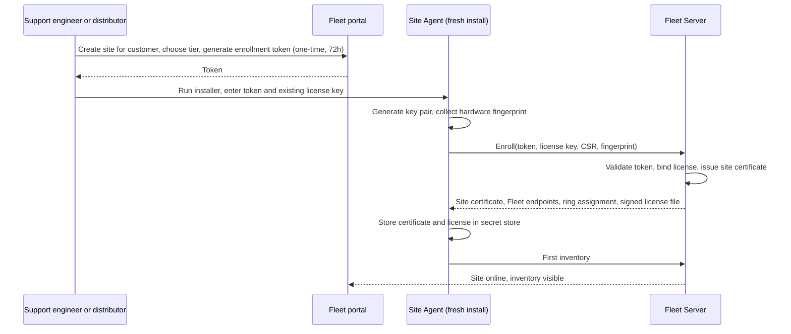

The existing license key identifies the customer and carries the migration into the new model. The enrollment token binds the installation. Distributors see only their own sites in the portal (Keycloak group per distributor).

### 8.3 Release and upgrade

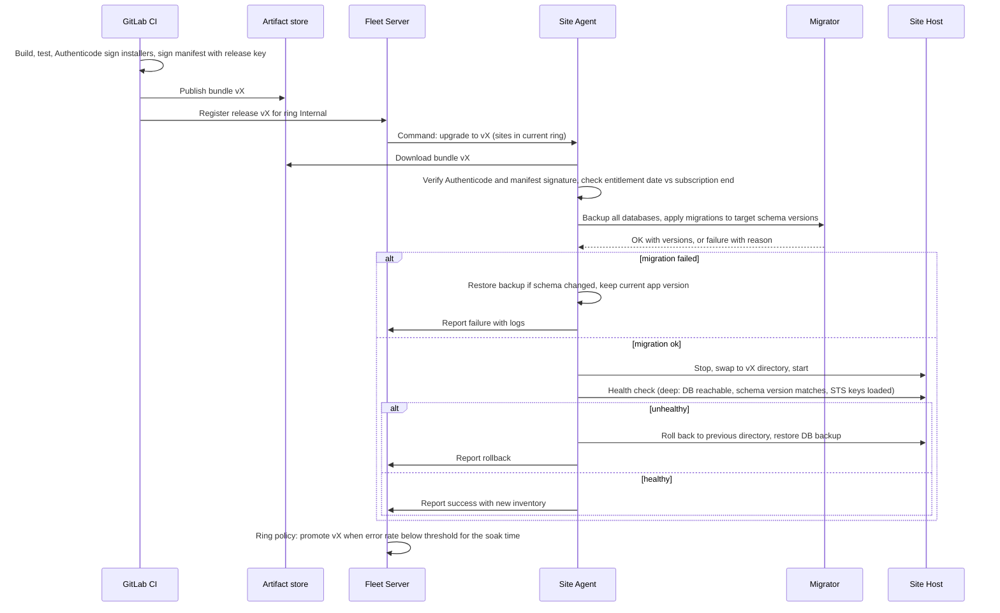

### 8.4 Rollout rings

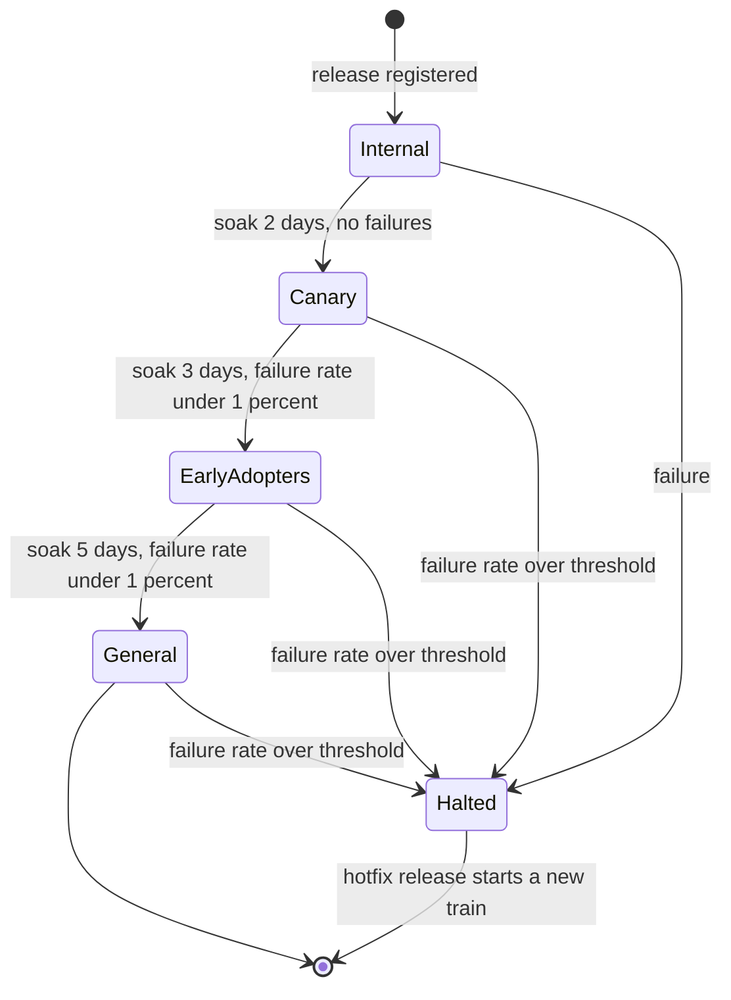

Policies:

- Biweekly release train plus an emergency lane. An urgent law change compresses soak times to hours, not to zero; the ring order is never skipped.
- A site may pin a version or set a maintenance window, but may not lag more than 3 releases behind the general ring; beyond that the agent updates in the next window and reports the forced update.
- Canary sites are volunteers with a support contact; early adopters are sites with a dedicated server and good connectivity.
- Promotion is automatic on metrics, halt is automatic on metrics, and a human can halt at any time.

### 8.5 Subscription enforcement

- The signed license file carries the customer, the sites, the entitled modules, and the subscription end date.
- The agent installs a release only if the release date is before the subscription end date (perpetual fallback model). Expired sites keep their last entitled version indefinitely.
- Security-only releases are flagged in the manifest and installed regardless of subscription state.
- At expiry, central services stop for the site: no event sync, no Data API access for its tenants, support sessions only on a paid ticket. Telemetry and heartbeat continue, so the fleet picture stays complete.
- Because active sites are within 3 releases of current, the event contract must support at most 4 concurrent versions. Expired sites do not sync, so they do not widen that window.

### 8.6 OS patching

- Tier S: the agent reports patch level, pending reboot, disk, antivirus state and Firebird version. The Fleet portal shows a compliance report per site that support can send to the municipality. The agent never changes Windows Update settings.
- Tier M: the VM image runs unattended upgrades in the maintenance window; the Guest Agent reports the result; a failed upgrade halts the window and reports.

### 8.7 Delphi exe distribution during coexistence

- The agent is installed on the site server only. Operator PCs get no agent.
- The server hosts the Delphi exe bundles on a share. A tiny launcher on each operator PC (the only per-PC component, installed once) compares the bundle version with the local copy, copies on change, and starts the application. The launcher is self-contained, signed, and updates itself from the share.
- The agent updates the share from the same release bundle, so Delphi applications and the Site Host move together, after the migration has run.
- Until the launcher is deployed at a site, the current per-PC update mechanism stays, pointed at the share instead of the public update server.

### 8.8 Site-initiated support access (VPN assessed)

The VPN is for support engineers only. It is never on the agent or data-sync path.

| Criterion | WireGuard mesh with self-hosted control plane (Headscale or NetBird) | OpenVPN per site | AnyDesk or TeamViewer style remote desktop |
|---|---|---|---|
| Direction | Outbound from site, NAT traversal built in | Outbound from site, needs a central concentrator | Outbound from site |
| Agent-started, time-boxed session | Yes (node registered on demand with an expiry) | Possible with scripted config | Possible with unattended access; usually permanent |
| Audit of who connected when | Control plane logs plus agent audit | Server logs | Vendor logs |
| Access scope | Network-level; restricted by ACL to the site host ports | Network-level | Desktop-level, operator sees the screen |
| Municipality consent per session | Yes: agent accepts the command only within an approved window | Scriptable | Usually a standing permission |
| Cost | Free, self-hosted | Free | Per-seat licence |
| Operational burden for 2 DevOps | Low (one control plane) | Medium | None, but outside your audit |
| Verdict | Recommended | Fallback | Keep for screen-sharing with operators, not for server access |

Session model: a support engineer opens a ticket-bound session in the Fleet portal; the Fleet Server sends a signed command with a time window; the agent brings up the WireGuard node, applies an ACL that allows only the engineer's node, and tears it down at expiry. Every session is logged with ticket, engineer, start, end, and is visible to the municipality in its portal view.

---

## 9. Database

### 9.1 Migrator

Phase A (bridge, from deliverable 1): the Migrator applies the existing versioned SQL scripts (as `RuDatabaseMigrator` does today for RU with `ACRU_MIGRATIONS_HISTORY`), generalized to every on-site database.

Phase B (target): once database versions are unified across the fleet and the Site Host API has replaced direct database access from the Delphi/C++ applications, module schemas are owned by EF Core and shipped as EF Core migration bundles (`dotnet ef migrations bundle`), which are self-contained executables the agent runs the same way.

Rules that hold in both phases:

- A migration is idempotent in effect and recorded in a history table per database (`<APP>_MIGRATIONS_HISTORY` with version, checksum, applied-at from the server clock, applied-by agent version).
- Before any migration: `gbak` backup, `gfix -validate`, and a lock row that prevents concurrent runs.
- The application refuses to start if the schema version in the history table does not match the version it was built for, and reports the mismatch.
- Scripts that need an interactive step do not exist. If a current Delphi script needs one, that step is redesigned before the script joins the Migrator (open question in section 17).
- Firebird-specific rules from the existing skills apply: 31-character identifiers, dialect 3, explicit names for every constraint and index, `DateTimeOffset` and `DateOnly` conversions, no schema resets on deployed databases.

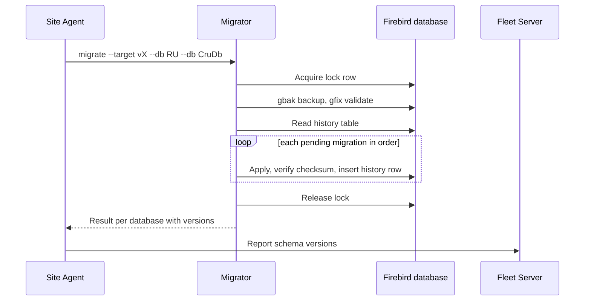

### 9.2 Firebird standardization

- Deliverable 1 includes a Firebird inventory per site. Sites below Firebird 3 dialect 3 get a scheduled, agent-driven upgrade (backup, install, restore with `gbak -fix_fss_data` where needed, validate) during a maintenance window with a support engineer on call for the first batches.
- Firebird 4 or 5 is a later decision gated by Delphi driver compatibility and by the encryption and replication features; it is recorded as an open question, not assumed.

### 9.3 Credentials

- Per-site random SYSDBA password generated by the agent at enrollment, stored in the secret store, rotated on command.
- Each module and each Delphi application gets its own Firebird user with the roles it needs. No application connects as SYSDBA.
- Break-glass: municipality IT can request a time-limited read-only account through the portal; the request, the grant and the expiry are audited and visible to both parties.
- Credential delivery to Delphi applications during coexistence: the launcher fetches the application's connection secret from the Site Host over local HTTP with a per-PC token, so no password is stored in a config file on the share.

### 9.4 Encryption as a deterrent

- Firebird 3 and later expose a database encryption plugin API and ship no production-grade plugin; third-party plugins exist (commercial and open source) and must be evaluated for Firebird 3 compatibility and Delphi driver support.
- Key handling: a key-holder plugin asks the Site Agent for the key at database open; the agent keeps the key in DPAPI (Windows) or a root-only file (Linux). The key never sits in a config file next to the database.
- Honest statement of value: encryption stops copying the database file to another machine and stops reading backups without the key. It does not stop a local administrator who can read the agent's process memory or the running server's. It is scheduled after standardization and credential rotation, which deliver more protection for less effort.

### 9.5 Backups

- Mandatory local: nightly `gbak`, restore test into a scratch database, retention policy, result in inventory. A site with a failed backup is a red item in the Fleet portal.
- Optional central: encrypted with a site key before upload; key escrow in the Fleet Server only with municipality opt-in (it is a processing activity under RODO); restore is agent-driven and audited.

---

## 10. Data exposure

### 10.1 Why CQRS

The on-site databases are normalized for data entry. A citizen-facing portal is a read-heavy, bursty, public-internet workload. Serving it from the on-site database would degrade operators and expose the schema. The write side stays on site; the read side is a separate, curated model built from events, hosted centrally, with its own scaling and security.

### 10.2 Outbox and contract events

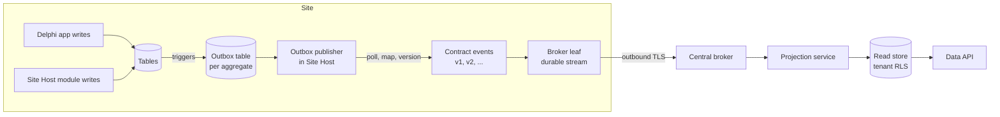

- Change capture is trigger-based into outbox tables, versioned through the Migrator. It works on Firebird 3, survives offline periods, and captures Delphi writes without changing Delphi code. Firebird `POST_EVENT` is rejected (not durable). Firebird 4 replication is not available on the enforced version.
- The outbox publisher inside the Site Host maps outbox rows to contract events. The contract is the only thing central knows; the site owns the mapping, so thousands of sites on several schema versions produce one contract.
- Every aggregate also has a snapshot event (`<Aggregate>Snapshot vN`) so a municipality can be fully re-projected after a contract change or after outbox retention is exceeded. Resync is throttled per site.
- Events carry tenant id, site id, aggregate id, version, server-clock timestamp, and a monotonically increasing sequence per site for ordering and deduplication. Projections are idempotent.
- Contracts are described in AsyncAPI and reviewed like public APIs (section 18).

### 10.3 Transport assessed

| Criterion | (a) HTTPS batch push from the agent to an ingest API | (b) Broker leaf node with outbound TLS (NATS JetStream leaf, or RabbitMQ shovel/federation) | (c) WireGuard VPN, central pulls from the site | (d) VPN plus broker |
|---|---|---|---|---|
| Needs inbound or VPN | No | No | Yes | Yes |
| Offline durability | Site must implement its own queue and retry | Built in (JetStream stream on site) | Central retries against an unreachable site | Built in |
| Ordering and dedup | Implemented by hand | Built in (sequence, ack, redelivery) | Implemented by hand | Built in |
| Footprint on Tier S | Nothing extra | NATS: single binary, tens of MB RAM; RabbitMQ: Erlang runtime, hundreds of MB | WireGuard node | Both |
| Central scaling | Ingest API scales like any API | Broker cluster, well understood | Pull scheduler per site, awkward at thousands | Both |
| Security surface | One outbound endpoint | One outbound endpoint | Every site becomes a network peer of the central platform | Both |
| Bidirectional (commands to site) | Needs the agent's long-poll anyway | Free: subscribe on a subject | Yes | Yes |
| Operational burden | Low | Low to medium (NATS) or medium to high (RabbitMQ) | High (thousands of tunnels, ACLs, key rotation) | Highest |
| Verdict | Fallback if the leaf node does not fit Tier S | Primary candidate: NATS JetStream leaf nodes | Rejected for sync | Rejected for sync |

NATS is preferred over RabbitMQ for the on-site side because leaf nodes are a first-class NATS topology, the binary is small and dependency-free, and JetStream gives durable store-and-forward with per-subject retention. RabbitMQ remains a valid central broker if the team already knows it, with the site side using (a).

### 10.4 Central read store tenancy

- One PostgreSQL cluster, every row carries `tenant_id`, row-level security policies enforced for the Data API role, large tables partitioned by tenant hash or by tenant range for the biggest customers.
- Tenant model: Customer (licensee) has Sites (installations) has Tenants (municipalities whose data a site holds). A shared service centre (CUW) is one Site with several Tenants. Licensing is per Customer, agent identity per Site, row-level security per Tenant.
- Contract end: drop the tenant partition, purge the tenant's events from the broker streams, record the purge. This is the operation the municipality's data protection officer will ask about.
- Thousands of databases or schemas are rejected as an operational trap for a two-person DevOps team.

### 10.5 Data API and consent

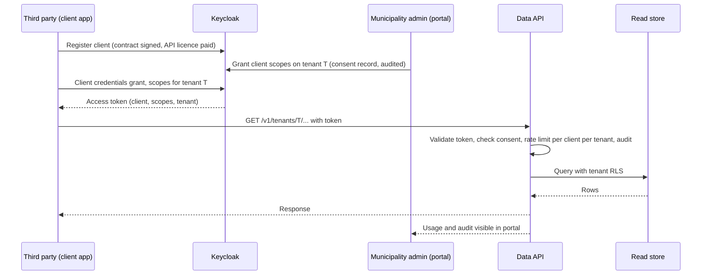

- Who pays: the third party pays for API access; the municipality grants consent; both see audit and usage. A free tier exists if a law obliges the municipality to provide the data.
- Versioned REST API with OpenAPI 3, cursor pagination, filtering limited to indexed fields, ETags, rate limits and quotas per client per tenant, idempotency keys where the API accepts writes (none in phase 3).
- The Data API is the only path to the read store. No consumer gets a database connection.

### 10.6 Risk assessment for the central read model

| Risk | Assessment | Control |
|---|---|---|
| RODO: the company becomes a processor of citizen data at scale | Real, per municipality | Umowa powierzenia przetwarzania per municipality; opt-in only; DPIA (ocena skutkow dla ochrony danych) for the read model as a whole; records of processing; data minimization in the contract events (only what the API exposes) |
| KRI (Krajowe Ramy Interoperacyjnosci) obligations of the municipality | The municipality must show the system meets KRI requirements | Information security management evidence from the company (ISO 27001 or equivalent), interoperability through documented open API |
| NIS2 (ustawa o krajowym systemie cyberbezpieczenstwa amendment; verify transposition status) | Municipalities are public entities; vendors are supply chain | Incident reporting process, vulnerability handling, supply-chain statements, logging and retention |
| Breach of the central store | Single large target | Tenant RLS, encryption at rest, per-tenant keys for the most sensitive fields, no personal data in logs, access only through the Data API, pentest before go-live |
| Hosting location | Must be in Poland or at least the EU per municipal procurement expectations | Polish providers to evaluate: OVHcloud (Warsaw region), Beyond.pl, Polcom, Operator Chmury Krajowej, Atman. Criteria: Polish data centre, ISO 27001, public-sector references, DPA availability, egress pricing, object storage, managed PostgreSQL optional |
| Municipality refuses any central copy | Expected for some | Fallback: agent-held outbound tunnel so the Data API proxies to the on-site API for that tenant; lower availability and rate limits documented for that tenant |
| Schema change on site breaks projections | Common failure mode | Contract versioning, snapshot events, projection tests against every supported contract version, consumer-driven contract tests |
| Data owned by the municipality served to a competitor | Business risk, not technical | Consent record per grant, audit visible to the municipality, pricing that makes the API the cheaper path, licence terms that keep direct DB access forbidden |

---

## 11. Identity

### 11.1 Populations

| Population | Now | Later | Authenticated by |
|---|---|---|---|
| Operators (municipal staff) | Yes | | On-site STS (OpenIddict in the Site Host) |
| Support staff and distributors | Yes | | Central Keycloak; on-site actions through capability tokens (11.7) |
| Citizens | | Yes | Central Keycloak with identity brokering to Wezel Krajowy (login.gov.pl, SAML 2.0) |
| Third-party systems | | Yes | Central Keycloak, client credentials |
| Machine principals on site (host jobs, migrator) | Yes | | Reserved accounts in the site user registry |

### 11.2 On-site STS and the site user registry

- OpenIddict (Apache 2.0, .NET native) runs inside the Site Host, issues OIDC tokens for the SPA (authorization code with PKCE), for the Delphi applications (resource owner password flow during the bridge, then authorization code through a local browser), and for machine principals (client credentials). It works offline. Signing keys are generated per site and stored in the agent's secret store.
- Each application has its own users table today, so the STS owns a thin site-level user registry created by the Migrator: `SITE_USERS` (site user id, login, password hash, lockout, TOTP secret, status, created from the server clock) and `SITE_USER_MAP` (site user id, application code, application user id). It is seeded from the existing application tables; the application tables keep their own ids and the map is the only link.
- The token `sub` is the site user id. An application resolves its own user id through the map (a shared library does this with a cache) and then reads permissions from its own tables exactly as today.
- Passwords belong to the STS from day one. Existing hashes are imported if the format is known and strong enough; otherwise the first STS login forces a password change. There are never two password stores.
- User lifecycle during the bridge: the existing admin tooling keeps creating users in application tables; a sync job in the Site Host creates the registry row and the map entry, or the admin tooling calls a local Site Host endpoint. Target: the Site Host admin module manages users and the application tables are written through the map.

### 11.3 Operator login

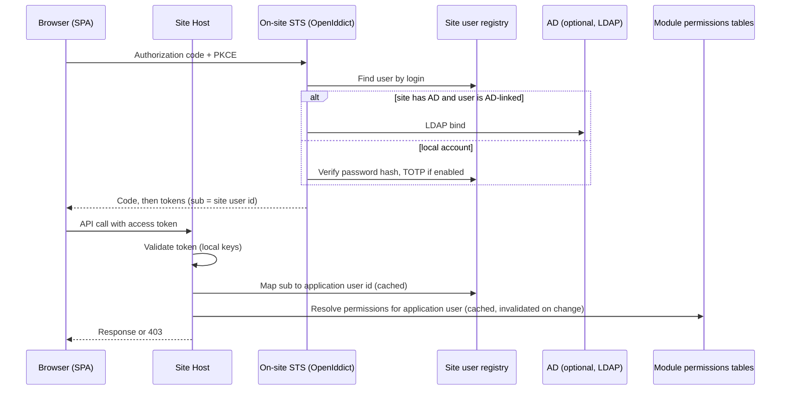

### 11.4 Authorization reuse

- Tokens carry identity only. No permission claims.
- A shared .NET authorization library provides: `IPermissionResolver` per module (reads the module's own tables), a per-user cache with an invalidation hook the admin tooling calls, ASP.NET Core authorization policies and attributes (`[RequirePermission("RU.Agreements.Publish")]`), organizational-unit scoping as a first-class concept, and a `GET /modules/<name>/me/permissions` endpoint so the SPA can hide what it may not call. The server always enforces.
- New modules declare their permission catalog as migrator-managed rows in the same model the Delphi applications use, so municipality admins manage rights in one place with the tooling they know.
- Central Keycloak tokens never carry on-site permissions; the Data API's consent model authorizes them.

### 11.5 Reserved principals

The Migrator creates per site: a disabled `support` account and one `service` account per module, in the registry and in each application's tables, with permissions assigned through the existing tooling like any user. Municipality admins can see and restrict what support may do.

### 11.6 Active Directory

- Default: LDAP bind from the on-site STS, no domain join needed, works from Tier M Linux VMs and from an unjoined Windows service. A registry user is linked to an AD account by UPN.
- Optional: Windows Integrated Authentication where the municipality insists and the Site Host is a domain-joined Windows service.
- Without AD: local accounts with a password policy, lockout, and optional TOTP.

### 11.7 Support staff access

Recommended, pending a review of current support procedures (open question):

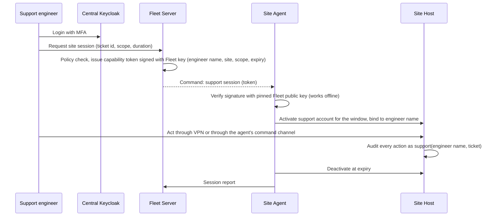

Per-site accounts for support staff across thousands of sites and shared passwords are both rejected.

### 11.8 Central Keycloak

- Realms: `company` (support staff, distributors, with MFA), `citizens` (brokered to Wezel Krajowy, later), `partners` (third-party clients, client credentials).
- Keycloak is central only. It is not deployed on sites: a Java process with a 1 GB minimum does not fit Tier S, and operators must log in offline.

### 11.9 Product comparison

| Criterion | OpenIddict | Keycloak | Duende IdentityServer | ASP.NET Core Identity alone |
|---|---|---|---|---|
| Licence | Apache 2.0 | Apache 2.0 | Commercial above 1M USD revenue | MIT |
| Runs inside a .NET process | Yes | No (Java) | Yes | Yes (no OIDC server) |
| Footprint for Tier S | Negligible | Too large | Small | Negligible |
| Admin UI, MFA UI, federation out of the box | No (build what you need) | Yes | Partial | No |
| SAML brokering (Wezel Krajowy) | Not built in | Yes | Not built in | No |
| Verdict | On site | Central | Excluded (cost) | Building block under OpenIddict |

---

## 12. Frontend and desktop

- Next.js with TypeScript is the framework for all SPAs. On site, every module ships a static export (`output: "export"`) served by the Site Host under `/modules/<name>/`. No Node process runs on a site. Server-side rendering is used only centrally (citizen portal, SEO), where a Node runtime is operated by the company.
- Shared UI package: one component library, one design system (the existing Figma), one authentication client, one API client generator from OpenAPI.
- Desktop C# is not a second UI. It exists only when hardware on the operator PC requires it (fiscal printers, card readers, scanners) and then as a thin WebView2 shell around the same SPA plus a local device bridge exposed to the SPA over a loopback API. The shell is distributed by the launcher share like the Delphi exes.
- Mobile for operators is deferred until the on-site API and the central read model exist; a mobile app would consume the Data API or, for on-site use, the Site Host API over the office network.

---

## 13. Observability and bug reporting

- Every component emits OpenTelemetry: structured logs (the existing logging guide in `docs/logging_guide.md` applies), metrics, and traces with a site id and a tenant id as resource attributes.
- The on-site collector scrubs personal data by rule (configurable deny-list of attributes, hashing of identifiers), batches, buffers to disk while offline, and ships to the central collector gateway. Only technical telemetry leaves the site; the contract with the municipality states this, with retention periods.
- Central stack: Prometheus (metrics), Loki (logs), Grafana (dashboards and alerting), optional Tempo (traces), GlitchTip for exceptions and problem reports (Sentry-compatible SDKs, MIT licensed, far lighter to self-host than Sentry).
- Fleet dashboards: version spread per ring, failed upgrades, failed backups, schema mismatches, sites silent for more than N hours, subscription states, error rates per release (feeds ring promotion).
- Operator problem report: a "report a problem" action in the SPA and in the Delphi applications collects the last N minutes of local logs, component versions, schema versions, the current screen (screenshot optional, with explicit operator consent because it may show personal data), and the operator's description, and sends the bundle through the agent to GlitchTip, which creates a GitLab issue with the fleet context attached. Support sees the report with everything they would have asked for.
- Alerting goes to the support rota, not to developers, with runbooks linked from each alert.

---

## 14. API and code conventions

APIs (on-site module APIs and the central Data API):

- REST over HTTPS, OpenAPI 3 generated from code and published per version; breaking changes mean a new major version in the URL (`/v2/`); non-breaking additions are allowed within a version.
- Errors as RFC 9457 Problem Details with a stable `type` URI per error kind; validation errors list field paths (`[0].podstawoweDane.numerUmowy` style, as ACRU does).
- Cursor pagination, `limit` capped, filtering on documented fields only, sorting on indexed fields only, ETags on single resources.
- Commands that create or mutate accept an idempotency key header and replay the first result.
- Async operations return 202 with a status resource. Long-running work goes through the queue, never through a long request.
- Events are described in AsyncAPI, versioned per event type, and reviewed like public APIs.
- Internal module-to-module calls go through `Contracts` interfaces, never through HTTP inside one process.

Code (extends the existing repository conventions):

- .NET LTS releases only, upgraded within six months of release. Self-contained, single-file publish for on-site binaries. `UseWindowsService()` and `UseSystemd()` on the same host.
- Layering as in ACRU: Web, Application, Domain, Persistence, Legacy, Contracts. Business logic in Application. Hand-written fakes and in-memory EF for unit tests; raw-SQL repositories integration-tested only.
- Every rule in a validator gets a passing and a failing test. Every contract event gets a schema test per supported version.
- `TimeProvider` injected everywhere; no `DateTime.Now`, `DateTime.UtcNow` or `DateTime.Today` in code that stores or compares with database values.
- One public type per file, file-scoped namespaces, `sealed` by default, English identifiers, Polish allowed only in JSON property names dictated by external contracts.
- Secrets never in configuration files on site; always through the agent's secret store. API keys never in logs or exception messages.

---

## 15. Security threat model and controls

| Threat | What it means | Primary control | Secondary controls | What is not attempted |
|---|---|---|---|---|
| (a) Municipality grants a competitor legal DB access | The data owner exercises a right | Licence terms keep direct DB access forbidden; the Data API with consent and pricing is the sanctioned, cheaper path; audit visible to the municipality | Per-site credentials held by the agent so "access" requires a formal break-glass request | Technical prevention of a legal grant |
| (b) Competitor software with local admin on the same server | Can read files, memory, network | Tier M VM boundary where available; per-site random SYSDBA and least-privilege users; secrets in DPAPI or root-only files; database encryption with agent-held key | Firebird listens on localhost only where all clients are local; host firewall rules written by the agent; telemetry of unexpected connections | Protection against a hypervisor-level or memory-dumping administrator |
| (c) Reverse engineering of binaries | Delphi exes and .NET assemblies decompile | Business logic moves server-side over time; licence verification and release signing keys are central; contracts and pricing protect commercial position | Signed artifacts so a modified binary is detected by the agent; tamper reporting | Obfuscation or DRM (cost high, value low, breaks diagnostics) |
| Supply chain and malicious update | A compromised build or artifact reaches thousands of sites | Authenticode plus manifest signature with an offline release key; agent verifies both; rings halt automatically | Reproducible builds, dependency scanning in GitLab, SBOM per release | |
| Central platform breach | One target, many tenants | Tenant RLS, encryption at rest, MFA for staff, no DB access except the Data API, pentest, incident process (NIS2) | Per-tenant keys for sensitive fields, short-lived tokens, audit retention | |
| Stolen site certificate | Impersonation of a site | Certificate bound to hardware fingerprint, revocation from the portal, short validity with agent renewal | Anomaly alerts (two locations, one site) | |
| Support access misuse | An engineer or distributor overreaches | Capability tokens with ticket, scope, expiry; reserved support account with municipality-visible permissions; full audit | Session recording at the command-channel level | |

---

## 16. Migration roadmap

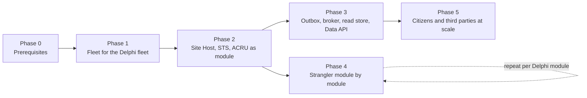

| Phase | Deliverables | Exit criterion | Size |
|---|---|---|---|
| 0 Prerequisites | EV Authenticode certificate; release signing key in an HSM or offline; central VMs at a Polish provider with Compose, backups and monitoring; GitLab pipelines that build, sign and publish; ADR practice started; licence key format documented; current support procedures documented | A signed, published, empty bundle flows from GitLab to the artifact store | S |
| 1 Fleet | Site Agent (Tier S first), Updater, enrollment, inventory, heartbeat, Fleet Server and portal with distributor scoping, Migrator for existing SQL scripts, launcher share, telemetry collector, GlitchTip, Firebird inventory and standardization campaign, local backups | 90 percent of multi-user sites enrolled; every release of the Delphi suite ships through rings; no manual SQL on sites | L |
| 2 Platform | Site Host, module SDK with architecture tests, on-site STS with site user registry and map, shared authorization library, Next.js static shell, ACRU moved onto the host, Tier M VM image and Host Agent, subscription enforcement, support session flow | ACRU runs as a module at every ACRU site through the agent; operators log in once for ACRU and for one Delphi app switched to the STS | L |
| 3 Data | Outbox triggers for the first aggregates, outbox publisher, NATS leaf and cluster, projection service, read store with RLS, Data API v1 with consent, Keycloak partners realm, DPIA and processing agreement template | One municipality opted in, one third party consuming the Data API under contract | L |
| 4 Strangler | One Delphi module replaced at a time: its data model moves to a module schema, its screens to the SPA, its login to the STS, its SQL scripts to EF Core migrations; direct DB access from the remaining Delphi apps replaced by Site Host APIs where they touch migrated data | Each module: no Delphi code path remains for that module at any site on the general ring | XL total, M per module |
| 5 Citizens at scale | Keycloak citizens realm with Wezel Krajowy, citizen-facing Data API scopes, Kubernetes if traffic requires it, mobile app decision | First citizen-facing consumer live | M |

Rules for the roadmap:

- Phase 1 ships value to the current product and is the channel for everything after it. It is not skipped or shortened to start the "new" platform earlier.
- Phase 4 is a sequence of module projects; the order is a business decision made per module with an ADR. The Delphi retirement date is a consequence of module count and team capacity, and the document does not promise one.
- The ten Delphi developers own, during phases 1 and 2: the launcher, the login switch to the STS, outbox triggers for Delphi-owned tables, and the clean-up of SQL scripts into the Migrator. This is how the pace gets faster than five years without a big-bang rewrite.
- Critical path: certificate and central hosting (phase 0) then agent enrollment at scale (phase 1, bounded by distributor and support visits) then everything else.

---

## 17. Open questions and risks

| Item | Owner | Needed by |
|---|---|---|
| Current support procedures for accessing sites (who, how, which credentials); confirms or changes the capability-token model in 11.7 | Support lead | Phase 2 |
| Inventory of existing SQL migration scripts per application: any interactive steps, ordering constraints, or Delphi-side upgrade coupling | Delphi lead | Phase 1 |
| Licence key format and how it is generated and verified today | Product | Phase 0 |
| Whether any component of the business logic is a trade secret that would justify more than contractual protection | Management | Phase 2 |
| Existence of shared service centres (CUW) or multi-site municipalities in the customer base; confirms the tenant model | Sales | Phase 3 |
| Share of sites with Active Directory and interest in SSO | Support | Phase 2 |
| Firebird 4 or 5 upgrade feasibility with current Delphi drivers; prerequisite for built-in replication and better encryption options | Delphi lead | Phase 3 |
| Choice of Polish hosting provider against the criteria in 10.6 | DevOps | Phase 0 |
| Encryption plugin for Firebird 3: candidates, licences, driver compatibility | DevOps | Phase 3 |
| NIS2 transposition status in Poland and the company's obligations as a supplier | Legal | Phase 3 |
| Whether the contract with municipalities must be amended for telemetry, central backups, and the Data API consent model | Legal | Phase 1 |

Risks:

| Risk | Impact | Mitigation |
|---|---|---|
| Enrollment at thousands of sites takes longer than planned because it rides on physical visits | Everything after phase 1 waits | Enrollment packaged as a five-minute step for distributors; remote enrollment through the existing per-PC updater where it still works; incentive in the subscription for early enrollment |
| Two deployment tiers double the DevOps load | Slower releases | One build, one install contract, Tier M only where a VM can actually be imported; measure the Tier M share and reconsider if under 10 percent |
| The event contract drifts with Delphi schema changes | Broken projections | Outbox triggers and contract mapping are versioned in the same migration as the schema change; projection tests per contract version in CI |
| Keycloak and OpenIddict as two identity stacks | Two skill sets | Keycloak is operated, not developed; OpenIddict is code the .NET team already owns; a shared token validation library hides the difference from modules |
| The business pushes to skip phase 1 | No channel for later phases; the new platform cannot reach sites | The executive summary makes phase 1 the cost-reduction story for the current product |
| Municipalities refuse the central read model broadly | Data API cannot serve citizens | Tunnel fallback per tenant; opt-in rate tracked as a KPI from phase 3 |

---

## 18. Governance

- Architecture Decision Records live in `docs/research/adr/`, one file per decision, numbered, with the template below. Every rejected alternative in this document becomes an ADR when it is first challenged.
- An architecture review (one hour, two reviewers, written outcome) is required for any change to: the agent install contract, the enrollment or signing scheme, the event contract or any AsyncAPI document, the identity flows, the tenant model, or a module running out of process.
- This document is revised through merge requests; the version field and date are bumped on every merged change; the history is `git log`.
- A principle (section 4) can be broken only by an ADR that names the principle and the reason.

ADR template:

```markdown
# ADR-NNNN: <title>

Date: YYYY-MM-DD
Status: Proposed | Accepted | Superseded by ADR-MMMM

## Context
What forces are at play, which principle or decision in the guidelines is affected.

## Decision
What is decided, in one paragraph.

## Alternatives considered
Each with the reason it was not chosen.

## Consequences
What becomes easier, what becomes harder, what must change elsewhere.
```

---

## 19. Appendix: technology shortlist

| Concern | Chosen | Rejected and why |
|---|---|---|
| On-site runtime | Self-contained .NET services (Tier S), company Linux VM with Podman or Docker CE (Tier M) | Docker Desktop on Windows (licensing, reliability on shared PCs); Windows containers (size, kernel coupling) |
| Fleet agent | Own thin .NET agent supervising standard components | Intune, Ansible, Salt, Chef (assume domain, inbound access, or an agent model that does not fit outbound-only offline sites) |
| Migrations | SQL-script migrator now, EF Core migration bundles later, both run by the agent | Startup migrations in every app (no backup, no lock, no fleet report); manual scripts (the current state) |
| On-site identity | OpenIddict in the Site Host with a site user registry | Keycloak on site (footprint, Java, offline operation of a second runtime); Duende (cost); two password stores |
| Central identity | Keycloak | Building SAML brokering and MFA UI on OpenIddict centrally (effort, risk) |
| Event transport | NATS JetStream leaf nodes over outbound TLS | VPN pull (security surface, operations at thousands of sites); RabbitMQ on site (footprint); HTTPS batch push kept as fallback |
| Read store | PostgreSQL with row-level security and partitioning | Database per tenant (operations); Firebird centrally (ecosystem, tooling) |
| Public API edge | Traefik or Caddy with ASP.NET Core rate limiting; YARP inside the Site Host | Kong or a commercial gateway (unneeded until citizen scale) |
| Observability | OpenTelemetry, Prometheus, Loki, Grafana, optional Tempo | Paid SaaS by default (budget stance; allowed later for alerting if self-hosting fails) |
| Error reporting | GlitchTip | Self-hosted Sentry (heavy, licence change); nothing (current state) |
| Support access | WireGuard mesh with Headscale or NetBird, agent-started sessions | Standing remote-desktop tools for server access (audit outside the company); OpenVPN (kept as fallback) |
| Frontend | Next.js static export on site, SSR centrally | Blazor (team direction is Next.js, existing ACRU frontend); Node runtime on every site |
| Desktop | WebView2 shell plus device bridge only when hardware requires | A second native UI |
| Central hosting | Docker Compose on VMs at a Polish provider | Kubernetes from day one (team size); non-Polish regions (procurement expectations) |
| CI/CD and artifacts | GitLab CI, GitLab package registry, object storage | A second CI system |
| Code signing | EV Authenticode for installers, own release key for manifests | Unsigned binaries (blocked by Smart App Control and SmartScreen; cannot be verified by the agent) |
