# Wytyczne architektury oprogramowania

| Pole | Wartość |
|---|---|
| Wersja | 1.0 |
| Data | 2026-10-02 |
| Status | Szkic do przeglądu |
| Zakres | Całe nowe oprogramowanie tworzone przez firmę; migracja istniejącego pakietu aplikacji Delphi/C++ |
| Historia zmian | `git log -- docs/research/software-architecture-guidelines_pl.md` |
| Rejestr decyzji | `docs/research/adr/` (patrz sekcja 18) |
| Wersja źródłowa | `docs/research/software-architecture-guidelines.md` (angielska, wiodąca w razie rozbieżności) |

Dokument łączy trzy rzeczy: zasady, których musi przestrzegać każdy nowy projekt (sekcja 4), jedną rekomendowaną topologię docelową z nazwanymi komponentami (sekcje 5 do 15) oraz plan migracji z obecnego pakietu Delphi/C++ do tej topologii (sekcja 16). Alternatywy, które oceniono i odrzucono, są zapisane obok każdej decyzji, aby uzasadnienie przetrwało dłużej niż ludzie, którzy je podjęli.

Nazwy techniczne komponentów, technologii i wzorców pozostają w języku angielskim (Site Agent, Site Host, Fleet Server, Migrator, Data API, Tier S, Tier M, outbox, broker leaf, ring, tenant). Terminy prawne i domenowe pozostają po polsku (RODO, KRI, CUW, umowa powierzenia przetwarzania, Węzeł Krajowy).

---

## 1. Streszczenie dla zarządu

### 1.1 Problemy

- Tysiące instalacji w lokalizacjach klientów, każda to serwer Firebird plus aplikacje desktopowe exe, bez centralnej wiedzy o tym, która wersja gdzie działa, i bez sygnału o stanie zdrowia. Aktualizacje często wymagają wizyty inżyniera wsparcia.
- Aktualizacje schematu bazy to skrypty SQL bez mechanizmu wymuszania i bez raportowania. Lokalizacja może po cichu działać na dowolnej kombinacji wersji aplikacji i wersji schematu.
- Aplikacje exe niosą całą logikę biznesową i można je poddać inżynierii wstecznej. Konkurencja może być zainstalowana na tych samych serwerach i czytać te same bazy.
- Gminy są właścicielami danych i coraz częściej chcą udostępniać je podmiotom trzecim (portale dla mieszkańców). Dziś jedyna droga to bezpośredni dostęp do bazy, który jest wolny przy odczytach, obniża wydajność operatorów i odsłania wewnętrzny schemat.
- Nie ma mechanizmu zgłaszania błędów, który zbierałby kontekst razem ze zgłoszeniem. Wsparcie obsługuje do stu zgłoszeń dziennie bez telemetrii.
- Uwierzytelnianie jest per aplikacja, z własnymi tabelami użytkowników; nie ma nowoczesnego, współdzielonego komponentu uwierzytelniania.

### 1.2 Cel na jednym obrazku

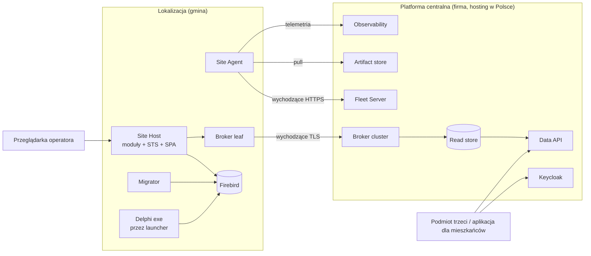

### 1.3 Kluczowe decyzje

1. Jedna platforma w lokalizacji: jeden proces hosta (Site Host) z modułami, jeden agent (Site Agent), jeden komponent tożsamości (lokalny STS). Nie jedna usługa na aplikację.
2. Dwie wspierane formy wdrożenia, jeden build: Tier S (self-contained usługi .NET na maszynie Windows klienta) oraz Tier M (dostarczany przez firmę obraz VM z Linuksem uruchamiający kontenery). Agent jest jedynym komponentem, który wie, w którym Tier działa.
3. Lokalizacje są autonomiczne i komunikują się wyłącznie ruchem wychodzącym. Wszystko, co centralne, leży poza ścieżką krytyczną operatora. Brak VPN na ścieżce agenta i synchronizacji danych; VPN wyłącznie do audytowanego dostępu wsparcia.
4. Własny, cienki agent floty w .NET nadzorujący gotowe komponenty. Deliverable 1 to zarządzanie flotą istniejących instalacji Delphi, przed jakimkolwiek nowym modułem.
5. Migracje uruchamia agent jako krok wydania, z backupem, blokadą, zapisaną wersją i raportem do centrali. Najpierw skrypty SQL (obejmują aplikacje Delphi), docelowo EF Core migration bundles.
6. Udostępnianie danych przez CQRS: outbox na triggerach w lokalizacji, wersjonowane zdarzenia kontraktowe, wychodzący broker leaf, jeden centralny PostgreSQL read store z row-level security per tenant, Data API ze zgodą gminy i licencją dla podmiotów trzecich.
7. Tożsamość: OpenIddict wbudowany w Site Host dla operatorów, Keycloak centralnie dla wsparcia teraz oraz dla mieszkańców i podmiotów trzecich później. Tokeny niosą wyłącznie tożsamość; istniejące tabele uprawnień per aplikacja pozostają i są czytane przez aplikacje.
8. Postawa bezpieczeństwa: umowy plus atrakcyjne API są obroną podstawową; szyfrowanie, rotacja poświadczeń i minimalne uprawnienia podnoszą koszt nadużycia; brak wydatków na obfuskację.
9. Nudna, samodzielnie hostowana technologia open source domyślnie, dopasowana do dwóch inżynierów DevOps: Docker Compose na VM centralnie, Kubernetes odłożony.

### 1.4 Fazy

| Faza | Zawartość | Rozmiar |
|---|---|---|
| 0 | Warunki wstępne: certyfikat code signing, hosting centralny, pipeline'y GitLab, praktyka ADR | S |
| 1 | Flota: Site Agent, Fleet Server, enrollment, inwentaryzacja, Migrator dla istniejących skryptów SQL, telemetria | L |
| 2 | Platforma: Site Host, lokalny STS z site user registry, SDK modułów, statyczna powłoka SPA Next.js, ACRU przeniesione na hosta | L |
| 3 | Dane: outbox, zdarzenia kontraktowe, broker leaf, centralny read store, Data API ze zgodą | L |
| 4 | Strangler: pierwszy moduł Delphi zastąpiony, logowanie Delphi przełączone na STS, migracje EF Core | XL (M na moduł) |
| 5 | Mieszkańcy i podmioty trzecie na skalę: federacja Keycloak z Węzłem Krajowym, Kubernetes jeśli ruch tego wymaga | M |

---

## 2. Stan obecny

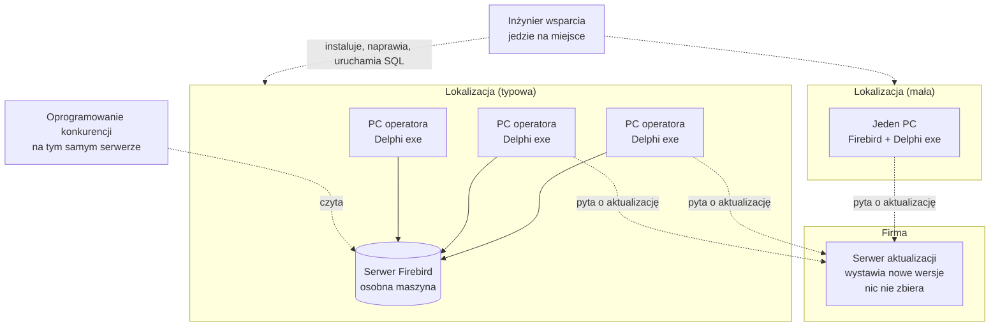

Co istnieje i zostaje jako wzorzec:

- ACRU (Asystent CRU) to już .NET WebApi plus scheduler plus frontend Next.js plus własna baza Firebird (CruDb), instalowane w lokalizacji obok aplikacji Delphi RU, zintegrowane przez tabele zdarzeń w bazie (`ACRU_EVENTS`) i wersjonowany migrator SQL dla bazy RU (`RuDatabaseMigrator`). To zalążek Site Host i wzorca outbox.
- ACRU już używa zegara serwera bazy jako jedynego zegara (`FirebirdAnchoredTimeProvider`), bo zegary PC operatorów są niewiarygodne. To staje się regułą platformy.

Czego nie ma: tożsamości lokalizacji, inwentaryzacji, stanu zdrowia, wymuszanych migracji, współdzielonego uwierzytelniania, zgłaszania błędów z kontekstem, jakiegokolwiek API do danych.

---

## 3. Ograniczenia i założenia

| Obszar | Ograniczenie lub założenie | Źródło |
|---|---|---|
| Lokalizacje | Tysiące lokalizacji wielostanowiskowych z dedykowanym serwerem, kilka dużych, wiele małych, gdzie serwer jest jednocześnie PC operatora. Dziesiątki tysięcy operatorów. | Dane |
| Własność sprzętu | Firma nie posiada żadnej maszyny w lokalizacjach. Administruje nimi IT gminy. Firma czasem ma poświadczenia. | Dane |
| Systemy operacyjne | Głównie Windows (Server i Pro), trochę Linuksa. | Dane |
| Sieć | Wychodzący HTTPS prawie zawsze dostępny. Ruch przychodzący nigdy nie jest zakładany. Niektóre lokalizacje mają proxy z uwierzytelnianiem. | Dane |
| Offline | Operatorzy muszą pracować bez internetu bez ograniczeń czasowych. Usługi dla mieszkańców mogą wymagać łączności. | Dane |
| Baza danych | Firebird 3, dialekt 3, egzekwowany u administratorów gmin. W terenie istnieją starsze wersje. | Dane |
| Prawo | Gminy są właścicielami danych. Kopiowanie danych do centrali wymaga umowy powierzenia przetwarzania per gmina i oceny ryzyka. Nie jest powszechne. | Dane |
| Zagrożenie | Konkurencja może uzyskać legalny dostęp do bazy od gminy, może działać z uprawnieniami lokalnego administratora na tym samym serwerze i może dekompilować binaria. | Dane |
| Zespół | 10 programistów Delphi, 10 programistów nowego stosu, 5 inżynierów wsparcia plus zewnętrzni dystrybutorzy, 2 inżynierów DevOps, administratorzy IT gmin. | Dane |
| Wydania | Brak kadencji; wydania wynikają ze zmian prawa i zamówionych funkcji. Do 100 zgłoszeń wsparcia dziennie. | Dane |
| Budżet narzędzi | Domyślnie samodzielnie hostowany open source. GitLab istnieje. Płatny SaaS tylko tam, gdzie self-hosting jest wyraźnym ciężarem. | Dane |
| Model komercyjny | Czasowa subskrypcja aktualizacji. Istnieje klucz licencyjny per klient; jego format wymaga udokumentowania. Licencje zabraniają dostępu podmiotów trzecich do bazy, ale klienci chcą udzielać im dostępu do danych. | Dane |
| Tożsamość | Operatorzy i wsparcie teraz; mieszkańcy i systemy podmiotów trzecich później. Każda aplikacja ma własną tabelę użytkowników; autoryzacja per aplikacja w tabelach własnych działa i zostaje. | Dane |
| Tempo | Migracja strangler, znacznie szybciej niż pięć lat. Biznes może naciskać na szybsze tempo. | Dane |

---

## 4. Zasady

Każdy nowy projekt jest sprawdzany względem tej listy na pierwszym przeglądzie architektury. Zasadę można złamać wyłącznie przez ADR, który mówi dlaczego.

1. **Lokalizacja jest autonomiczna.** Wszystko, czego potrzebuje operator, działa w lokalizacji i pracuje bez internetu przez nieograniczony czas. Usługi centralne dodają możliwości; nigdy nie blokują ścieżki krytycznej.
2. **Wyłącznie ruch wychodzący.** Żaden komponent nigdy nie zakłada połączenia przychodzącego do lokalizacji. Jeśli centrala czegoś potrzebuje, lokalizacja to wypycha albo sama otwiera połączenie.
3. **Jeden artefakt, jeden kontrakt.** Wydanie to jeden podpisany, wersjonowany pakiet. Site Agent jest jedyną rzeczą, która instaluje oprogramowanie w lokalizacji, i robi to przez jeden kontrakt, którego przestrzega każdy moduł.
4. **Wszystko jest wersjonowane i raportowane.** Wersja aplikacji, wersja schematu, poziom łatek OS, stan komponentów, ostatni udany backup. Jeśli nie jest zaraportowane do Fleet Server, nie istnieje.
5. **Jeden host, wiele modułów.** Nowa funkcjonalność to moduł w Site Host, nie nowy proces, chyba że ADR udowodni powód zasobowy. Moduły to osobne assembly z egzekwowanymi granicami.
6. **Dane zostają w lokalizacji domyślnie.** Kopie opuszczają lokalizację tylko jako wyselekcjonowany, wersjonowany kontrakt, tylko za zgodą gminy, tylko do magazynu izolowanego per tenant, który można wyczyścić per tenant.
7. **Tożsamość w tokenie, uprawnienia w aplikacji.** STS mówi kto. Aplikacja decyduje co, z własnych tabel, przez współdzieloną bibliotekę autoryzacji.
8. **Kontrakty ponad schematy.** Komponenty centralne nigdy nie zależą od schematu bazy w lokalizacji. Zdarzenia i API to wersjonowane kontrakty (OpenAPI, AsyncAPI); schematy są prywatne dla lokalizacji.
9. **Nudna technologia, dopasowana do dwóch inżynierów DevOps.** Jedno narzędzie na problem, samodzielnie hostowane, z dużą społecznością. Nową technologię dodaje się tylko wtedy, gdy istniejąca nie jest w stanie wykonać zadania.
10. **Podnoś koszt, polegaj na umowie.** Techniczna ochrona danych i binariów w lokalizacji jest środkiem odstraszającym. Legalnego dostępu nie da się technicznie uniemożliwić; kieruje się go do API przez umowę i cennik.
11. **Obserwowalność domyślnie, żadne dane osobowe nie opuszczają lokalizacji.** Każdy komponent emituje ustrukturyzowane logi, metryki i trace'y przez OpenTelemetry. Dane osobowe są usuwane u źródła.
12. **Migracje to kod, wykonywany przez maszynę.** Żaden człowiek nie uruchamia SQL w lokalizacji. Zmiana schematu to wersjonowana migracja wykonywana przez Migrator pod kontrolą agenta, z backupem i raportem.
13. **Zegar serwera bazy jest jedynym zegarem.** Każda wartość zapisywana w bazie lub z nią porównywana pochodzi z zegara serwera przez `TimeProvider`, nigdy z zegara PC.

---

## 5. Architektura docelowa

### 5.1 Komponenty

**W lokalizacji**

| Komponent | Odpowiedzialność | Środowisko uruchomieniowe |
|---|---|---|
| Site Agent | Tożsamość lokalizacji i enrollment, heartbeat i inwentaryzacja, pobieranie i weryfikacja artefaktów, instalacja, aktualizacja, rollback, orkiestracja Migratora, przechowywanie sekretów, nadzór nad dołączonymi komponentami, samoaktualizacja przez osobny updater, węzeł VPN wsparcia na żądanie | Self-contained usługa .NET (Windows Service lub systemd) |
| Site Host | Jeden proces ASP.NET Core: moduły, lokalny STS (OpenIddict), statyczne pliki SPA, outbox publisher, lokalne API dla aplikacji Delphi, zadania w tle (Quartz) | Self-contained usługa .NET lub kontener w Tier M |
| Migrator | Stosuje wersjonowane migracje (skrypty SQL teraz, EF Core bundles później) do każdej bazy w lokalizacji, z backupem, blokadą, tabelą wersji i raportem | CLI wywoływane przez Site Agent |
| Firebird | System of record dla wszystkich aplikacji w okresie współistnienia | Istniejąca instalacja, standaryzowana przez agenta |
| Broker leaf | Trwałe store-and-forward zdarzeń kontraktowych do brokera centralnego | NATS server w trybie leaf (kandydat) |
| Telemetry collector | Odbiera OpenTelemetry ze wszystkich lokalnych komponentów, czyści, grupuje, wysyła ruchem wychodzącym | OpenTelemetry Collector |
| Launcher share | Pakiety exe Delphi serwowane na PC operatorów z serwera lokalizacji | Udział plikowy plus malutki launcher exe |
| Site user registry | Tabela użytkowników na poziomie lokalizacji, własność STS, zmapowana na tabele użytkowników każdej aplikacji | Baza Firebird własna Site Host |

**Centralnie**

| Komponent | Odpowiedzialność | Środowisko uruchomieniowe |
|---|---|---|
| Fleet Server | Rejestr lokalizacji, enrollment, inwentaryzacja, stan zdrowia, ringi wdrożeniowe, przypięcia wersji i okna serwisowe, egzekwowanie subskrypcji, portal dla wsparcia i dystrybutorów | ASP.NET Core plus PostgreSQL |
| Artifact store | Podpisane pakiety wydań, obrazy VM, pakiety exe Delphi | GitLab package registry plus object storage |
| Release pipeline | Build, testy, podpis Authenticode, podpis manifestu, publikacja | GitLab CI |
| Keycloak | Tożsamość dla wsparcia i dystrybutorów teraz; mieszkańców (Węzeł Krajowy) i klientów podmiotów trzecich później | Keycloak |
| Broker cluster | Odbiera zdarzenia z węzłów leaf, zasila projekcje | NATS JetStream cluster (kandydat) |
| Projection service | Buduje read store ze zdarzeń kontraktowych, per tenant | .NET worker |
| Read store | Model odczytu izolowany per tenant | PostgreSQL z row-level security |
| Data API | Wersjonowane publiczne API dla podmiotów trzecich, zgody, limity, audyt, pomiar użycia | ASP.NET Core za reverse proxy |
| Observability | Metryki, logi, trace'y, dashboardy, alerty | Prometheus, Loki, Tempo (opcjonalnie), Grafana |
| Error reporting | Wyjątki i zgłoszenia problemów od operatorów, powiązane z issue w GitLab | GlitchTip (zgodny z Sentry) |
| Support VPN control plane | Koordynuje sesje WireGuard na żądanie do lokalizacji | Headscale lub NetBird (ocena w 8.8) |
| Backup storage | Zaszyfrowane kopie backupów z lokalizacji poza siedzibą, opt-in | Object storage |

### 5.2 Tier S: usługi Windows na maszynie klienta

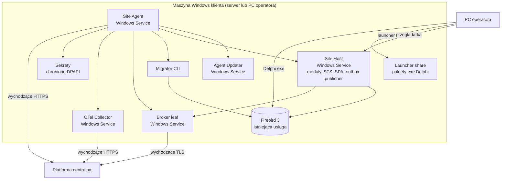

Budżet zasobów dla najmniejszej lokalizacji (serwer jest PC operatora): Site Agent plus Updater poniżej 100 MB RAM, Site Host 300 do 500 MB, broker leaf poniżej 50 MB, collector poniżej 100 MB. Łącznie poniżej 1 GB ponad Firebird. Jeśli moduł się nie mieści, to on jest niewłaściwy dla Tier S, nie odwrotnie.

### 5.3 Tier M: dostarczany przez firmę obraz VM z Linuksem i kontenerami

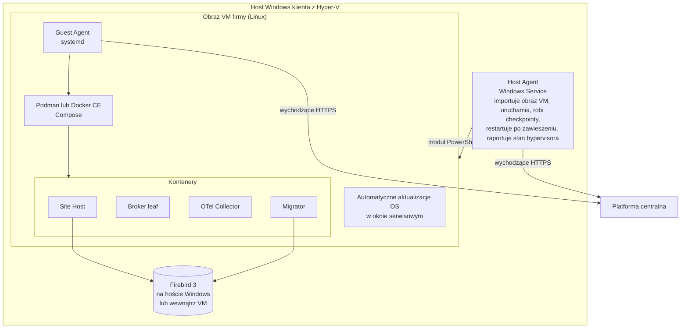

Reguły Tier M:

- Hyper-V jest wymagany na hostach Windows, które chcą Tier M (dostępny w Windows Server, Windows 10/11 Pro, Enterprise i Education; nie w Home). Host Agent używa modułu PowerShell Hyper-V (`Import-VM`, `Start-VM`, `Checkpoint-VM`, heartbeat przez `Get-VMIntegrationService`) z uprawnieniami lokalnego administratora.
- Na innym hypervisorze lub na hoście Linux obraz importuje IT gminy i istnieje tylko Guest Agent. Lokalizacja traci automatyczne provisioning i restart z poziomu hosta, nic więcej.
- Guest Agent to ten sam binarny agent co w Tier S, skompilowany pod Linux. Wszystko istotne biznesowo zarządza Guest Agent, więc oba Tier dzielą jeden model operacyjny.
- Miejsce Firebird to wybór per lokalizacja zapisany w inwentaryzacji: na hoście Windows (aplikacje Delphi zachowują connection stringi) lub wewnątrz VM (zalecane dla nowych lokalizacji i tam, gdzie wszystkie klienty exe można przekierować).

### 5.4 Platforma centralna

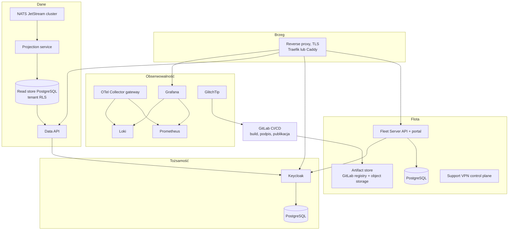

Hosting: Docker Compose na kilku VM u polskiego dostawcy, cała konfiguracja w GitLab, nocne backupy do object storage w drugiej lokalizacji, zmiany infrastruktury przez merge requesty. Kubernetes jest odłożony do czasu, gdy Data API będzie obsługiwać ruch na skalę mieszkańców; definicje Compose pisze się tak, aby przejście było mechaniczne.

### 5.5 Anatomia modułu

Moduł to zestaw assembly składanych w Site Host w czasie builda:

```
Company.Platform.Host                 jedyny proces; referencuje każdy moduł
Company.Modules.<Name>.Contracts      publiczne API modułu dla innych modułów (interfejsy, DTO, zdarzenia)
Company.Modules.<Name>.Application    przypadki użycia, walidatory, orkiestracja
Company.Modules.<Name>.Domain         enumy, value objecty, interfejsy repozytoriów
Company.Modules.<Name>.Persistence    EF Core DbContext, konfiguracje, migracje
Company.Modules.<Name>.Legacy         repozytoria raw-SQL do tabel należących do Delphi
Company.Modules.<Name>.Web            endpointy, DTO, mappery
Company.Modules.<Name>.Spa            statyczny eksport Next.js, serwowany pod /modules/<name>/
```

Reguły:

- Moduł referencuje inny moduł wyłącznie przez jego assembly `Contracts`. Test architektury (NetArchTest lub podobny) przerywa build przy każdej innej referencji.
- Moduł posiada jeden schemat bazy (dziś własna baza Firebird, jak ACRU z CruDb). Tabele należące do Delphi czyta wyłącznie przez assembly `Legacy` i nigdy ich nie zapisuje, poza tabelami zdarzeń zarządzanymi przez Migrator.
- Moduły komunikują się w procesie przez kontrakty i wewnątrzprocesową szynę zdarzeń. Zdarzenia przekraczające granicę lokalizacji są publikowane do outbox (sekcja 10).
- Funkcje są bramkowane podpisanym plikiem licencji, nie składaniem różnych buildów. Jeden artefakt obsługuje każdą lokalizację.
- Moduł może działać poza procesem za reverse proxy hosta (YARP) wyłącznie wtedy, gdy ADR dokumentuje powód zasobowy (na przykład scheduler z dużym ruchem do CRU). Domyślnie w procesie.

ACRU jest pierwszym modułem i dowodem działania SDK modułów: jego WebApi, Scheduler i Frontend stają się jednym modułem w Site Host.

---

## 6. Ocena opcji topologii

| Kryterium | Opcja 1: API na serwerze lokalizacji, SPA na serwerze lokalizacji | Opcja 2: API i SPA na każdym PC operatora (ACRU dziś) | Opcja 3: API i SPA centralnie, dane w lokalizacji | Rekomendacja: dwa Tier (sekcja 5) |
|---|---|---|---|---|
| Praca offline | Tak | Tak | Nie | Tak |
| Mobile i mieszkańcy | Nie | Nie | Tak | Tak, przez centralny read store i Data API |
| Rezydencja danych | Dane zostają w lokalizacji | Dane zostają w lokalizacji | Każde żądanie idzie do lokalizacji albo dane są kopiowane; nierozwiązane | Opt-in per gmina, tylko wyselekcjonowana kopia |
| Obciążenie bazy lokalizacji przez mieszkańców | Brak | Brak | Całe | Brak; odczyty trafiają do centralnego read store |
| Instalacje do zarządzania | Jedna na lokalizację | Jedna na PC | Jedna centralna plus cienka lokalna | Jedna na lokalizację plus jedna centralna |
| Wymaga dostępu przychodzącego do lokalizacji | Nie | Nie | Tak (lub tunel per lokalizacja) | Nie |
| Małe lokalizacje (serwer to PC) | Działa | Działa | Działa | Tier S działa |
| Kontenery | Możliwe, jeśli lokalizacja ma VM | Nie | Tak | Tylko Tier M |
| Powierzchnia inżynierii wstecznej | Binaria w lokalizacji | Binaria w lokalizacji | Tylko centrala | Binaria w lokalizacji (zaakceptowane, sekcja 15) |
| Werdykt | Właściwy kształt części lokalnej | Odrzucona jako model ogólny: N instalacji na lokalizację, brak współdzielonego stanu, brak jednego STS | Odrzucona jako jedyny model: łamie offline i rezydencję danych | Wybrana |

Opcja 2 pozostaje właściwym kształtem dla lokalizacji jednostanowiskowej bez serwera: Tier S na tym jednym PC to dokładnie to.

---

## 7. Ocena środowiska uruchomieniowego

| Kryterium | Windows Services (self-contained .NET) | VM z kontenerami (obraz Linux firmy) |
|---|---|---|
| Działa w najmniejszych lokalizacjach | Tak | Nie (wymaga hypervisora, RAM, współpracy administratora) |
| Wymaga zaangażowania administratora gminy | Jednorazowa instalacja przez dystrybutora lub wsparcie | Import obrazu VM, przypisanie IP, zezwolenie na ruch wychodzący |
| Izolacja od innego oprogramowania na maszynie | Tylko na poziomie procesu | Pełna granica VM; oprogramowanie konkurencji na hoście nie zajrzy do środka bez uprawnień hypervisora |
| Atomowość aktualizacji i rollback | Per usługa, katalogi side-by-side, zarządzane przez agenta | Per obraz kontenera, trywialnie atomowe |
| Łatanie OS | Klienta, tylko raportowanie | Firmy, zautomatyzowane wewnątrz obrazu |
| Licencjonowanie Docker | Niepotrzebne | Podman lub Docker CE wewnątrz Linuksa; bez Docker Desktop |
| Hosty Linux | Nie dotyczy (wariant systemd tych samych binariów) | Natywnie |
| Koszt DevOps | Jedno pakowanie | Drugie pakowanie plus pipeline budowy obrazu |
| Obserwowalność | Taka sama (OTel) | Taka sama (OTel) |
| Położenie Firebird | Zostaje na hoście Windows | Host lub wewnątrz VM |

Decyzja: oba, jako Tier S i Tier M, z jednym buildem. Docker Desktop na Windows jest wykluczony: licencjonowany per użytkownik dla firm powyżej 250 pracowników lub 10 milionów USD przychodu, co oznacza rozmowę zakupową z każdą gminą, a do tego nie jest niezawodny jako środowisko serwerowe na współdzielonym PC. Kontenery Windows są wykluczone: rozmiar obrazów, sprzężenie z wersją jądra i słabe narzędzia.

Agent abstrahuje różnicę. Kontrakt instalacji ma cztery czasowniki (`install`, `upgrade`, `rollback`, `health`) zaimplementowane dwukrotnie: raz nad Windows Service Control Manager i katalogami side-by-side, raz nad Compose.

---

## 8. Zarządzanie flotą

### 8.1 Odpowiedzialności Site Agent

- Tożsamość: przechowuje certyfikat lokalizacji i uwierzytelnia nim każde wywołanie do Fleet Server (mTLS lub podpisane żądania).
- Heartbeat i inwentaryzacja: co N minut raportuje wersję agenta, wersje komponentów, wersje schematów per baza, OS i poziom łatek, dysk, wersję i stan Firebird, wynik ostatniego backupu, stan subskrypcji, Tier.
- Polecenia: odpytuje Fleet Server metodą long-poll o polecenia (aktualizacja do wersji X, uruchomienie migracji, zebranie logów, start sesji wsparcia, rotacja poświadczeń). Polecenia są podpisane i idempotentne.
- Artefakty: pobiera pakiety z artifact store, weryfikuje Authenticode instalatorów i podpis manifestu przypiętym kluczem wydań, przechowuje je na potrzeby rollbacku.
- Kontrakt instalacji: `install`, `upgrade`, `rollback`, `health` per komponent, zaimplementowany dla usług Windows i dla Compose.
- Migracje: wywołuje Migrator przed uruchomieniem nowej wersji aplikacji, przerywa i cofa aplikację przy niepowodzeniu migracji.
- Sekrety: generuje i przechowuje sekrety per lokalizacja (SYSDBA Firebird, użytkownicy baz aplikacji, klucz podpisujący STS, poświadczenia brokera, klucz szyfrowania backupów) w DPAPI na Windows i w pliku dostępnym tylko dla roota na Linuksie. Sekrety nigdy nie opuszczają lokalizacji, poza depozytem klucza backupów, który jest opt-in.
- Nadzór: restartuje Site Host, broker leaf i collector po awarii, z backoff i raportem.
- Backupy: uruchamia `gbak` co noc, waliduje `gfix`, przywraca do bazy tymczasowej w celu weryfikacji, czyści stare, opcjonalnie wysyła zaszyfrowane kopie.
- Sesja wsparcia: na podpisane polecenie z oknem ważności uruchamia węzeł WireGuard i zatrzymuje go po końcu okna.
- Samoaktualizacja: Updater to osobna malutka usługa, która na podpisane polecenie podmienia binarium agenta i restartuje go; agent może aktualizować Updater. Każdy może naprawić drugiego.

### 8.2 Enrollment

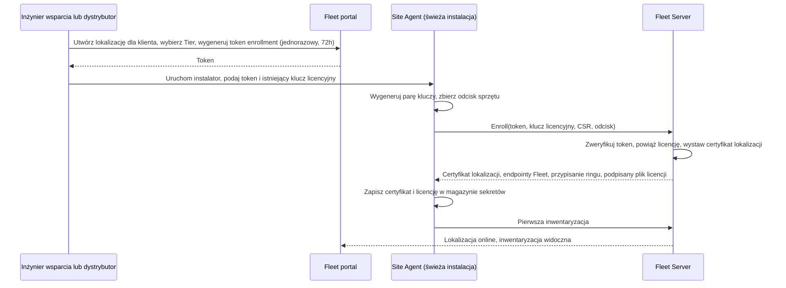

Istniejący klucz licencyjny identyfikuje klienta i przenosi go do nowego modelu. Token enrollment wiąże instalację. Dystrybutorzy widzą w portalu tylko swoje lokalizacje (grupa Keycloak per dystrybutor).

### 8.3 Wydanie i aktualizacja

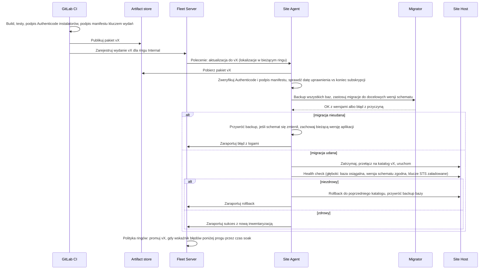

### 8.4 Ringi wdrożeniowe

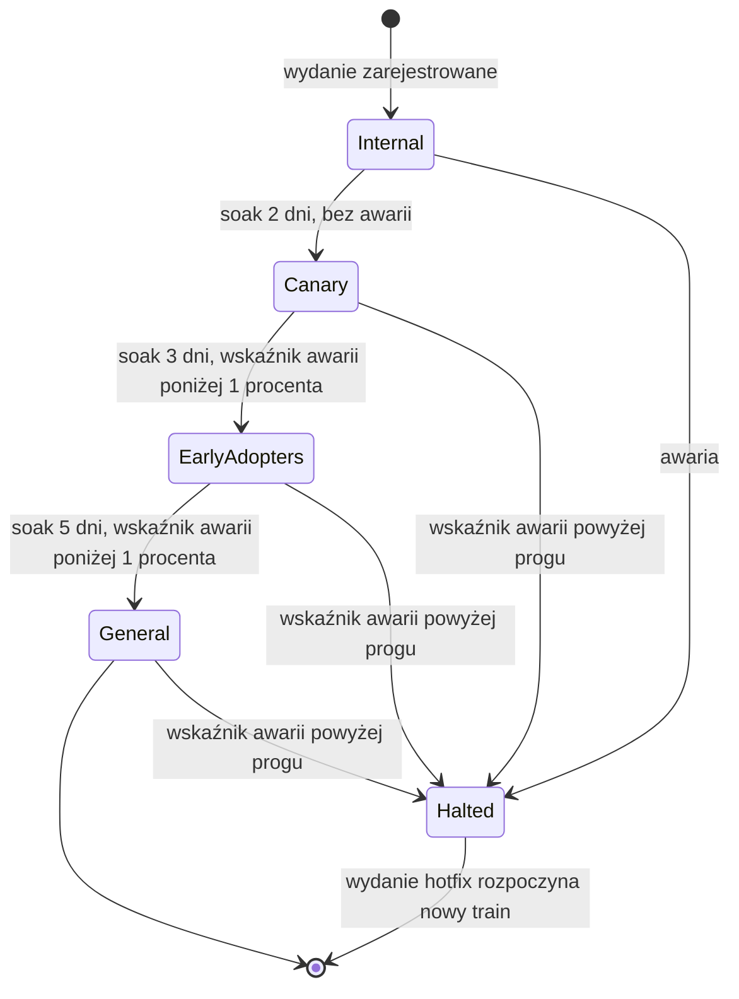

Polityki:

- Dwutygodniowy release train plus ścieżka awaryjna. Pilna zmiana prawa skraca czasy soak do godzin, nie do zera; kolejność ringów nigdy nie jest pomijana.
- Lokalizacja może przypiąć wersję lub ustawić okno serwisowe, ale nie może zostać w tyle o więcej niż 3 wydania za ringiem General; powyżej tego agent aktualizuje w najbliższym oknie i raportuje wymuszoną aktualizację.
- Lokalizacje Canary to ochotnicy z kontaktem do wsparcia; EarlyAdopters to lokalizacje z dedykowanym serwerem i dobrą łącznością.
- Promocja jest automatyczna na podstawie metryk, zatrzymanie jest automatyczne na podstawie metryk, a człowiek może zatrzymać w każdej chwili.

### 8.5 Egzekwowanie subskrypcji

- Podpisany plik licencji niesie klienta, lokalizacje, uprawnione moduły i datę końca subskrypcji.
- Agent instaluje wydanie tylko wtedy, gdy data wydania jest wcześniejsza niż koniec subskrypcji (model perpetual fallback). Lokalizacje z wygasłą subskrypcją zachowują ostatnią uprawnioną wersję bez ograniczeń czasowych.
- Wydania wyłącznie bezpieczeństwa są oznaczone w manifeście i instalowane niezależnie od stanu subskrypcji.
- Po wygaśnięciu usługi centralne dla lokalizacji ustają: brak synchronizacji zdarzeń, brak dostępu Data API dla jej tenantów, sesje wsparcia tylko na płatne zgłoszenie. Telemetria i heartbeat trwają, więc obraz floty pozostaje kompletny.
- Ponieważ aktywne lokalizacje są w odległości najwyżej 3 wydań od bieżącego, kontrakt zdarzeń musi wspierać najwyżej 4 równoległe wersje. Wygasłe lokalizacje nie synchronizują, więc nie poszerzają tego okna.

### 8.6 Łatanie OS

- Tier S: agent raportuje poziom łatek, oczekujący restart, dysk, stan antywirusa i wersję Firebird. Fleet portal pokazuje raport zgodności per lokalizacja, który wsparcie może wysłać gminie. Agent nigdy nie zmienia ustawień Windows Update.
- Tier M: obraz VM wykonuje automatyczne aktualizacje w oknie serwisowym; Guest Agent raportuje wynik; nieudana aktualizacja zatrzymuje okno i raportuje.

### 8.7 Dystrybucja exe Delphi w okresie współistnienia

- Agent jest instalowany wyłącznie na serwerze lokalizacji. PC operatorów nie dostają agenta.
- Serwer udostępnia pakiety exe Delphi na udziale. Malutki launcher na każdym PC operatora (jedyny komponent per PC, instalowany raz) porównuje wersję pakietu z lokalną kopią, kopiuje przy zmianie i uruchamia aplikację. Launcher jest self-contained, podpisany i aktualizuje się sam z udziału.
- Agent aktualizuje udział z tego samego pakietu wydania, więc aplikacje Delphi i Site Host przesuwają się razem, po wykonaniu migracji.
- Do czasu wdrożenia launchera w lokalizacji obecny mechanizm aktualizacji per PC pozostaje, wskazując na udział zamiast na publiczny serwer aktualizacji.

### 8.8 Dostęp wsparcia inicjowany przez lokalizację (ocena VPN)

VPN jest wyłącznie dla inżynierów wsparcia. Nigdy nie leży na ścieżce agenta ani synchronizacji danych.

| Kryterium | Mesh WireGuard z samodzielnie hostowanym control plane (Headscale lub NetBird) | OpenVPN per lokalizacja | Zdalny pulpit typu AnyDesk lub TeamViewer |
|---|---|---|---|
| Kierunek | Wychodzący z lokalizacji, wbudowany NAT traversal | Wychodzący z lokalizacji, wymaga centralnego koncentratora | Wychodzący z lokalizacji |
| Sesja uruchamiana przez agenta, ograniczona czasowo | Tak (węzeł rejestrowany na żądanie z wygaśnięciem) | Możliwe ze skryptowaną konfiguracją | Możliwe z dostępem nienadzorowanym; zwykle stały |
| Audyt kto i kiedy się połączył | Logi control plane plus audyt agenta | Logi serwera | Logi dostawcy |
| Zakres dostępu | Sieciowy; ograniczony ACL do portów hosta lokalizacji | Sieciowy | Pulpit, operator widzi ekran |
| Zgoda gminy per sesja | Tak: agent przyjmuje polecenie tylko w zatwierdzonym oknie | Skryptowalne | Zwykle stałe zezwolenie |
| Koszt | Darmowy, self-hosted | Darmowy | Licencja per stanowisko |
| Ciężar operacyjny dla 2 DevOps | Niski (jeden control plane) | Średni | Żaden, ale poza waszym audytem |
| Werdykt | Rekomendowany | Zapasowy | Zostawić do współdzielenia ekranu z operatorami, nie do dostępu do serwera |

Model sesji: inżynier wsparcia otwiera w Fleet portal sesję powiązaną ze zgłoszeniem; Fleet Server wysyła podpisane polecenie z oknem czasowym; agent podnosi węzeł WireGuard, nakłada ACL dopuszczający wyłącznie węzeł inżyniera i zamyka go po wygaśnięciu. Każda sesja jest logowana ze zgłoszeniem, inżynierem, początkiem i końcem oraz widoczna dla gminy w jej widoku portalu.

---

## 9. Baza danych

### 9.1 Migrator

Faza A (pomost, od deliverable 1): Migrator stosuje istniejące wersjonowane skrypty SQL (tak jak `RuDatabaseMigrator` robi dziś dla RU z `ACRU_MIGRATIONS_HISTORY`), uogólnione na każdą bazę w lokalizacji.

Faza B (cel): gdy wersje baz zostaną ujednolicone w całej flocie, a API Site Host zastąpi bezpośredni dostęp do bazy z aplikacji Delphi/C++, schematy modułów należą do EF Core i są dostarczane jako EF Core migration bundles (`dotnet ef migrations bundle`), czyli self-contained pliki wykonywalne, które agent uruchamia w ten sam sposób.

Reguły obowiązujące w obu fazach:

- Migracja jest idempotentna w skutkach i zapisana w tabeli historii per baza (`<APP>_MIGRATIONS_HISTORY` z wersją, sumą kontrolną, czasem zastosowania z zegara serwera, wersją agenta).
- Przed każdą migracją: backup `gbak`, `gfix -validate` oraz wiersz blokady zapobiegający równoległym uruchomieniom.
- Aplikacja odmawia startu, jeśli wersja schematu w tabeli historii nie zgadza się z wersją, dla której została zbudowana, i raportuje niezgodność.
- Skrypty wymagające kroku interaktywnego nie istnieją. Jeśli obecny skrypt Delphi takiego wymaga, krok jest przeprojektowywany, zanim skrypt trafi do Migratora (pytanie otwarte w sekcji 17).
- Obowiązują reguły specyficzne dla Firebird z istniejących skilli: identyfikatory do 31 znaków, dialekt 3, jawne nazwy każdego ograniczenia i indeksu, konwersje `DateTimeOffset` i `DateOnly`, brak resetów schematu na wdrożonych bazach.

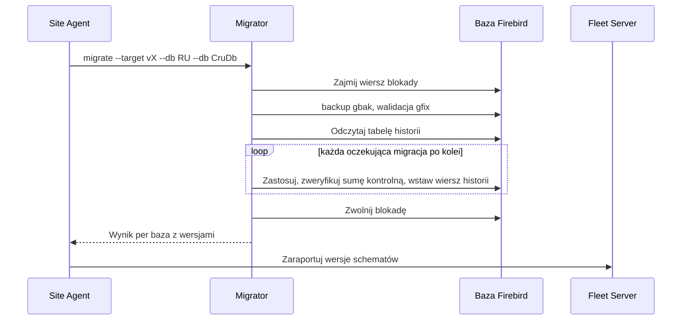

### 9.2 Standaryzacja Firebird

- Deliverable 1 obejmuje inwentaryzację Firebird per lokalizacja. Lokalizacje poniżej Firebird 3 dialekt 3 dostają zaplanowaną, sterowaną przez agenta aktualizację (backup, instalacja, odtworzenie z `gbak -fix_fss_data` tam, gdzie trzeba, walidacja) w oknie serwisowym, z inżynierem wsparcia na dyżurze przy pierwszych partiach.
- Firebird 4 lub 5 to późniejsza decyzja uzależniona od zgodności sterowników Delphi oraz od funkcji szyfrowania i replikacji; zapisana jako pytanie otwarte, nie założenie.

### 9.3 Poświadczenia

- Losowe hasło SYSDBA per lokalizacja generowane przez agenta przy enrollment, przechowywane w magazynie sekretów, rotowane na polecenie.
- Każdy moduł i każda aplikacja Delphi dostaje własnego użytkownika Firebird z potrzebnymi rolami. Żadna aplikacja nie łączy się jako SYSDBA.
- Break-glass: IT gminy może przez portal poprosić o czasowe konto tylko do odczytu; wniosek, nadanie i wygaśnięcie są audytowane i widoczne dla obu stron.
- Dostarczanie poświadczeń aplikacjom Delphi w okresie współistnienia: launcher pobiera sekret połączenia aplikacji z Site Host przez lokalne HTTP z tokenem per PC, więc żadne hasło nie leży w pliku konfiguracyjnym na udziale.

### 9.4 Szyfrowanie jako środek odstraszający

- Firebird 3 i nowsze wystawiają API wtyczek szyfrowania bazy i nie dostarczają wtyczki klasy produkcyjnej; istnieją wtyczki firm trzecich (komercyjne i open source), które trzeba ocenić pod kątem zgodności z Firebird 3 i wsparcia sterowników Delphi.
- Obsługa klucza: wtyczka key-holder pyta Site Agent o klucz przy otwarciu bazy; agent trzyma klucz w DPAPI (Windows) lub w pliku dostępnym tylko dla roota (Linux). Klucz nigdy nie leży w pliku konfiguracyjnym obok bazy.
- Uczciwe stwierdzenie wartości: szyfrowanie uniemożliwia skopiowanie pliku bazy na inną maszynę i czytanie backupów bez klucza. Nie zatrzymuje lokalnego administratora, który może czytać pamięć procesu agenta lub działającego serwera. Jest zaplanowane po standaryzacji i rotacji poświadczeń, które dają więcej ochrony za mniej wysiłku.

### 9.5 Backupy

- Obowiązkowo lokalnie: nocny `gbak`, test odtworzenia do bazy tymczasowej, polityka retencji, wynik w inwentaryzacji. Lokalizacja z nieudanym backupem to czerwona pozycja w Fleet portal.
- Opcjonalnie centralnie: szyfrowanie kluczem lokalizacji przed wysyłką; depozyt klucza w Fleet Server wyłącznie za zgodą gminy (to czynność przetwarzania w rozumieniu RODO); odtwarzanie sterowane przez agenta i audytowane.

---

## 10. Udostępnianie danych

### 10.1 Dlaczego CQRS

Bazy w lokalizacjach są znormalizowane pod wprowadzanie danych. Portal dla mieszkańców to obciążenie odczytowe, skokowe, z publicznego internetu. Obsługa go z bazy w lokalizacji degradowałaby operatorów i odsłaniała schemat. Strona zapisu zostaje w lokalizacji; strona odczytu to osobny, wyselekcjonowany model budowany ze zdarzeń, hostowany centralnie, z własnym skalowaniem i bezpieczeństwem.

### 10.2 Outbox i zdarzenia kontraktowe

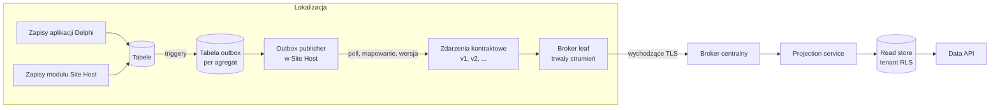

- Przechwytywanie zmian odbywa się przez triggery do tabel outbox, wersjonowanych przez Migrator. Działa na Firebird 3, przetrwa okresy offline i wychwytuje zapisy Delphi bez zmian w kodzie Delphi. Firebird `POST_EVENT` odrzucony (nietrwały). Replikacja Firebird 4 nie jest dostępna w egzekwowanej wersji.
- Outbox publisher w Site Host mapuje wiersze outbox na zdarzenia kontraktowe. Kontrakt jest jedyną rzeczą, którą zna centrala; lokalizacja posiada mapowanie, więc tysiące lokalizacji na kilku wersjach schematu produkują jeden kontrakt.
- Każdy agregat ma też zdarzenie migawkowe (`<Aggregate>Snapshot vN`), aby gminę można było w całości przeprojektować po zmianie kontraktu lub po przekroczeniu retencji outbox. Resynchronizacja jest dławiona per lokalizacja.
- Zdarzenia niosą id tenanta, id lokalizacji, id agregatu, wersję, znacznik czasu z zegara serwera i monotonicznie rosnącą sekwencję per lokalizacja do porządkowania i deduplikacji. Projekcje są idempotentne.
- Kontrakty są opisane w AsyncAPI i przeglądane jak publiczne API (sekcja 18).

### 10.3 Ocena transportu

| Kryterium | (a) Wsadowy push HTTPS z agenta do API ingest | (b) Broker leaf z wychodzącym TLS (NATS JetStream leaf lub RabbitMQ shovel/federation) | (c) VPN WireGuard, centrala ciągnie z lokalizacji | (d) VPN plus broker |
|---|---|---|---|---|
| Wymaga ruchu przychodzącego lub VPN | Nie | Nie | Tak | Tak |
| Trwałość offline | Lokalizacja musi sama zaimplementować kolejkę i ponawianie | Wbudowana (strumień JetStream w lokalizacji) | Centrala ponawia wobec nieosiągalnej lokalizacji | Wbudowana |
| Porządkowanie i deduplikacja | Ręcznie | Wbudowane (sekwencja, ack, redelivery) | Ręcznie | Wbudowane |
| Ślad na Tier S | Nic dodatkowego | NATS: jeden plik binarny, dziesiątki MB RAM; RabbitMQ: runtime Erlang, setki MB | Węzeł WireGuard | Oba |
| Skalowanie centralne | API ingest skaluje się jak każde API | Klaster brokera, dobrze rozumiany | Harmonogram pull per lokalizacja, niewygodny przy tysiącach | Oba |
| Powierzchnia bezpieczeństwa | Jeden endpoint wychodzący | Jeden endpoint wychodzący | Każda lokalizacja staje się sieciowym sąsiadem platformy centralnej | Oba |
| Dwukierunkowość (polecenia do lokalizacji) | I tak potrzebny long-poll agenta | Za darmo: subskrypcja na subject | Tak | Tak |
| Ciężar operacyjny | Niski | Niski do średniego (NATS) lub średni do wysokiego (RabbitMQ) | Wysoki (tysiące tuneli, ACL, rotacja kluczy) | Najwyższy |
| Werdykt | Zapasowy, jeśli węzeł leaf nie zmieści się w Tier S | Główny kandydat: NATS JetStream leaf nodes | Odrzucony dla synchronizacji | Odrzucony dla synchronizacji |

NATS jest preferowany nad RabbitMQ po stronie lokalizacji, bo węzły leaf są pierwszorzędną topologią NATS, binarium jest małe i bez zależności, a JetStream daje trwałe store-and-forward z retencją per subject. RabbitMQ pozostaje poprawnym brokerem centralnym, jeśli zespół już go zna, przy stronie lokalizacji używającej (a).

### 10.4 Tenancy centralnego read store

- Jeden klaster PostgreSQL, każdy wiersz niesie `tenant_id`, polityki row-level security egzekwowane dla roli Data API, duże tabele partycjonowane po hashu tenanta lub po zakresie tenantów dla największych klientów.
- Model tenantów: Customer (licencjobiorca) ma Sites (instalacje), Site ma Tenants (gminy, których dane przechowuje). Centrum usług wspólnych (CUW) to jeden Site z kilkoma Tenants. Licencjonowanie per Customer, tożsamość agenta per Site, row-level security per Tenant.
- Koniec umowy: usunięcie partycji tenanta, wyczyszczenie zdarzeń tenanta ze strumieni brokera, zapis wyczyszczenia. To operacja, o którą zapyta inspektor ochrony danych gminy.
- Tysiące baz lub schematów odrzucone jako pułapka operacyjna dla dwuosobowego zespołu DevOps.

### 10.5 Data API i zgody

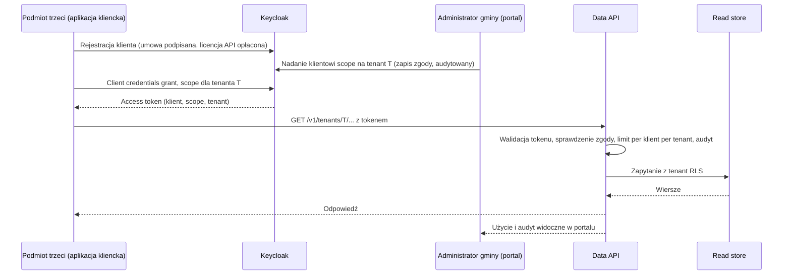

- Kto płaci: podmiot trzeci płaci za dostęp do API; gmina udziela zgody; obie strony widzą audyt i użycie. Istnieje darmowy poziom, jeśli prawo zobowiązuje gminę do udostępnienia danych.
- Wersjonowane REST API z OpenAPI 3, paginacja kursorowa, filtrowanie ograniczone do pól indeksowanych, ETagi, limity i kwoty per klient per tenant, klucze idempotencji tam, gdzie API przyjmuje zapisy (żadnych w fazie 3).
- Data API jest jedyną drogą do read store. Żaden konsument nie dostaje połączenia do bazy.

### 10.6 Ocena ryzyka centralnego modelu odczytu

| Ryzyko | Ocena | Kontrola |
|---|---|---|
| RODO: firma staje się podmiotem przetwarzającym dane mieszkańców na skalę | Realne, per gmina | Umowa powierzenia przetwarzania per gmina; wyłącznie opt-in; DPIA (ocena skutków dla ochrony danych) dla modelu odczytu jako całości; rejestr czynności przetwarzania; minimalizacja danych w zdarzeniach kontraktowych (tylko to, co wystawia API) |
| Obowiązki gminy z KRI (Krajowe Ramy Interoperacyjności) | Gmina musi wykazać, że system spełnia wymagania KRI | Dowody zarządzania bezpieczeństwem informacji od firmy (ISO 27001 lub równoważne), interoperacyjność przez udokumentowane otwarte API |
| NIS2 (nowelizacja ustawy o krajowym systemie cyberbezpieczeństwa; zweryfikować stan transpozycji) | Gminy to podmioty publiczne; dostawcy to łańcuch dostaw | Proces zgłaszania incydentów, obsługa podatności, oświadczenia o łańcuchu dostaw, logowanie i retencja |
| Naruszenie centralnego magazynu | Jeden duży cel | Tenant RLS, szyfrowanie w spoczynku, klucze per tenant dla najwrażliwszych pól, brak danych osobowych w logach, dostęp wyłącznie przez Data API, pentest przed uruchomieniem |
| Lokalizacja hostingu | Musi być w Polsce lub przynajmniej w UE zgodnie z oczekiwaniami zamówień gminnych | Polscy dostawcy do oceny: OVHcloud (region Warszawa), Beyond.pl, Polcom, Operator Chmury Krajowej, Atman. Kryteria: polskie centrum danych, ISO 27001, referencje z sektora publicznego, dostępność umowy powierzenia, ceny egress, object storage, opcjonalnie zarządzany PostgreSQL |
| Gmina odmawia jakiejkolwiek kopii centralnej | Oczekiwane u części | Zapas: tunel wychodzący utrzymywany przez agenta, aby Data API proxowało do lokalnego API dla tego tenanta; niższa dostępność i limity udokumentowane dla tego tenanta |
| Zmiana schematu w lokalizacji psuje projekcje | Częsty tryb awarii | Wersjonowanie kontraktu, zdarzenia migawkowe, testy projekcji względem każdej wspieranej wersji kontraktu, testy kontraktowe sterowane przez konsumenta |
| Dane gminy serwowane konkurencji | Ryzyko biznesowe, nie techniczne | Zapis zgody per nadanie, audyt widoczny dla gminy, cennik czyniący API tańszą drogą, warunki licencji utrzymujące zakaz bezpośredniego dostępu do bazy |

---

## 11. Tożsamość

### 11.1 Populacje

| Populacja | Teraz | Później | Uwierzytelniana przez |
|---|---|---|---|
| Operatorzy (pracownicy gmin) | Tak | | Lokalny STS (OpenIddict w Site Host) |
| Wsparcie i dystrybutorzy | Tak | | Centralny Keycloak; działania w lokalizacji przez capability tokens (11.7) |
| Mieszkańcy | | Tak | Centralny Keycloak z brokeringiem tożsamości do Węzła Krajowego (login.gov.pl, SAML 2.0) |
| Systemy podmiotów trzecich | | Tak | Centralny Keycloak, client credentials |
| Podmioty maszynowe w lokalizacji (zadania hosta, Migrator) | Tak | | Konta zarezerwowane w site user registry |

### 11.2 Lokalny STS i site user registry

- OpenIddict (Apache 2.0, natywny .NET) działa w Site Host, wystawia tokeny OIDC dla SPA (authorization code z PKCE), dla aplikacji Delphi (resource owner password flow w okresie pomostowym, potem authorization code przez lokalną przeglądarkę) i dla podmiotów maszynowych (client credentials). Działa offline. Klucze podpisujące są generowane per lokalizacja i przechowywane w magazynie sekretów agenta.
- Każda aplikacja ma dziś własną tabelę użytkowników, więc STS posiada cienki rejestr użytkowników na poziomie lokalizacji tworzony przez Migrator: `SITE_USERS` (id użytkownika lokalizacji, login, hash hasła, blokada, sekret TOTP, status, data utworzenia z zegara serwera) oraz `SITE_USER_MAP` (id użytkownika lokalizacji, kod aplikacji, id użytkownika aplikacji). Jest zasilany z istniejących tabel aplikacji; tabele aplikacji zachowują własne id, a mapa jest jedynym łącznikiem.
- `sub` w tokenie to id użytkownika lokalizacji. Aplikacja rozwiązuje własne id użytkownika przez mapę (robi to współdzielona biblioteka z cache) i następnie czyta uprawnienia z własnych tabel dokładnie tak jak dziś.
- Hasła należą do STS od pierwszego dnia. Istniejące hashe są importowane, jeśli format jest znany i wystarczająco silny; w przeciwnym razie pierwsze logowanie do STS wymusza zmianę hasła. Nigdy nie ma dwóch magazynów haseł.
- Cykl życia użytkownika w okresie pomostowym: istniejące narzędzia administracyjne nadal tworzą użytkowników w tabelach aplikacji; zadanie synchronizujące w Site Host tworzy wiersz rejestru i wpis mapy, albo narzędzia administracyjne wołają lokalny endpoint Site Host. Cel: moduł administracyjny Site Host zarządza użytkownikami, a tabele aplikacji są zapisywane przez mapę.

### 11.3 Logowanie operatora

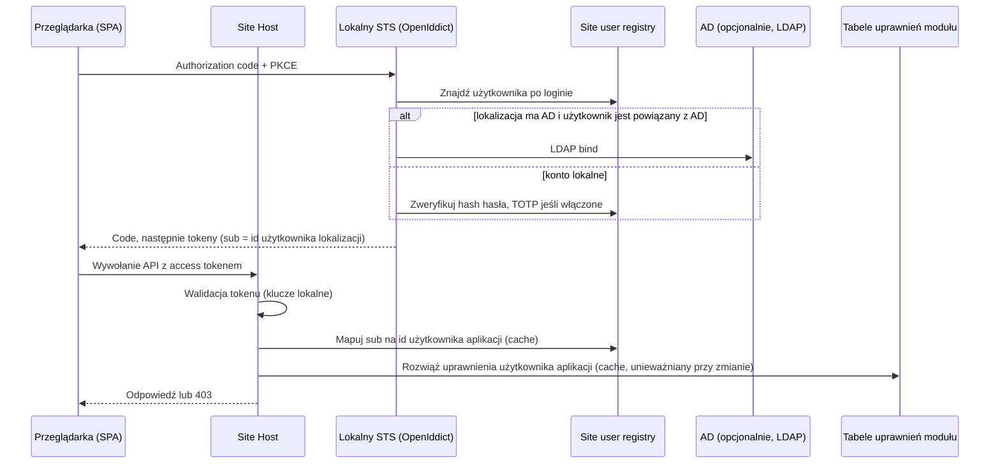

### 11.4 Ponowne użycie autoryzacji

- Tokeny niosą wyłącznie tożsamość. Brak claimów uprawnień.
- Współdzielona biblioteka autoryzacji .NET dostarcza: `IPermissionResolver` per moduł (czyta własne tabele modułu), cache per użytkownik z hookiem unieważniania wołanym przez narzędzia administracyjne, polityki i atrybuty autoryzacji ASP.NET Core (`[RequirePermission("RU.Agreements.Publish")]`), zakres jednostki organizacyjnej jako pojęcie pierwszorzędne oraz endpoint `GET /modules/<name>/me/permissions`, aby SPA mogło ukrywać to, czego nie wolno wywołać. Serwer zawsze egzekwuje.
- Nowe moduły deklarują swój katalog uprawnień jako wiersze zarządzane przez Migrator w tym samym modelu, którego używają aplikacje Delphi, więc administratorzy gmin zarządzają uprawnieniami w jednym miejscu narzędziami, które znają.
- Tokeny centralnego Keycloak nigdy nie niosą uprawnień lokalnych; autoryzuje je model zgód Data API.

### 11.5 Konta zarezerwowane

Migrator tworzy per lokalizacja: wyłączone konto `support` oraz jedno konto `service` per moduł, w rejestrze i w tabelach każdej aplikacji, z uprawnieniami nadawanymi istniejącymi narzędziami jak każdemu użytkownikowi. Administratorzy gmin widzą i mogą ograniczać to, co wolno wsparciu.

### 11.6 Active Directory

- Domyślnie: LDAP bind z lokalnego STS, bez przyłączania do domeny, działa z VM Linux w Tier M i z nieprzyłączonej usługi Windows. Użytkownik rejestru jest powiązany z kontem AD przez UPN.
- Opcjonalnie: Windows Integrated Authentication tam, gdzie gmina nalega, a Site Host jest usługą Windows przyłączoną do domeny.
- Bez AD: konta lokalne z polityką haseł, blokadą i opcjonalnym TOTP.

### 11.7 Dostęp pracowników wsparcia

Rekomendowane, w oczekiwaniu na przegląd obecnych procedur wsparcia (pytanie otwarte):

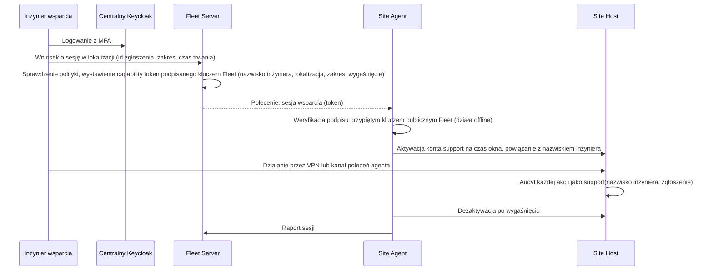

Konta per lokalizacja dla wsparcia w tysiącach lokalizacji oraz współdzielone hasła są odrzucone.

### 11.8 Centralny Keycloak

- Realmy: `company` (wsparcie, dystrybutorzy, z MFA), `citizens` (brokering do Węzła Krajowego, później), `partners` (klienci podmiotów trzecich, client credentials).
- Keycloak jest wyłącznie centralny. Nie jest wdrażany w lokalizacjach: proces Java z minimum 1 GB nie mieści się w Tier S, a operatorzy muszą logować się offline.

### 11.9 Porównanie produktów

| Kryterium | OpenIddict | Keycloak | Duende IdentityServer | Samo ASP.NET Core Identity |
|---|---|---|---|---|
| Licencja | Apache 2.0 | Apache 2.0 | Komercyjna powyżej 1 mln USD przychodu | MIT |
| Działa wewnątrz procesu .NET | Tak | Nie (Java) | Tak | Tak (bez serwera OIDC) |
| Ślad dla Tier S | Pomijalny | Za duży | Mały | Pomijalny |
| Admin UI, UI MFA, federacja od ręki | Nie (buduje się, co potrzebne) | Tak | Częściowo | Nie |
| Brokering SAML (Węzeł Krajowy) | Brak wbudowanego | Tak | Brak wbudowanego | Nie |
| Werdykt | W lokalizacji | Centralnie | Wykluczony (koszt) | Klocek pod OpenIddict |

---

## 12. Frontend i desktop

- Next.js z TypeScript jest frameworkiem wszystkich SPA. W lokalizacji każdy moduł dostarcza statyczny eksport (`output: "export"`) serwowany przez Site Host pod `/modules/<name>/`. W lokalizacji nie działa żaden proces Node. Renderowanie po stronie serwera używane jest wyłącznie centralnie (portal dla mieszkańców, SEO), gdzie runtime Node utrzymuje firma.
- Współdzielony pakiet UI: jedna biblioteka komponentów, jeden design system (istniejąca Figma), jeden klient uwierzytelniania, jeden generator klienta API z OpenAPI.
- Desktop C# nie jest drugim UI. Istnieje tylko wtedy, gdy wymaga tego sprzęt na PC operatora (drukarki fiskalne, czytniki kart, skanery), i wówczas jako cienka powłoka WebView2 wokół tego samego SPA plus lokalny mostek do urządzeń wystawiony dla SPA przez API na loopback. Powłoka jest dystrybuowana przez launcher share jak exe Delphi.
- Mobile dla operatorów jest odłożone do czasu istnienia lokalnego API i centralnego read store; aplikacja mobilna konsumowałaby Data API albo, do użytku w lokalizacji, API Site Host przez sieć biurową.

---

## 13. Obserwowalność i zgłaszanie błędów

- Każdy komponent emituje OpenTelemetry: ustrukturyzowane logi (obowiązuje istniejący przewodnik logowania w `docs/logging_guide.md`), metryki i trace'y z id lokalizacji i id tenanta jako atrybutami zasobu.
- Lokalny collector usuwa dane osobowe według reguł (konfigurowalna lista zabronionych atrybutów, hashowanie identyfikatorów), grupuje, buforuje na dysk w czasie offline i wysyła do centralnego gateway collectora. Lokalizację opuszcza wyłącznie telemetria techniczna; umowa z gminą to stwierdza, z okresami retencji.
- Stos centralny: Prometheus (metryki), Loki (logi), Grafana (dashboardy i alerty), opcjonalnie Tempo (trace'y), GlitchTip do wyjątków i zgłoszeń problemów (SDK zgodne z Sentry, licencja MIT, znacznie lżejszy w self-hostingu niż Sentry).
- Dashboardy floty: rozkład wersji per ring, nieudane aktualizacje, nieudane backupy, niezgodności schematów, lokalizacje milczące dłużej niż N godzin, stany subskrypcji, wskaźniki błędów per wydanie (zasila promocję ringów).
- Zgłoszenie problemu przez operatora: akcja "zgłoś problem" w SPA i w aplikacjach Delphi zbiera ostatnie N minut lokalnych logów, wersje komponentów, wersje schematów, bieżący ekran (zrzut opcjonalny, za wyraźną zgodą operatora, bo może zawierać dane osobowe) oraz opis operatora i wysyła paczkę przez agenta do GlitchTip, który tworzy issue w GitLab z dołączonym kontekstem floty. Wsparcie widzi zgłoszenie ze wszystkim, o co by zapytało.
- Alerty trafiają do dyżuru wsparcia, nie do programistów, z runbookami podlinkowanymi z każdego alertu.

---

## 14. Konwencje API i kodu

API (API modułów w lokalizacji i centralne Data API):

- REST przez HTTPS, OpenAPI 3 generowane z kodu i publikowane per wersja; zmiany łamiące oznaczają nową wersję główną w URL (`/v2/`); dodatki niełamiące są dozwolone w ramach wersji.
- Błędy jako RFC 9457 Problem Details ze stabilnym URI `type` per rodzaj błędu; błędy walidacji wymieniają ścieżki pól (styl `[0].podstawoweDane.numerUmowy`, jak w ACRU).
- Paginacja kursorowa, `limit` z górnym ograniczeniem, filtrowanie tylko po udokumentowanych polach, sortowanie tylko po polach indeksowanych, ETagi na pojedynczych zasobach.
- Polecenia tworzące lub modyfikujące przyjmują nagłówek klucza idempotencji i odtwarzają pierwszy wynik.
- Operacje asynchroniczne zwracają 202 z zasobem statusu. Długa praca idzie przez kolejkę, nigdy przez długie żądanie.
- Zdarzenia są opisane w AsyncAPI, wersjonowane per typ zdarzenia i przeglądane jak publiczne API.
- Wewnętrzne wywołania moduł do modułu idą przez interfejsy `Contracts`, nigdy przez HTTP wewnątrz jednego procesu.

Kod (rozszerza istniejące konwencje repozytorium):

- Wyłącznie wydania LTS .NET, aktualizowane w ciągu sześciu miesięcy od wydania. Publikacja self-contained, single-file dla binariów w lokalizacji. `UseWindowsService()` i `UseSystemd()` na tym samym hoście.
- Warstwy jak w ACRU: Web, Application, Domain, Persistence, Legacy, Contracts. Logika biznesowa w Application. Ręcznie pisane fake'i i EF in-memory do testów jednostkowych; repozytoria raw-SQL testowane wyłącznie integracyjnie.
- Każda reguła walidatora dostaje test przechodzący i test niezaliczający. Każde zdarzenie kontraktowe dostaje test schematu per wspierana wersja.
- `TimeProvider` wstrzykiwany wszędzie; brak `DateTime.Now`, `DateTime.UtcNow` i `DateTime.Today` w kodzie, który zapisuje lub porównuje wartości z bazą.
- Jeden typ publiczny na plik, file-scoped namespaces, `sealed` domyślnie, identyfikatory po angielsku, polski dozwolony wyłącznie w nazwach właściwości JSON narzuconych przez zewnętrzne kontrakty.
- Sekrety nigdy w plikach konfiguracyjnych w lokalizacji; zawsze przez magazyn sekretów agenta. Klucze API nigdy w logach ani komunikatach wyjątków.

---

## 15. Model zagrożeń i kontrole bezpieczeństwa

| Zagrożenie | Co oznacza | Kontrola podstawowa | Kontrole dodatkowe | Czego się nie próbuje |
|---|---|---|---|---|
| (a) Gmina udziela konkurencji legalnego dostępu do bazy | Właściciel danych korzysta ze swojego prawa | Warunki licencji utrzymują zakaz bezpośredniego dostępu do bazy; Data API ze zgodą i cennikiem jest usankcjonowaną, tańszą drogą; audyt widoczny dla gminy | Poświadczenia per lokalizacja trzymane przez agenta, więc "dostęp" wymaga formalnego wniosku break-glass | Techniczne uniemożliwienie legalnego udzielenia dostępu |
| (b) Oprogramowanie konkurencji z lokalnym administratorem na tym samym serwerze | Może czytać pliki, pamięć, sieć | Granica VM w Tier M tam, gdzie dostępna; losowe SYSDBA per lokalizacja i użytkownicy z minimalnymi uprawnieniami; sekrety w DPAPI lub plikach tylko dla roota; szyfrowanie bazy z kluczem u agenta | Firebird nasłuchuje tylko na localhost tam, gdzie wszystkie klienty są lokalne; reguły zapory hosta pisane przez agenta; telemetria nieoczekiwanych połączeń | Ochrona przed administratorem na poziomie hypervisora lub zrzucającym pamięć |
| (c) Inżynieria wsteczna binariów | Exe Delphi i assembly .NET dają się dekompilować | Logika biznesowa z czasem przenosi się na serwer; weryfikacja licencji i klucze podpisujące wydania są centralne; umowy i cennik chronią pozycję handlową | Podpisane artefakty, więc zmodyfikowane binarium wykrywa agent; raportowanie manipulacji | Obfuskacja lub DRM (wysoki koszt, niska wartość, psuje diagnostykę) |
| Łańcuch dostaw i złośliwa aktualizacja | Skompromitowany build lub artefakt dociera do tysięcy lokalizacji | Authenticode plus podpis manifestu kluczem wydań trzymanym offline; agent weryfikuje oba; ringi zatrzymują się automatycznie | Powtarzalne buildy, skanowanie zależności w GitLab, SBOM per wydanie | |
| Naruszenie platformy centralnej | Jeden cel, wielu tenantów | Tenant RLS, szyfrowanie w spoczynku, MFA dla pracowników, brak dostępu do bazy poza Data API, pentest, proces incydentowy (NIS2) | Klucze per tenant dla wrażliwych pól, krótkożyjące tokeny, retencja audytu | |
| Kradzież certyfikatu lokalizacji | Podszywanie się pod lokalizację | Certyfikat powiązany z odciskiem sprzętu, unieważnianie z portalu, krótka ważność z odnawianiem przez agenta | Alerty anomalii (dwie lokalizacje geograficzne, jedna lokalizacja) | |
| Nadużycie dostępu wsparcia | Inżynier lub dystrybutor przekracza uprawnienia | Capability tokens ze zgłoszeniem, zakresem, wygaśnięciem; zarezerwowane konto support z uprawnieniami widocznymi dla gminy; pełny audyt | Nagrywanie sesji na poziomie kanału poleceń | |

---

## 16. Plan migracji

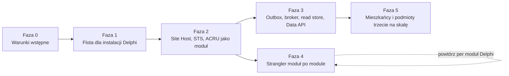

| Faza | Produkty | Kryterium wyjścia | Rozmiar |
|---|---|---|---|
| 0 Warunki wstępne | Certyfikat EV Authenticode; klucz podpisujący wydania w HSM lub offline; centralne VM u polskiego dostawcy z Compose, backupami i monitoringiem; pipeline'y GitLab budujące, podpisujące i publikujące; rozpoczęta praktyka ADR; udokumentowany format klucza licencyjnego; udokumentowane obecne procedury wsparcia | Podpisany, opublikowany, pusty pakiet przepływa z GitLab do artifact store | S |
| 1 Flota | Site Agent (najpierw Tier S), Updater, enrollment, inwentaryzacja, heartbeat, Fleet Server i portal z zakresem dla dystrybutorów, Migrator dla istniejących skryptów SQL, launcher share, telemetry collector, GlitchTip, inwentaryzacja Firebird i kampania standaryzacji, backupy lokalne | 90 procent lokalizacji wielostanowiskowych zarejestrowanych; każde wydanie pakietu Delphi idzie przez ringi; brak ręcznego SQL w lokalizacjach | L |
| 2 Platforma | Site Host, SDK modułów z testami architektury, lokalny STS z site user registry i mapą, współdzielona biblioteka autoryzacji, statyczna powłoka Next.js, ACRU przeniesione na hosta, obraz VM Tier M i Host Agent, egzekwowanie subskrypcji, przepływ sesji wsparcia | ACRU działa jako moduł w każdej lokalizacji ACRU przez agenta; operatorzy logują się raz do ACRU i do jednej aplikacji Delphi przełączonej na STS | L |
| 3 Dane | Triggery outbox dla pierwszych agregatów, outbox publisher, NATS leaf i cluster, projection service, read store z RLS, Data API v1 ze zgodami, realm partners w Keycloak, DPIA i wzór umowy powierzenia | Jedna gmina z opt-in, jeden podmiot trzeci konsumujący Data API na podstawie umowy | L |
| 4 Strangler | Jeden moduł Delphi na raz: jego model danych przechodzi do schematu modułu, ekrany do SPA, logowanie do STS, skrypty SQL do migracji EF Core; bezpośredni dostęp do bazy z pozostałych aplikacji Delphi zastąpiony API Site Host tam, gdzie dotykają zmigrowanych danych | Każdy moduł: żadna ścieżka kodu Delphi nie pozostaje dla tego modułu w żadnej lokalizacji w ringu General | XL łącznie, M per moduł |
| 5 Mieszkańcy na skalę | Realm citizens w Keycloak z Węzłem Krajowym, scope Data API dla mieszkańców, Kubernetes jeśli ruch tego wymaga, decyzja o aplikacji mobilnej | Pierwszy konsument dla mieszkańców na produkcji | M |

Reguły planu:

- Faza 1 dostarcza wartość obecnemu produktowi i jest kanałem dla wszystkiego po niej. Nie pomija się jej ani nie skraca, aby wcześniej zacząć "nową" platformę.
- Faza 4 to sekwencja projektów modułowych; kolejność to decyzja biznesowa podejmowana per moduł przez ADR. Data wycofania Delphi wynika z liczby modułów i przepustowości zespołu, a dokument jej nie obiecuje.
- Dziesięciu programistów Delphi odpowiada w fazach 1 i 2 za: launcher, przełączenie logowania na STS, triggery outbox dla tabel należących do Delphi oraz uporządkowanie skryptów SQL do Migratora. Tak tempo staje się szybsze niż pięć lat bez przepisywania wszystkiego naraz.
- Ścieżka krytyczna: certyfikat i hosting centralny (faza 0), potem enrollment agentów na skalę (faza 1, ograniczona wizytami dystrybutorów i wsparcia), potem cała reszta.

---

## 17. Pytania otwarte i ryzyka

| Pozycja | Właściciel | Potrzebne do |
|---|---|---|
| Obecne procedury dostępu wsparcia do lokalizacji (kto, jak, jakie poświadczenia); potwierdza lub zmienia model capability token z 11.7 | Lider wsparcia | Faza 2 |
| Inwentaryzacja istniejących skryptów migracji SQL per aplikacja: kroki interaktywne, ograniczenia kolejności, sprzężenie z aktualizacją po stronie Delphi | Lider Delphi | Faza 1 |
| Format klucza licencyjnego oraz jak jest dziś generowany i weryfikowany | Produkt | Faza 0 |
| Czy jakikolwiek element logiki biznesowej jest tajemnicą handlową uzasadniającą więcej niż ochronę umowną | Zarząd | Faza 2 |
| Istnienie centrów usług wspólnych (CUW) lub gmin wielolokalizacyjnych w bazie klientów; potwierdza model tenantów | Sprzedaż | Faza 3 |
| Udział lokalizacji z Active Directory i zainteresowanie SSO | Wsparcie | Faza 2 |
| Wykonalność aktualizacji do Firebird 4 lub 5 z obecnymi sterownikami Delphi; warunek wbudowanej replikacji i lepszych opcji szyfrowania | Lider Delphi | Faza 3 |
| Wybór polskiego dostawcy hostingu według kryteriów z 10.6 | DevOps | Faza 0 |
| Wtyczka szyfrowania dla Firebird 3: kandydaci, licencje, zgodność sterowników | DevOps | Faza 3 |
| Stan transpozycji NIS2 w Polsce i obowiązki firmy jako dostawcy | Prawny | Faza 3 |
| Czy umowę z gminami trzeba aneksować pod telemetrię, backupy centralne i model zgód Data API | Prawny | Faza 1 |

Ryzyka:

| Ryzyko | Skutek | Mitygacja |
|---|---|---|
| Enrollment w tysiącach lokalizacji trwa dłużej niż planowano, bo zależy od fizycznych wizyt | Wszystko po fazie 1 czeka | Enrollment zapakowany jako pięciominutowy krok dla dystrybutorów; zdalny enrollment przez istniejący updater per PC tam, gdzie jeszcze działa; zachęta w subskrypcji za wczesny enrollment |
| Dwa Tier wdrożenia podwajają obciążenie DevOps | Wolniejsze wydania | Jeden build, jeden kontrakt instalacji, Tier M tylko tam, gdzie VM faktycznie da się zaimportować; mierzyć udział Tier M i rozważyć ponownie, jeśli poniżej 10 procent |
| Kontrakt zdarzeń dryfuje ze zmianami schematu Delphi | Zepsute projekcje | Triggery outbox i mapowanie kontraktu wersjonowane w tej samej migracji co zmiana schematu; testy projekcji per wersja kontraktu w CI |
| Keycloak i OpenIddict jako dwa stosy tożsamości | Dwa zestawy kompetencji | Keycloak jest utrzymywany, nie rozwijany; OpenIddict to kod, który zespół .NET już posiada; współdzielona biblioteka walidacji tokenów ukrywa różnicę przed modułami |
| Biznes naciska na pominięcie fazy 1 | Brak kanału dla późniejszych faz; nowa platforma nie dotrze do lokalizacji | Streszczenie dla zarządu czyni fazę 1 historią redukcji kosztów obecnego produktu |
| Gminy szeroko odmawiają centralnego modelu odczytu | Data API nie może obsłużyć mieszkańców | Zapasowy tunel per tenant; wskaźnik opt-in śledzony jako KPI od fazy 3 |

---

## 18. Zarządzanie dokumentem (governance)

- Architecture Decision Records mieszkają w `docs/research/adr/`, jeden plik per decyzja, numerowane, według szablonu poniżej. Każda odrzucona alternatywa z tego dokumentu staje się ADR, gdy zostanie po raz pierwszy zakwestionowana.
- Przegląd architektury (godzina, dwóch recenzentów, pisemny wynik) jest wymagany dla każdej zmiany: kontraktu instalacji agenta, schematu enrollment lub podpisywania, kontraktu zdarzeń lub dowolnego dokumentu AsyncAPI, przepływów tożsamości, modelu tenantów oraz modułu działającego poza procesem.
- Dokument jest zmieniany przez merge requesty; pole wersji i data są podbijane przy każdej zmergowanej zmianie; historia to `git log`.
- Zasadę (sekcja 4) można złamać wyłącznie przez ADR, który wskazuje zasadę i powód.

Szablon ADR:

```markdown
# ADR-NNNN: <tytuł>

Data: RRRR-MM-DD
Status: Proposed | Accepted | Superseded by ADR-MMMM

## Kontekst
Jakie siły działają, która zasada lub decyzja z wytycznych jest dotknięta.

## Decyzja
Co postanowiono, w jednym akapicie.

## Rozważone alternatywy
Każda z powodem, dla którego nie została wybrana.

## Konsekwencje
Co staje się łatwiejsze, co trudniejsze, co musi się zmienić gdzie indziej.
```

---

## 19. Załącznik: lista technologii

| Obszar | Wybrane | Odrzucone i dlaczego |
|---|---|---|
| Runtime w lokalizacji | Self-contained usługi .NET (Tier S), firmowa VM Linux z Podman lub Docker CE (Tier M) | Docker Desktop na Windows (licencja, niezawodność na współdzielonych PC); kontenery Windows (rozmiar, sprzężenie z jądrem) |
| Agent floty | Własny cienki agent .NET nadzorujący standardowe komponenty | Intune, Ansible, Salt, Chef (zakładają domenę, dostęp przychodzący lub model agenta niepasujący do lokalizacji offline z ruchem wyłącznie wychodzącym) |
| Migracje | Migrator skryptów SQL teraz, EF Core migration bundles później, oba uruchamiane przez agenta | Migracje przy starcie każdej aplikacji (brak backupu, blokady, raportu do floty); skrypty ręczne (stan obecny) |
| Tożsamość w lokalizacji | OpenIddict w Site Host z site user registry | Keycloak w lokalizacji (ślad, Java, utrzymanie drugiego runtime offline); Duende (koszt); dwa magazyny haseł |
| Tożsamość centralna | Keycloak | Budowanie brokeringu SAML i UI MFA na OpenIddict centralnie (wysiłek, ryzyko) |
| Transport zdarzeń | NATS JetStream leaf nodes przez wychodzący TLS | VPN pull (powierzchnia bezpieczeństwa, operacje w tysiącach lokalizacji); RabbitMQ w lokalizacji (ślad); wsadowy push HTTPS zachowany jako zapas |
| Read store | PostgreSQL z row-level security i partycjonowaniem | Baza per tenant (operacje); Firebird centralnie (ekosystem, narzędzia) |
| Brzeg publicznego API | Traefik lub Caddy z rate limiting ASP.NET Core; YARP wewnątrz Site Host | Kong lub komercyjna brama (niepotrzebne do skali mieszkańców) |
| Obserwowalność | OpenTelemetry, Prometheus, Loki, Grafana, opcjonalnie Tempo | Płatny SaaS domyślnie (stanowisko budżetowe; dopuszczalny później do alertów, jeśli self-hosting zawiedzie) |
| Raportowanie błędów | GlitchTip | Self-hosted Sentry (ciężki, zmiana licencji); nic (stan obecny) |
| Dostęp wsparcia | Mesh WireGuard z Headscale lub NetBird, sesje uruchamiane przez agenta | Stałe narzędzia zdalnego pulpitu do dostępu do serwera (audyt poza firmą); OpenVPN (zachowany jako zapas) |
| Frontend | Statyczny eksport Next.js w lokalizacji, SSR centralnie | Blazor (kierunek zespołu to Next.js, istniejący frontend ACRU); runtime Node w każdej lokalizacji |
| Desktop | Powłoka WebView2 plus mostek do urządzeń tylko, gdy wymaga sprzęt | Drugie natywne UI |
| Hosting centralny | Docker Compose na VM u polskiego dostawcy | Kubernetes od pierwszego dnia (wielkość zespołu); regiony poza Polską (oczekiwania zamówień publicznych) |
| CI/CD i artefakty | GitLab CI, GitLab package registry, object storage | Drugi system CI |
| Podpisywanie kodu | EV Authenticode dla instalatorów, własny klucz wydań dla manifestów | Niepodpisane binaria (blokowane przez Smart App Control i SmartScreen; niemożliwe do weryfikacji przez agenta) |
