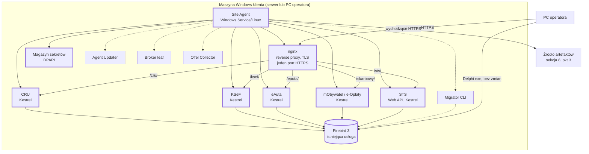
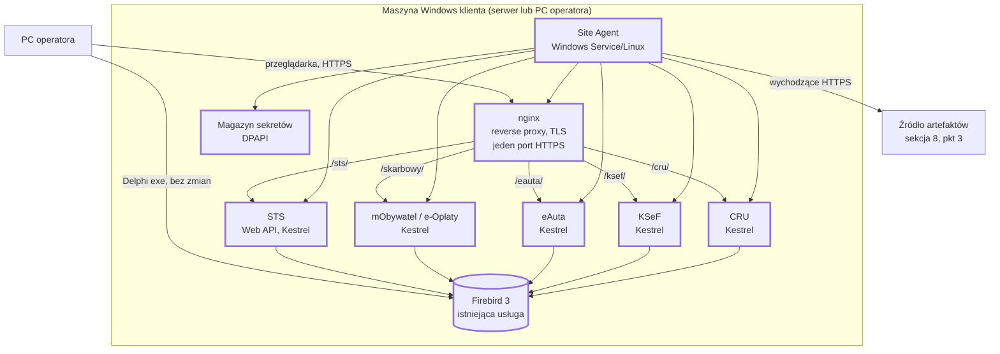

# Tier S: wyciąg z wytycznych architektury na spotkanie z serwisem

Źródło: `docs/research/software-architecture-guidelines_pl.md` v1.0 (2026-10-02). Numery sekcji w nawiasach odnoszą się do tego dokumentu.
Kontekst: ustalenia ze spotkania 2026-10-09 (`2026-10-09_PreArchitecture_summary.md`) i agenda (`2026-10-XX_TierS_agenda.md`).

## 1. Cel i zakres wyciągu

Tier S to sposób wdrożenia nowych aplikacji webowych jako zestawu usług Windows na maszynie klienta, bez wirtualizacji i bez kontenerów. Działa w każdej lokalizacji, także tam, gdzie serwer jest jednocześnie PC operatora. To pierwszy krok z pełnej architektury i jedyny, który ma być omawiany na spotkaniu.

Wyciąg odstępuje w jednym punkcie od wytycznych: aplikacje (CRU, KSeF, eAuta, mObywatel/e-Opłaty) nie są składane w jeden proces Site Host (zasada 5 wytycznych, "jeden host, wiele modułów"), bo są rozwijane osobno i stoją na różnych wersjach .NET. Każda działa jako osobna usługa za wspólnym reverse proxy. Wytyczne wymagają, aby odstępstwo od zasady zapisać w ADR (sekcja 18 źródła).

Pominięte celowo, bo nie wchodzą w pierwszy krok: Tier M (VM z kontenerami), platforma centralna (Fleet Server, Keycloak, broker, read store, Data API), udostępnianie danych podmiotom trzecim, ringi wdrożeniowe, egzekwowanie subskrypcji, VPN wsparcia, aplikacje dla mieszkańców.

## 2. Zasady, które dotyczą Tier S (sekcja 4)

- Lokalizacja jest autonomiczna: wszystko, czego potrzebuje operator, działa lokalnie i bez internetu przez nieograniczony czas.
- Wyłącznie ruch wychodzący: żaden komponent nie zakłada połączenia przychodzącego do lokalizacji.
- Jeden kontrakt instalacji: każdy pakiet jest podpisany i wersjonowany, a Site Agent jest jedyną rzeczą, która instaluje oprogramowanie.
- Sekrety nigdy w plikach konfiguracyjnych w lokalizacji; zawsze przez magazyn sekretów agenta.
- Zegar serwera bazy jest jedynym zegarem; zegary PC operatorów są niewiarygodne.

## 3. Diagram Tier S (sekcja 5.2, dostosowany)

Komponenty MVP są oznaczone grubą ramką. Pozostałe są częścią Tier S, ale odłożone na później (sekcja 5).

## 4. Komponenty MVP (sekcje 5.1, 5.2, 8.1, 11.2, 12, dostosowane)

Wszystko instaluje się wyłącznie na serwerze lokalizacji. PC operatorów nie dostają nowego oprogramowania: operator pracuje w przeglądarce pod jednym adresem HTTPS. Każda usługa .NET to self-contained binarium z własnym runtime, uruchamiane jako Windows Service, bez instalacji .NET u klienta.

### 4.1 Site Agent

Jedyny komponent, który instaluje oprogramowanie w lokalizacji. Nie zawiera logiki biznesowej.

W pierwszej wersji:

- pobiera pakiety wydań (osobny pakiet per aplikacja) i weryfikuje ich podpis; niepodpisany lub zmieniony pakiet nie jest instalowany,
- instaluje, aktualizuje, cofa i sprawdza zdrowie każdej usługi (`install`, `upgrade`, `rollback`, `health`), trzymając poprzednią wersję obok nowej na potrzeby rollbacku,
- generuje konfigurację nginx z szablonu i przeładowuje nginx po zmianach; nikt nie edytuje jej ręcznie,
- generuje i przechowuje sekrety lokalizacji i przekazuje je uruchamianym usługom,
- restartuje usługi po awarii i raportuje zainstalowane wersje każdej aplikacji.

Później, w tym samym agencie: uruchamianie Migratora, backupy, telemetria, samoaktualizacja, sesje wsparcia, kontenery Tier M.

Wymaga konta usługi z prawem instalowania i restartowania usług (dokument zakłada lokalnego administratora; do potwierdzenia z serwisem).

### 4.2 Hosting aplikacji: nginx i Kestrel

Każda aplikacja webowa jest osobnym procesem. Wspólny jest tylko punkt wejścia.

nginx:

- jedyne wejście z PC operatora: reverse proxy i TLS termination na jednym porcie HTTPS,
- routing po prefiksach ścieżek: `/cru/`, `/ksef/`, `/eauta/`, `/skarbowy/`, `/sts/`; jeden adres i jeden certyfikat dla całej lokalizacji,
- nginx nie ma natywnej usługi Windows; sposób uruchamiania (wrapper usługi czy nadzór agenta) jest punktem do decyzji (sekcja 8),
- konfiguracja jest generowana przez agenta z szablonu wersjonowanego razem z agentem.

Kestrel per aplikacja:

- każda aplikacja (CRU, KSeF, eAuta, mObywatel/e-Opłaty) to osobny Windows Service z własnym runtime .NET, więc różne wersje frameworka nie kolidują,
- nasłuch tylko na localhost, HTTP bez TLS; TLS kończy się na nginx,
- aplikacja musi obsługiwać base path (prefiks ścieżki), także w swoim SPA,
- zadania w tle (Quartz) działają w usłudze; kolejki KSeF i CRU przestają zależeć od PC operatora, więc znika problem usypiania schedulera,
- każda aplikacja ma własną bazę lub schemat (jak CruDb w ACRU); tabele należące do Delphi tylko czyta.

Wspólny kontrakt każdej aplikacji wobec agenta:

- endpoint health używany przez agenta po aktualizacji,
- jeden uzgodniony sposób odczytu konfiguracji i sekretów (sekcja 4.5),
- walidacja tokenów z lokalnego STS,
- wersja raportowana przy starcie.

Konsekwencja osobnych procesów: w terenie powstaje macierz wersji aplikacji, której nikt nie przetestował w komplecie. Agent raportuje zainstalowane kombinacje; o ewentualnym manifeście przetestowanych zestawów można zdecydować później.

### 4.3 Lokalny STS

Osobne Web API na Kestrelu, za nginx pod `/sts/`. Wspólne logowanie operatorów do wszystkich aplikacji, działające bez internetu.

- Implementacja: OpenIddict (lekki, natywny .NET). Keycloak w lokalizacji odrzucony (Java, minimum 1 GB RAM, drugi runtime do utrzymania offline).
- Własna baza Firebird dla rejestru użytkowników lokalizacji. STS mówi tylko, kto się zalogował; uprawnienia zostają w tabelach każdej aplikacji i są czytane jak dziś. Cienki rejestr mapuje jedno konto na konta w poszczególnych aplikacjach.
- Aplikacje walidują tokeny po kluczach publicznych STS pobieranych lokalnie, więc brak internetu nic nie psuje.
- Hasła należą do STS od pierwszego dnia; istniejące hashe są importowane albo pierwsze logowanie wymusza zmianę hasła. Nigdy nie ma dwóch magazynów haseł.
- Active Directory przez LDAP, bez przyłączania do domeny. Bez AD: konta lokalne z polityką haseł i opcjonalnym TOTP.
- Aplikacje Delphi mogą logować się przez ten sam STS (okres pomostowy: login i hasło przekazywane do STS, docelowo przez przeglądarkę).

### 4.4 SPA

- Next.js jako statyczny eksport; każda aplikacja ma własny frontend dostępny pod swoim prefiksem. W lokalizacji nie działa żaden proces Node.
- Kto serwuje pliki statyczne (Kestrel aplikacji czy nginx z dysku) jest punktem do decyzji (sekcja 8).
- Wspólna biblioteka komponentów, jeden klient uwierzytelniania, jeden generator klienta API.
- Powłoka WebView2 wokół tego samego SPA tylko wtedy, gdy wymaga tego sprzęt na PC operatora (drukarki fiskalne, czytniki). Nie jest to drugie UI.

### 4.5 Magazyn sekretów

- Właścicielem jest Site Agent; sekrety chronione DPAPI na koncie usługi agenta.
- Zawartość: hasło SYSDBA lokalizacji, hasła użytkowników Firebird per aplikacja, klucz podpisujący STS, connection stringi, klucz prywatny certyfikatu TLS.
- Żaden sekret nie leży w pliku konfiguracyjnym obok aplikacji (dziś hasła są w plikach XML). Sekrety nie trafiają do logów.
- Sposób przekazania sekretu do aplikacji przy starcie (zmienne środowiskowe usługi, chroniony plik, lokalny endpoint z tokenem) jest do ustalenia na spotkaniu (agenda, decyzja o sekretach).

### 4.6 Budżet zasobów dla najmniejszej lokalizacji

| Komponent | RAM (szacunek) |
|---|---|
| Site Agent (z Updaterem) | poniżej 100 MB |
| nginx | około 30 MB |
| STS | 80 do 120 MB |
| Każda aplikacja (Kestrel, Quartz) | 100 do 200 MB, cztery aplikacje: 400 do 800 MB |
| Broker leaf (później) | poniżej 50 MB |
| OTel Collector (później) | poniżej 100 MB |
| Razem ponad Firebird | około 600 do 1050 MB |

Wytyczne zakładały granicę "poniżej 1 GB ponad Firebird" dla jednego procesu Site Host. Przy osobnych procesach ta granica jest na styku i trzeba ją zmierzyć na najmniejszej lokalizacji przed pilotem.

## 5. Komponenty Tier S odłożone na później (sekcje 5.1, 8.7, 9.1, 13)

- **Migrator CLI.** Stosuje wersjonowane migracje do każdej bazy w lokalizacji z backupem, blokadą i tabelą historii; wywoływany przez agenta przed uruchomieniem nowej wersji. Odłożony decyzją ze spotkania: najpierw instalacja, migracje gdy wdrożenia ruszą. Dokument lokuje go w pierwszym deliverable (sekcja 8).
- **Broker leaf.** Lokalny węzeł kolejki (NATS) wysyłający zdarzenia do centrali ruchem wychodzącym. Potrzebny dopiero przy udostępnianiu danych.
- **OTel Collector.** Zbiera logi, metryki i trace'y z komponentów, usuwa dane osobowe, buforuje offline i wysyła do centrali. Potrzebny, gdy istnieje centralna obserwowalność.
- **Launcher share.** Udział plikowy z pakietami exe Delphi plus malutki launcher na PC operatora. Na spotkaniu uznano, że obecny mechanizm aktualizacji exe zostaje.
- **Agent Updater.** Osobna malutka usługa podmieniająca binarium agenta; agent i updater mogą naprawić siebie nawzajem. Potrzebny, gdy agent jest już w terenie.

## 6. Sekrety i poświadczenia Firebird (sekcje 9.3, 8.1)

- Losowe hasło SYSDBA per lokalizacja, generowane przez agenta przy instalacji i przechowywane w magazynie sekretów. Koniec ze wspólnym `masterkey`.
- Każda aplikacja webowa i każda aplikacja Delphi dostaje własnego użytkownika Firebird z potrzebnymi rolami. Żadna aplikacja nie łączy się jako SYSDBA.
- Aplikacja dostaje swoje poświadczenia od agenta przy uruchomieniu; nic nie leży w pliku konfiguracyjnym.
- Break-glass: IT gminy może poprosić o czasowe konto tylko do odczytu; nadanie i wygaśnięcie są audytowane. Dziś wymaga to procesu, docelowo portalu.
- Firebird nasłuchuje tylko na localhost tam, gdzie wszystkie klienty są lokalne; reguły zapory pisze agent.

## 7. Proces instalacji i aktualizacji (sekcja 8.3, bez ringów i subskrypcji, per aplikacja)

Agent aktualizuje jedną aplikację naraz. Pozostałe działają bez przerwy.

1. Agent pobiera pakiet wydania danej aplikacji ze źródła artefaktów.
2. Weryfikuje podpis Authenticode instalatorów i podpis manifestu pakietu.
3. (Później) uruchamia Migrator dla baz tej aplikacji: backup, migracje do docelowej wersji schematu. Nieudana migracja przerywa aktualizację i przywraca backup.
4. Zatrzymuje usługę aplikacji, przełącza na katalog nowej wersji, uruchamia.
5. Jeśli zmienił się port lub prefiks, generuje nową konfigurację nginx i przeładowuje go bez przerwy dla innych aplikacji.
6. Health check aplikacji: baza osiągalna, wersja schematu zgodna, STS osiągalny.
7. Przy niezdrowym wyniku: rollback do poprzedniego katalogu (i backupu bazy, jeśli schemat się zmienił), przywrócenie poprzedniej konfiguracji nginx.
8. Raport wyniku i pełnej listy wersji zainstalowanych aplikacji.

Pierwsza instalacja różni się tym, że nie ma poprzedniej wersji: instalator uruchamia agenta, agent instaluje nginx, STS i aplikacje, generuje sekrety i certyfikat TLS (sposób pozyskania certyfikatu: sekcja 8).

## 8. Punkty do decyzji na spotkaniu

Ustalone przed spotkaniem (nie wracamy do nich): osobne usługi Kestrel per aplikacja zamiast jednego Site Host; STS jako osobne Web API; nginx jako reverse proxy i TLS termination; jeden adres z prefiksami ścieżek; osobny pakiet wydania per aplikacja.

| Temat | Dokument | Spotkanie 2026-10-09 lub stan obecny | Do rozstrzygnięcia |
|---|---|---|---|
| 1. Źródło artefaktów i raportów | Fleet Server z enrollment lokalizacji i certyfikatem | Istniejący serwer licencji i aktualizacji InfoSystem (aplikacja Janka, pobieranie paczek) | Czy agent w MVP pobiera z istniejącego serwera i raportuje do niego, a Fleet Server wchodzi później |
| 2. Migrator | W pierwszym deliverable, agent uruchamia go przed każdą aktualizacją | Po uruchomieniu wdrożeń; serwis instaluje ręcznie | Kiedy wchodzi i kto do tego czasu odpowiada za schemat baz |
| 3. Logowanie exe Delphi | Delphi loguje się do OpenIddict (okres pomostowy: login i hasło) | Podmiana logowania w bibliotece Menadżer, żeby wszystkie exe przeszły na STS naraz | To ta sama ścieżka; do ustalenia moment wdrożenia i kto po stronie Delphi to robi |
| 4. Konto usługi agenta | Lokalny administrator | Nie omawiano | Jakie uprawnienia IT gmin realnie nadaje; co agent robi, gdy ich nie ma |
| 5. Serwowanie plików SPA | Site Host serwuje statyczne pliki modułów | Nie omawiano | Kestrel każdej aplikacji (pakiet samowystarczalny, prostszy rollback) czy nginx z dysku (mniej obciążony Kestrel, pakiet w dwóch częściach) |
| 6. Certyfikat TLS dla nginx | Nie dotyczy (dokument nie przewidywał nginx) | Nie omawiano | Agent z własną CA firmy (root instalowany raz na PC operatorów), self-signed per lokalizacja (ostrzeżenia przeglądarek) czy certyfikat od IT gminy (zależność od gminy) |
| 7. nginx jako usługa Windows | Nie dotyczy | Nie omawiano | Wrapper usługi (np. WinSW) czy nadzór przez agenta; kto utrzymuje szablon konfiguracji |
| 8. Przekazanie sekretów aplikacji | Agent przekazuje sekrety przy uruchomieniu | Usługa sekretów z uwierzytelnieniem certyfikatem (Adam, 2026-10-09) | Zmienne środowiskowe usługi, chroniony plik czy lokalny endpoint z tokenem lub certyfikatem |

## 9. Pytania do serwisu

- Jak dziś wygląda instalacja aplikacji webowej krok po kroku i co zajmuje najwięcej czasu.
- Jakie uprawnienia na serwerze gminy są realnie do uzyskania i w jakim czasie.
- Ile lokalizacji ma serwer będący jednocześnie PC operatora i ile ma na nim wolnego RAM.
- Jak często występuje proxy z uwierzytelnianiem lub blokada ruchu wychodzącego.
- Jaka wersja Firebird i dialekt dominują w terenie; ile lokalizacji jest poniżej Firebird 3 dialekt 3.
- Czy są lokalizacje z Active Directory i czy gminy pytają o SSO.
- Czy serwis może instalować root CA firmy na PC operatorów (GPO lub ręcznie), czy jest to poza zasięgiem.
