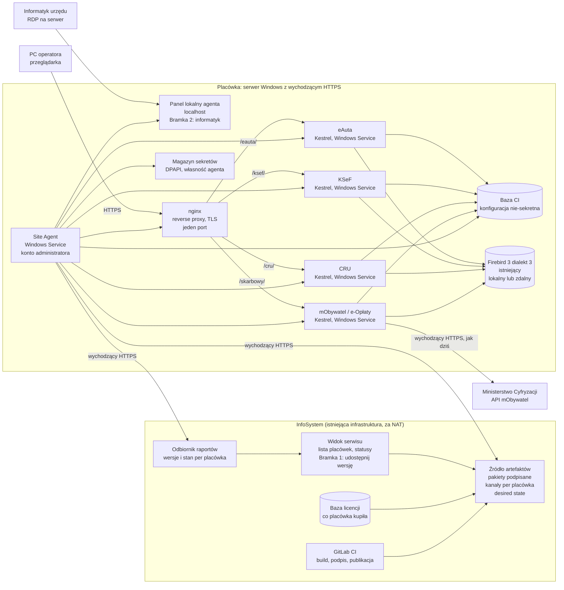

# Stan prac nad platformą dystrybucji, instalacji, aktualizacji i monitoringu aplikacji: podsumowanie i materiał wyjściowy do architektury MVP i Tier S

| | |
|---|---|
| **Data** | 19 października 2026 |
| **Status** | Szkic v0.1 do przeglądu na kolejnej iteracji „Fundamentów” |
| **Właściciel** | Adam Koper (architektura) |
| **Odbiorcy** | Marcin Grzybowski, Bolesław Groszek, serwis (Rafał Wilgos, Michał Baum), infrastruktura (Marek Królikowski), programiści (Jan Grabowski, Wojciech Grabowski, Paweł, Artur Kwiatkowski), Józek Bedra |
| **Cel** | Jeden dokument, który zbiera to, co już wiemy (wymagania, ograniczenia, istniejące rozwiązania), opisuje architekturę zakresu MVP i te aspekty Tier S, które decydują o spójności i bezpieczeństwie, oraz wskazuje decyzje do podjęcia. Ma być punktem wyjścia do dalszych prac nad Tier S i MVP, nie ich zamknięciem. |

### Źródła

| Skrót | Dokument | Treść |
|---|---|---|
| **1.10** | `2026-10-01-podsumowanie-spotkanie-dystrybucja.md` | Pierwsze spotkanie: realia klientów, VM/Docker nie do wdrożenia u ~90%, dwutorowość, luka XML, front opłat skarbowych |
| **WA** | `../2026_10_15_Architecture_Research/software-architecture-guidelines_pl.md` v1.0 (2.10) | Pełna wizja: Tier S, Tier M, platforma centralna, tożsamość, dane, fazy 0–5 |
| **9.10** | `2026-10-13_Omówienie pre-architektury - podsumowanie.md` | Akceptacja koncepcji, odchudzenie do MVP = Site Agent + Site Host, nginx zamiast IIS |
| **14.10** | `2026-10-14_Spotkanie Fundamenty - podsumowanie.md` | Szerokie spotkanie z serwisem: realia terenu, wymagania serwisu, bramkowanie aktualizacji, Firebird poza MVP |
| **AG** | `2026-10-16_TierS_agenda.md` | Agenda spotkania Tier S, lista decyzji do podjęcia |
| **TS** | `2026-10-16_TierS_architecture_extract.md` | Wyciąg Tier S z wytycznych na spotkanie z serwisem |
| **OC-WA** | `2026-10-18-ocena-architektury-vs-spotkanie.md` | Ocena wytycznych względem spotkania 1.10 (luki A–J) |
| **OC-TS** | `2026-10-18-ocena-tier-s-vs-wymagania.md` | Ocena wyciągu Tier S względem trzech spotkań (luki 3.1–3.7) |
| **DP** | `devops-portal-concept.md` v0.1 (18.10) | Wstępny research platform do zarządzania flotą, licencjonowania, sekretów, telemetrii; wzorce z rynku |

**Jak czytać identyfikatory.** Wymagania i ograniczenia w tym dokumencie mają nowe, skonsolidowane numery (F, B, N, T‑x, O‑x). Kolumna „Źródło” odsyła do tabel w dokumentach źródłowych (np. `14.10 A5` to wymaganie A5 z podsumowania spotkania 14.10; `WA 8.4` to sekcja 8.4 wytycznych). Zdania oznaczone **Rekomendacja** są propozycją autora tego dokumentu, nie ustaleniem ze spotkań.

> **Uwaga o tożsamości uczestników.** Podsumowanie z 9.10 identyfikuje „Wilgosa” jako Pawła Wiśniewskiego, a nagranie z 14.10 jako Rafała Wilgosa (serwis, autor updatera). Agenda wymienia obie osoby. W tym dokumencie wypowiedzi serwisu o updaterze, Firebirdzie i dostępie do serwerów przypisuję Rafałowi Wilgosowi; tożsamość w podsumowaniu z 9.10 wymaga poprawy.

---

## 1. Streszczenie

**Gdzie jesteśmy.** Po trzech spotkaniach (1.10, 9.10, 14.10) i dwóch dokumentach architektury (pełne wytyczne, wyciąg Tier S) kierunek jest uzgodniony koncepcyjnie, ale nie zatwierdzony decyzyjnie. Zgoda panuje co do rdzenia: **Site Agent jako usługa z uprawnieniami administratora instaluje i aktualizuje aplikacje .NET na Kestrelu za nginx, na istniejącej maszynie Windows klienta, bez VM i kontenerów, komunikując się wyłącznie ruchem wychodzącym.** Serwis nazwał to „cudowne, jeżeli się uda” i nie zgłosił sprzeciwu wobec nginx ani agenta.

**Dlaczego to robimy.** Obecny kierunek (VM z Dockerem) wdrożono u 2 z 60 klientów ePłatności, bo urzędy nie mają zasobów. Jesteśmy „zablokowani totalnie” w instalacji aplikacji webowych u wielu jednostek. Do tego: hasła do Firebirda leżą w XML‑ach na każdym PC, nikt nie wie, która wersja gdzie działa, KSeF i CRU na końcówkach nie działają niezawodnie, a serwis obsługuje do 100 zgłoszeń dziennie bez telemetrii.

**Zakres MVP (ustalony 9.10 i 14.10).** Cztery aplikacje webowe (mObywatel z ePłatnościami, KSeF, CRU, eAuta) instalowane i aktualizowane jednolicie w ok. 60 placówkach, które już mają te aplikacje na IIS. Bez Migratora, telemetrii, Tier M, kontenerów, aplikacji dla mieszkańców.

**Co ten dokument zmienia względem wyciągu Tier S.** Wprowadza do MVP trzy rzeczy, których wyciąg nie miał, a które serwis uznał za warunek wejścia na serwery: **bramkowanie aktualizacji przez informatyka urzędu** (dwie bramki: serwis udostępnia, informatyk akceptuje), **jedno źródło konfiguracji nie‑sekretnej** (baza CI na Firebirdzie z UI) i **jawne założenia o sieci i topologii** (serwer z agentem ma wychodzący HTTPS, Firebird może stać na innej maszynie). Wyprowadza z MVP STS (zgodnie z decyzją 9.10) i łagodzi zmiany poświadczeń Firebirda do opcji (zgodnie z „agent nie dotyka Firebirda”).

**Pięć decyzji, które blokują start prac (sekcja 9.2).**

1. STS w MVP czy poza (rekomendacja: poza).
2. Linux w MVP czy tylko Windows (rekomendacja: tylko Windows, z abstrakcją).
3. Źródło artefaktów: istniejący serwer licencji po dostosowaniu czy nowy komponent (rekomendacja: istniejący, z minimalnym API).
4. Certyfikat TLS dla nginx i dostęp do panelu lokalnego (rekomendacja: CA placówki generowane przez agenta, panel tylko na localhost).
5. Pierwsza aplikacja i pierwsza gmina pilotażu (rekomendacja: mObywatel/e‑Opłaty w „przyjaznej” placówce z 60, nie w Warszawie).

**Pięć warunków wstępnych poza architekturą (sekcja 7.13).** Podpisywanie kodu w CI zamiast tokena u jednej osoby, kompilacja self‑contained czterech aplikacji, obsługa base path w czterech SPA, konto usługi z uprawnieniami administratora u klientów, zgoda klientów na agenta i nginx.

---

## 2. Oś czasu i stan dokumentacji

| Data | Zdarzenie | Wynik |
|---|---|---|
| ok. 24.09 | Spotkanie o VM i sposobie jej aktualizacji (wg Marka) | Bez dokumentu; punkt wyjścia dla 1.10 |
| 1.10 | Spotkanie o dystrybucji (serwis, programiści, infrastruktura) | VM/Docker nie do wdrożenia u ~90% klientów; odrzucony SaaS/OVH; propozycja agenta (Adam); front opłat skarbowych jako krok 1 (Artur); luka XML ujawniona |
| 2.10 | Wytyczne architektury v1.0 (Adam, po angielsku i polsku) | Pełna wizja Tier S + Tier M + platforma centralna; fazy 0–5; napisane przed spotkaniami, z perspektywy docelowej |
| 9.10 | Omówienie pre‑architektury (Adam, Marcin, Bolek) | Koncepcja zaakceptowana jako zbieżna z InfoSystem; MVP = Site Agent + Site Host; nginx + Kestrel + Windows Service, IIS odpada; Migrator, telemetria, Tier M poza MVP |
| 14.10 | Spotkanie „Fundamenty” (szerokie, z serwisem) | Zbieranie informacji, nie decyzje; długa lista realiów; bramkowanie aktualizacji jako warunek; Firebird poza MVP; „posprzątać dom” |
| 16.10 | Agenda i wyciąg Tier S | Rysunek Tier S z komponentami MVP i odłożonymi; 8 punktów do decyzji |
| 18.10 | Dwie oceny dopasowania; koncepcja DevOps portal | Luki wyciągu (bramkowanie, STS, Firebird, konfiguracja, sieć, warunki wstępne); wzorce z rynku (Arc, Octopus, Argo, Mender) |
| 19.10 | Ten dokument | Konsolidacja; architektura MVP z poprawkami; decyzje do podjęcia |
| ok. 21.10 | Kolejna iteracja „Fundamentów” (zapowiedziana 14.10 „za tydzień”) | Oczekiwane: decyzje z sekcji 9.2, zaproszenie do „sabotowania”, potem test run |

**Stan dokumentów architektury.**

| Dokument | Stan | Co z nim zrobić |
|---|---|---|
| Wytyczne (WA) | Szkic v1.0, pełna wizja, częściowo nieaktualny po spotkaniach (fazy, zasada 5, wymuszone aktualizacje, SYSDBA, faza 3) | Zostaje jako wizja docelowa; sekcje sprzeczne ze spotkaniami do korekty przez ADR (lista w 9.1 i 4.5) |
| Wyciąg Tier S (TS) | v1 na spotkanie 14.10; luki wskazane w OC‑TS | Wersja 2 z uzupełnieniami z sekcji 7 tego dokumentu |
| Koncepcja DevOps portal (DP) | v0.1, research rynkowy, pytania otwarte bez odpowiedzi | Odpowiedzi na pytania z DP 9 są w tym dokumencie (sekcja 6.2); DP służy jako katalog wzorców, nie jako plan |
| Ten dokument | v0.1 | Materiał wyjściowy; po decyzjach z 9.2 staje się podstawą dla ADR‑ów i wyciągu Tier S v2 |

---

## 3. Słownik

| Termin | Znaczenie w tym dokumencie |
|---|---|
| **Tier S / Tier M** | Rozmiary T‑shirt, nie poziomy subskrypcji. Tier S: usługi .NET na istniejącej maszynie Windows klienta, bez VM. Tier M: obraz VM firmy z kontenerami, dla klientów z zasobami. Te same aplikacje w obu, różnią się narzędzia instalacji |
| **MVP** | Podzbiór Tier S: 4 aplikacje webowe instalowane i aktualizowane przez agenta w ~60 placówkach |
| **Site Agent** | Usługa na serwerze placówki (konto z uprawnieniami administratora), jedyny komponent instalujący oprogramowanie; komunikacja wyłącznie wychodząca |
| **Site Host** | W wytycznych: jeden proces z modułami. W MVP: zestaw osobnych usług Kestrel za nginx (odstępstwo, sekcja 8.1) |
| **Panel lokalny** | Interfejs agenta dla informatyka urzędu: co jest udostępnione, akceptacja instalacji, rollback, konfiguracja |
| **Źródło artefaktów** | Serwer po stronie InfoSystem, z którego agent pobiera podpisane pakiety; w MVP kandydat: istniejący serwer licencji/aktualizacji po dostosowaniu |
| **Odbiornik raportów** | Minimalne API po stronie InfoSystem przyjmujące stan i wersje z agentów; zalążek Fleet Server |
| **Fleet Server** | Docelowy rejestr lokalizacji, inwentaryzacja, ringi, portal (WA 8); poza MVP |
| **Baza CI** | Istniejąca centralna baza Firebird w placówce: operatorzy i połączenia do baz; w MVP proponowana jako źródło konfiguracji nie‑sekretnej |
| **STS** | Security Token Service, lokalny serwer tożsamości (OpenIddict); poza MVP |
| **Menadżer** | Wspólna biblioteka logowania w aplikacjach Delphi (exe) |
| **Updater (Rafała)** | Obecny mechanizm aktualizacji exe Delphi; zostaje bez zmian w MVP |
| **Bramka 1 / Bramka 2** | Bramka 1: serwis udostępnia wersję placówce. Bramka 2: informatyk urzędu akceptuje instalację |
| **Desired state** | Model „co ma być zainstalowane w placówce”, zasilany z bazy licencji; agent dąży do tego stanu i raportuje stan faktyczny |
| **JST** | Jednostki samorządu terytorialnego; tu też jednostki podległe urzędowi (szkoły, przedszkola, straż miejska) |

---

## 4. Wymagania

### 4.1 Formalne: prawne, umowne, decyzje zarządu

| # | Wymaganie | Źródło |
|---|---|---|
| F1 | **Firma nie jest administratorem ani pośrednikiem danych osobowych.** Dane (w tym PESEL‑e wysyłane do mObywatel) nie przechodzą przez serwery InfoSystem. Brak modelu SaaS, brak hostingu poza urzędem. Decyzja szefa. | 1.10 W7, P1; 9.10 1.3 |
| F2 | **Firma nie stawia tuneli ani nie konfiguruje dostępów** w urzędach; to odpowiedzialność informatyków urzędu. Brak VPN na ścieżce danych i agenta. | 1.10 P2; 9.10 D1 |
| F3 | **Umowy przenoszą odpowiedzialność za bazę i instalację na klienta.** Automatyczne, jednostronne działania na serwerach klienta „absolutnie nie wchodzą”. | 14.10 P1, P2, Z1, D5 |
| F4 | **Rozwiązania sprzedane w projektach muszą działać 5 lat** w warunkach infrastrukturalnych, jakie zapewnia gmina; nie można wymusić dokupienia serwera ani aktualizacji. | 1.10 W8, P4 |
| F5 | **Certyfikacja Ministerstwa Cyfryzacji** dla ePłatności (identyfikator i secret jednostki, certyfikat SSL, whitelist IP, testy bezpieczeństwa) musi zostać uszanowana przy zmianie hostingu i uwierzytelniania. | 1.10 P5 |
| F6 | **Gotowość na audyt bezpieczeństwa** (np. 30 dni na aktualizację pod rygorem wyłączenia); należyta staranność w przechowywaniu haseł obciąża firmę niezależnie od tego, gdzie leżą dane. | 1.10 T8, P3 |
| F7 | **Polityki bezpieczeństwa urzędów** mogą nie dopuścić agenta z uprawnieniami administratora, proxy na końcówkach ani ruchu wychodzącego z serwera; zgoda do zweryfikowania u klientów (Warszawa, Otwock, Złotoryja). | 14.10 P4, R17 |
| F8 | **Sprzęt z programu Cyberbezpieczny Samorząd** nie może gościć oprogramowania firmy (wg klientów; Marek wątpi). Do weryfikacji w umowach. | 1.10 I8, P7; OC‑WA I |
| F9 | Odpowiedzialność za **dostępność i aktualizacje nginx i innych komponentów spada na InfoSystem**, inaczej niż przy IIS aktualizowanym przez Windows Update. | 14.10 P3 |

### 4.2 Biznesowe i produktowe

| # | Wymaganie | Źródło |
|---|---|---|
| B1 | **Zakres MVP: 4 aplikacje** (mObywatel z ePłatnościami, KSeF, CRU, eAuta) zainstalowane jednolicie plus pilotaż. Skład będzie „dopieszczany”. | 14.10 W1, D1; 9.10 D4 |
| B2 | **Skala MVP: ok. 60 placówek** (gdzie mObywatel/eAuta działają na IIS), plus 20 w kolejce. Serwis: do 300 ogarnie w tydzień. | 14.10 W5; 1.10 W9 |
| B3 | **Skalowanie na przyszłość**: 3000–5000 klientów, zakupy „z dnia na dzień”, możliwa masowa instalacja u ~2000. | 14.10 W6, S9 |
| B4 | **Działać u małych i biednych jednostek** (gminy, biblioteki, szkoły, żłobki), bo z nich firma się utrzymuje. „Nasze aplikacje nie mają działać u 10%.” Skupić się na słabych zasobach. | 1.10 W1; 14.10 W3 |
| B5 | **Doinstalować obok obecnych aplikacji**, na serwerze „gdzie jest groszek”, bez nowego serwera; uruchamialne ze stacji i z serwera. | 1.10 W2, W3 |
| B6 | **Zacząć wdrażać coś, co faktycznie działa w urzędzie**; nie robić rozwiązania „cokolwiek” (VM wdrożona u 2 z 60 to antyprzykład). Iteracje, sabotowanie, test run przed decyzją. | 14.10 W2, W8 |
| B7 | **Zmiana metody instalacji nie jest celem**; dla użytkownika końcowego liczy się jakość aplikacji. Nie zaczynać od małej, opcjonalnej aplikacji jako argumentu za serwerem. | 1.10 W4, W5 |
| B8 | **Opłaty skarbowe natychmiast wdrażalne u 60 + 20 klientów** jako front (exe/WebView) z konfiguracją wskazującą na 2 API już działające w IIS. | 1.10 W9, R7 |
| B9 | **Dwutorowość**: Embarcadero zostaje, aż aplikacje zostaną przepisane; w nowym rozwiązaniu Tier S (najsłabsi klienci) i Tier M (pełne serwerowe) równolegle, te same aplikacje. Koszt utrzymania dwóch torów zaakceptowany świadomie. | 14.10 wstęp; 9.10 6; 1.10 W6, R3 |
| B10 | **Rozwiązanie musi dać radę przynajmniej połowie wyjątków**; „jeden wyjątek nie może nas pogrążyć”. | 14.10 W7 |
| B11 | **Jeden tor z Józkiem** (Bedra), który ma podobne potrzeby (szyfrowanie sekretów); bez bocznych torów. | 14.10 W9, P7 |
| B12 | **Panel samoobsługowy** docelowo: informatyk klika programy, wpisuje klucz, pobiera i instaluje; klucze i faktura automatycznie; „zero naszej ingerencji”. Model „cała paczka + aktywuj/dezaktywuj” odrzucony (stare sprzęty). | 14.10 Z5, R14 |
| B13 | **Jednostki podległe JST**: urząd chce „zaglądać” do baz szkół, przedszkoli, straży miejskiej; dziś „na żywca”. Wymagania do zebrania. | 9.10 2, A3; AG pkt 5 |
| B14 | Tier M (aplikacje dla mieszkańców, centralna platforma) to **„selling point”**, ale realnie ważniejsze jest zacząć instalować. | 9.10 1.3 |

### 4.3 Nieformalne: oczekiwania, kultura pracy, sposób prowadzenia projektu

Te wymagania nie padły jako „system musi”, ale zdecydują o przyjęciu rozwiązania przez serwis i programistów.

| # | Wymaganie | Kto | Źródło |
|---|---|---|---|
| N1 | **Narzędzia klikalne („ptaszki”), nie skrypty SQL z pamięci.** Młodzi serwisanci będą polegać na AI; UI pilnuje kompletu konfiguracji; łatwiej zatrudniać. | Rafał, Michał | 14.10 K4, S10 |
| N2 | **Jedno zintegrowane narzędzie** zamiast kilku (narzędzie do bazy, do konfiguracji, konfiguracja w programie). | Michał | 14.10 K5 |
| N3 | **Serwis chce być w decyzjach.** „W firmie są 3 firmy” (programiści starych aplikacji, nowych, serwis); decyzje o VM zapadały bez serwisu, który jest najbliżej klienta. | Artur | 1.10 P8 |
| N4 | **Wyjątki mają być przemyślane od początku**, nie „założenie, że będzie dobrze”. | Marek, Rafał | 14.10 S8, R1 |
| N5 | **„Posprzątać dom” równolegle z MVP**: pełny git, podpisywanie w CI, naprawa DBX, wycofanie porzuconych aplikacji. Bez tego „nic z tego nie będzie”. Adam: nie czekać, MVP równolegle. | Rafał | 14.10 R16, S6 |
| N6 | **Przyzwyczajenia serwisu i programistów**: konfiguracja przez wpisy w bazie, logi przez edycję config/XML; „chłopaki się nie zmienią”. Nowe narzędzie musi obsłużyć to, co dziś robi się ręcznie. | Rafał | 14.10 S5 |
| N7 | **Jeśli będzie trochę lepiej, sobie poradzimy**; nie oczekuje się ideału, oczekuje się poprawy względem „fatalnie”. | Rafał | 14.10 W7 |
| N8 | **Programiści chcą wiedzieć, co z ich pracą** (gateway, auth, menedżer Janka); „zaorać” tylko świadomie, po zebraniu wymagań. | Jan | 14.10 D8, pyt. 11 |
| N9 | **Dokumentacja po polsku, zwięzła**; „za dużo, nikomu nie będzie się chciało czytać”; obawa o odbiór jako „AI slop”. | Marek, Adam, Bolek | 9.10 7 |
| N10 | **Nie zmieniać sposobu logowania, dopóki agent nie działa stabilnie**; MVP = „jesteśmy w stanie zainstalować i serwis działa”. | Marcin | 9.10 D8 |
| N11 | **Zaufanie klientów jest kapitałem**: ePłatności to sukces („urząd dzwoni do urzędu”, uptime 99,9%), nie wolno tego zepsuć; nieudane wdrożenie rejestru nadszarpnęło wizerunek. | Artur | 1.10 U7 |
| N12 | **Więcej feedbacku dla architekta**: praca 2 h rano i wieczorem bez informacji zwrotnej prowadzi do przeszacowań. | Adam | 9.10 7 |
| N13 | **Nazewnictwo**: „Tier” kojarzy się z subskrypcją; Marcin „spróbuje się przeprogramować”. Warto rozważyć polskie nazwy w komunikacji z serwisem. | Marcin | 9.10 7 |

### 4.4 Techniczne

#### T‑A: Site Agent

| # | Wymaganie | Źródło |
|---|---|---|
| T‑A1 | Usługa (Windows Service; Linux do decyzji), ta sama funkcja niezależnie od OS. | 14.10 A1 |
| T‑A2 | Dedykowane konto z wysokimi uprawnieniami (administrator lokalny) do instalowania usług, edycji konfiguracji nginx, instalacji aplikacji. Konto do przygotowania u klienta. | 14.10 A2; TS 4.1 |
| T‑A3 | Instaluje i aktualizuje: aplikacje na Kestrelu, Windows Services, nginx i jego konfigurację, zwykłe exe; architektura rozszerzalna o nowe sposoby instalacji (w przyszłości kontenery). | 14.10 A3; 9.10 4.6; DP AD‑4 |
| T‑A4 | Aktualizuje wszystkie komponenty na rysunku **poza Firebirdem** (w tym nginx). | 14.10 A4, D4 |
| T‑A5 | Komunikacja wyłącznie wychodząca; brak dostępu z internetu do agenta. | 14.10 A5; 9.10 D1; WA zasada 2 |
| T‑A6 | Raportuje stan każdej aplikacji (podniesiona, działa) i zainstalowane wersje do części serwerowej InfoSystem. | 14.10 A6; TS 4.1 |
| T‑A7 | Samoaktualizacja agenta. | 14.10 A7; 9.10 4.6; DP 5.2 |
| T‑A8 | Instalacja agenta to jedyny krok ręczny (informatyk lub serwis), maksymalnie łatwa; resztę instaluje agent. | 14.10 A8 |
| T‑A9 | Paczki bez jakiejkolwiek interakcji (MSI silent, skrypty, zipy; na Linuksie deb/rpm). | 14.10 A9, R7 |
| T‑A10 | Agent i wszystkie binarki podpisane cyfrowo (antywirusy, SmartScreen). Agent weryfikuje podpis pakietu przed instalacją. | 14.10 A10; TS 4.1; WA 15 |
| T‑A11 | Działa w topologii kilku serwerów: agent na maszynie z internetem, Firebird na innej. | 14.10 A11, I3 |
| T‑A12 | Serwer bez internetu: warianty do rozważenia (PC operatora, agent pomocniczy na końcówce, komputer administratora); do weryfikacji z polityką bezpieczeństwa. | 14.10 A12 |
| T‑A13 | Zawsze FQDN, nigdy adresy IP w konfiguracji. | 14.10 A13 |
| T‑A14 | Sprawdzenia wstępne przed instalacją: miejsce na dysku, aktywne sesje na bazie, konflikty portów. | 14.10 Z3, I11; DP 5.2 |
| T‑A15 | Rollback binarki do poprzedniej wersji (katalogi side‑by‑side); rollback bazy rzadko. | 14.10 Z3; TS 4.1, 7; DP AD‑7 |

#### T‑H: hosting aplikacji w placówce

| # | Wymaganie | Źródło |
|---|---|---|
| T‑H1 | Rezygnacja z IIS w całości; nginx jako reverse proxy z terminacją TLS; aplikacje .NET na Kestrelu za nginx. | 14.10 H1, H2; 9.10 D7 |
| T‑H2 | Aplikacje kompilowane self‑contained (Windows; Linux do decyzji), bez instalacji .NET u klienta. Do sprawdzenia dla mObywatel i eAuta. | 14.10 H3; TS 4 |
| T‑H3 | Aplikacje jako Windows Service (lub exe podnoszone przez agenta); scheduler mObywatela i KSeF jako usługa na serwerze 24/7, nie w IIS ani na PC operatora. | 14.10 H4, H5, R13; 1.10 T13 |
| T‑H4 | Konflikty portów z usługami firm trzecich (IIS na 80/443, Firebird na 3050) i możliwość zmiany portu. | 14.10 H7 |
| T‑H5 | Usługa dostępna dla każdego operatora zalogowanego na serwerze przez RDP/terminal. | 14.10 H8 |
| T‑H6 | Minimalna wersja Firebirda 3, dialekt 3 (wymóg KSeF/CRU); docelowo FB5. Aplikacja musi wiedzieć, do której instancji i portu się łączy. | 14.10 H9, D3; OC‑TS 3.3 |
| T‑H7 | Sprawny start usług .NET na słabym sprzęcie (dziś 3 minuty, „Windows ubija”). | 14.10 H10 |
| T‑H8 | Jeden adres i jeden certyfikat dla placówki; routing po prefiksach ścieżek; aplikacja obsługuje base path, także w SPA. | TS 4.2 |
| T‑H9 | Jeśli aplikacje muszą działać na końcówkach (brak internetu na serwerze), muszą być napisane tak, by działały na końcówce. Poza MVP. | 14.10 H6 |
| T‑H10 | Usunąć podwójne instancje tych samych API z różnym uwierzytelnianiem (stan u 2 klientów). | 1.10 T15 |
| T‑H11 | Zegar serwera bazy jedynym zegarem (`TimeProvider`); zegary PC niewiarygodne (użytkownicy przestawiają datę). | WA zasada 13; 14.10 3.4 |

#### T‑K: konfiguracja i sekrety

| # | Wymaganie | Źródło |
|---|---|---|
| T‑K1 | Sekrety poza plikami XML (dziś login i hasło do bazy w XML, szyfrowanie trywialne). Propozycja: DPAPI lub baza. Sekrety nie trafiają do logów. | 1.10 luka 52:20; 14.10 K1; TS 4.5 |
| T‑K2 | Jedno źródło konfiguracji dla wszystkich aplikacji: jeden plik lub baza CI. | 14.10 K2, R10 |
| T‑K3 | Baza CI na Firebirdzie, nie na innym silniku. | 14.10 K3, D6 |
| T‑K4 | UI do konfiguracji zamiast SQL (bloby, komplet). | 14.10 K4 |
| T‑K5 | Model obsługuje oba warianty: informatyk robi wszystko i nie podaje haseł serwisowi, albo serwis robi wszystko. | 14.10 K6 |
| T‑K6 | Import operatorów do bazy CI z odświeżaniem i scalaniem (nie kopiowaniem). Dotyczy wariantu, w którym baza CI obsługuje logowanie. | 14.10 K7; 1.10 3.6 |
| T‑K7 | Parametry sieci (DNS, brama) z konfiguracji OS, nie na sztywno (lekcja z menedżera Janka). | 1.10 T1 |

#### T‑U: uwierzytelnianie

| # | Wymaganie | Źródło |
|---|---|---|
| T‑U1 | Uwierzytelnianie i uprawnienia to dwie różne rzeczy; rozdzielić. Uprawnienia zostają w bazach aplikacji. | 1.10 T7; 14.10 U2; WA zasada 7 |
| T‑U2 | Krok pośredni: API uwierzytelniające nad bazą CI (przez agenta); exe przepięte z XML na REST (w XML tylko adres serwera). | 14.10 U1, R11 |
| T‑U3 | Docelowo STS (standardowe rozwiązanie), integracja z domeną przez konfigurację; kojarzenie tożsamości z operatorem po loginie/mailu. Poza MVP. | 14.10 U2, R12; 9.10 D8 |
| T‑U4 | Brak AD u ~90% klientów; konta lokalne muszą być pierwszorzędne; LDAP opcjonalnie. | 1.10 I5; TS 4.3 |
| T‑U5 | Porzucone aplikacje (Woda, dodatki mieszkaniowe, ~5 innych) nie dostosują się; nie zakładać migracji 1:1. Tabele OPER zostawić w spokoju. | 14.10 U3, U4 |
| T‑U6 | Zmiana logowania w bibliotece Menadżer zmienia wszystkie exe naraz; dopiero po stabilnym działaniu agenta. | 9.10 4.4, D8 |

#### T‑Z: aktualizacje, wersje, back office

| # | Wymaganie | Źródło |
|---|---|---|
| T‑Z1 | **Zakaz jednostronnych aktualizacji.** Aktualizacja bramkowana z ostatecznym akcentem administratora urzędu. | 14.10 Z1, D5 |
| T‑Z2 | **Dwie bramki**: serwis udostępnia wersję placówce (kanary, beta); informatyk akceptuje instalację. Stara wersja działa równolegle. | 14.10 Z2 |
| T‑Z3 | **Panel administratora urzędu**: co się aktualizuje, kto siedzi na bazie, uruchomienie, rollback. | 14.10 Z3 |
| T‑Z4 | Przycisk „aktualizuj” dla użytkownika końcowego w aplikacji (dotyczy exe; dla aplikacji webowych aktualizacja jest na serwerze). | 14.10 Z4 |
| T‑Z5 | **Back office serwisu**: lista lokalizacji, zainstalowane usługi, statusy; grupowanie/tagowanie maszyn; wypychanie instalacji na grupy. | 14.10 Z6, R9 |
| T‑Z6 | Zbieranie wersji per jednostka (aplikacja, Firebird, baza), nie per końcówka. | 14.10 Z7 |
| T‑Z7 | **Środowisko testowe u klienta**: kopia bazy i druga instancja obok, na tym samym serwerze; testować osobno aplikację i bazę. | 14.10 Z8, R15 |
| T‑Z8 | Niezgodność wersji bazy blokuje nieaktualnych operatorów; akceptowalne. | 14.10 Z9 |
| T‑Z9 | **Desired state**: źródło artefaktów wie z bazy licencji, co placówka zakupiła, i na tej podstawie, co ma być zainstalowane. | 14.10 Z10, R3; DP AD‑2 |
| T‑Z10 | Kanary: wersja udostępniona wybranej placówce, instalacja za zgodą informatyka, stara wersja równolegle. | 14.10 Z2, R15 |
| T‑Z11 | Aktualizacja jednej aplikacji naraz; pozostałe działają bez przerwy. | TS 7 |

#### T‑D: baza danych

| # | Wymaganie | Źródło |
|---|---|---|
| T‑D1 | Agent nie aktualizuje i nie konfiguruje Firebirda („nie nasze”). | 14.10 D4 |
| T‑D2 | Zmiana hasła SYSDBA i użytkownicy per aplikacja tylko tam, gdzie brak zależności zewnętrznych (hasło serwerowe, Arisco, bloki Czarka); opcja, nie reguła. | OC‑TS 3.3; 14.10 I5 |
| T‑D3 | Migracje schematu: dziś ręczne skrypty serwisu; Migrator poza MVP, ale aktualizacja musi mieć miejsce na krok „migracja przed startem”. | 9.10 D5; TS 5, 7 |
| T‑D4 | Każda nowa aplikacja ma własną bazę lub schemat (jak CruDb); tabele Delphi czyta, nie zapisuje (do weryfikacji dla ePłatności, które księgują wpłaty). | TS 4.2; OC‑TS 3.7 |

#### T‑S: sieć i komunikacja

| # | Wymaganie | Źródło |
|---|---|---|
| T‑S1 | Agent potrzebuje tylko wychodzącego HTTPS (do potwierdzenia); lista hostów i portów do allow‑listy dla IT urzędu. | 14.10 16:02; OC‑WA F |
| T‑S2 | Po stronie InfoSystem: usługa dla agentów przez NAT na nietypowym porcie (np. 65000) lub subdomena na 443; do rozstrzygnięcia. | 14.10 I9, pyt. 7 |
| T‑S3 | Ruch DNS zewnętrzny bywa wycinany; polityki się zaostrzają. Rozwiązanie nie może zależeć od publicznych DNS. | 1.10 I6, T3 |
| T‑S4 | Zabezpieczenie „brak dostępu z internetu” nie wystarcza; wycieki idą od wewnątrz (phishing, przejęcie PC). | 1.10 T9 |

### 4.5 Rozbieżności między źródłami i ich rozstrzygnięcie

| # | Temat | Stanowiska | Rozstrzygnięcie w tym dokumencie | Status |
|---|---|---|---|---|
| R1 | **Internet na serwerze** | Jan: wymóg. Marek: DNS i ruch wychodzący bywają wycinane. Rafał: 60 serwerów z mObywatel ma internet, klienci tylko z podatkami nie. | MVP zakłada wychodzący HTTPS z serwera, na którym stoi agent (B2 to dokładnie te placówki). Wariant bez internetu to zdolność na później (sekcja 7.14). | Założenie jawne |
| R2 | **Baza CI** | Jan (1.10): zbędna w torze WebView. Artur, Rafał, Michał: klucz do jednego źródła konfiguracji i logowania. | Baza CI w MVP jako źródło konfiguracji nie‑sekretnej; operatorzy i logowanie przez bazę CI poza MVP (sekcje 7.7, 7.8). Rozdzielenie tych dwóch ról usuwa blokadę „brak synchronizacji operatorów”. | Rekomendacja |
| R3 | **STS w MVP** | Wyciąg TS: STS w grubej ramce. Marcin (9.10): nie zmieniać logowania przed stabilnym agentem. 14.10: STS docelowo. | STS poza MVP. Aplikacje zachowują obecne logowanie; kontrakt aplikacji przewiduje późniejszą walidację tokenów (sekcja 7.8). | Decyzja do potwierdzenia (9.2 D‑1) |
| R4 | **Poświadczenia Firebird** | Wytyczne: losowe SYSDBA, użytkownik per aplikacja, koniec masterkey. 14.10: hasło serwerowe, firmy trzecie, agent nie dotyka Firebirda. | Opcja per placówka, nie reguła MVP. Agent generuje i trzyma poświadczenia, które dostaje od informatyka lub serwisu; zmiana SYSDBA wyłącznie na życzenie i tam, gdzie jedna instancja bez zależności. | Rozstrzygnięte zgodnie z 14.10 D4 |
| R5 | **Wymuszone aktualizacje** | Wytyczne 8.4: lokalizacja nie może zostać w tyle o więcej niż 3 wydania, agent aktualizuje w najbliższym oknie. 14.10: absolutnie nie. | 14.10 wygrywa. Wytyczne do korekty: brak wymuszania; zamiast tego widoczność zaległości w back office i w panelu lokalnym, oraz T‑Z8 (niezgodność wersji bazy blokuje nieaktualnych). | ADR do napisania |
| R6 | **Jeden proces Site Host** | Wytyczne zasada 5: jeden host, wiele modułów. Wyciąg: osobne usługi per aplikacja (różne wersje .NET, osobny rozwój). | Osobne usługi w MVP; odstępstwo zapisane w ADR z warunkiem powrotu (wspólny SDK modułów, gdy aplikacje zejdą na jedną wersję .NET). | ADR do napisania |
| R7 | **Kolejność faz** | Wytyczne: faza 1 = flota istniejących instalacji Delphi przed nowymi modułami. 9.10: MVP = 4 aplikacje webowe. | MVP wygrywa: agent powstaje dla 4 aplikacji webowych; flota exe Delphi (launcher, inwentaryzacja Firebird) później, na tym samym agencie. Plan faz wytycznych do aktualizacji. | ADR do napisania |
| R8 | **Linux w MVP** | Diagram TS: „Windows Service/Linux”; sekrety przez DPAPI (tylko Windows). 1.10: ponad 90% Firebirda na Windows. | **Rekomendacja:** MVP wyłącznie Windows; w kodzie agenta abstrakcje (menedżer usług, magazyn sekretów, format pakietu) przygotowane pod Linux. | Decyzja (9.2 D‑2) |
| R9 | **PC operatorów bez nowego oprogramowania** | TS 4: nic na PC. TS 8 pkt 6: root CA na PC. 14.10 A12: agenty pomocnicze na końcówkach. | MVP: nic na PC poza ewentualnym jednorazowym zaufaniem certyfikatu (sekcja 8.2). Agenty pomocnicze to wariant na później dla serwerów bez internetu. | Rozstrzygnięte dla MVP |
| R10 | **Krok 1 wg Artura (front opłat skarbowych na IIS)** vs MVP (migracja z IIS na nginx) | 1.10: natychmiast, statyczny front obok istniejących API w IIS. 9.10/14.10: nginx zamiast IIS. | Front opłat skarbowych to jedna z 4 aplikacji MVP (mObywatel/e‑Opłaty). Jeśli biznes potrzebuje go przed MVP, to rozwiązanie taktyczne poza architekturą (statyczne SPA w IIS), z jawnym zapisem, że zostanie zastąpione. | Decyzja biznesowa (9.2 D‑9) |
| R11 | **Faza 3 wytycznych (centralny read store)** vs decyzja szefa (F1) | Wytyczne: opt‑in, umowa powierzenia. Artur: firma nie chce być trzecim administratorem. | Poza zakresem tego dokumentu; faza 3 oznaczona jako warunkowa, wymaga decyzji zarządu. | Poza MVP |
| R12 | **Dostęp wsparcia przez WireGuard** (WA 8.8) | Artur: firma nie stawia tuneli. Rafał: nikt nas nie wpuści na serwer. | Poza MVP; wymaga akceptacji serwisu i klientów przed fazą 2. | Poza MVP |

---

## 5. Ograniczenia środowisk

Każde ograniczenie ma kolumnę „Konsekwencja dla architektury”: to jest powód, dla którego ta tabela jest w dokumencie architektury, a nie tylko w podsumowaniu spotkania.

### 5.1 Infrastruktura u klientów

| # | Ograniczenie | Konsekwencja dla architektury | Źródło |
|---|---|---|---|
| O‑I1 | **Serwis nie ma dostępu do serwerów klientów.** VPN‑y blokowane, dostęp „po znajomości i pod nadzorem”, nawet informatycy dzielnic Warszawy nie mają dostępu. Deklaracje o zdalnych aktualizacjach to „bajka”. | Wszystko, co wymaga działania na serwerze, musi wykonać agent na zgodę informatyka lub informatyk sam przez panel lokalny. Nie projektować kroków „serwis zrobi zdalnie”. | 14.10 I1 |
| O‑I2 | **Brak internetu na serwerach** u części klientów (końcówki mają). Na ~60 serwerach z mObywatel/ePłatności internet jest. | MVP: założenie wychodzącego HTTPS na serwerze z agentem. Dla pozostałych: wariant z agentem pomocniczym lub pakietem z nośnika, po MVP. | 14.10 I2 |
| O‑I3 | **Topologia wieloserwerowa**: baza / aplikacje desktop / aplikacje z wyjściem na trzech serwerach (najbezpieczniej wg Rafała); część klientów nie chce, by eAuta miały wyjście, a mObywatel ma. | Agent na serwerze aplikacyjnym, Firebird zdalny w konfiguracji; możliwość dwóch agentów w jednej placówce (różne grupy aplikacji). | 14.10 I3, A11 |
| O‑I4 | **Zróżnicowane maszyny**: Windows Server (różne wersje, także 2016 bez obsługi nowych certyfikatów), czasem Linux (dziwne dystrybucje), PC operatora jako serwer, laptopy sprzed 5 lat. | Self‑contained .NET; brak zależności od wersji OS poza minimum; MVP Windows. | 14.10 I4; 1.10 I2, I3, I7 |
| O‑I5 | **Słaby sprzęt**: serwer z 4 GB RAM bez możliwości rozbudowy; usługa .NET startuje 3 minuty; „otwarcie menu Start wymaga cierpliwości”. | Budżet RAM z pomiarem na maszynie referencyjnej 4 GB **z IIS działającym równolegle** w okresie przejściowym; opóźniony start usług; brak brokera i kolektora w MVP. | 1.10 I2; 14.10 I6, H10 |
| O‑I6 | **Chaos wersji Firebirda**: 2.5/3/5 równolegle, kilka instancji na różnych portach (do 4 na serwerze), hasło serwerowe, 90% ma masterkey, aplikacje firm trzecich (Arisco) na starych wersjach; bazy 7–40 GB; migracja = weekend; 2–3 migracje dziennie w serwisie. | Agent nie dotyka Firebirda; konfiguracja aplikacji z jawną instancją i portem; MVP tylko tam, gdzie FB3 dialekt 3 już jest. | 14.10 I5, 3.5 |
| O‑I7 | **Antywirusy i polityki Windows** blokują niepodpisane programy. | Wszystko podpisane Authenticode; podpisywanie w CI jako warunek wstępny. | 14.10 I7 |
| O‑I8 | **Praca przez RDP/VPN**: 90% informatyków; wszyscy operatorzy pracują na serwerze. | Panel lokalny na localhost serwera wystarcza w MVP; certyfikat dla localhost upraszcza TLS tam, gdzie wszyscy są na serwerze. | 14.10 I8, H8 |
| O‑I9 | **Konflikty portów**: IIS na 80/443, Firebird na 3050 i innych, bloki Czarka wymagają tego samego portu. | Port nginx konfigurowalny; w okresie współistnienia z IIS nginx na porcie alternatywnym (sekcja 7.11). | 14.10 I11 |
| O‑I10 | **nginx na Windows**: kiedyś eksperymentalny (Jan); Rafał używa w PKP bez problemów. | Spike: nginx jako usługa Windows, reload konfiguracji, wydajność. | 14.10 I10 |
| O‑I11 | **Brak AD u ~90% klientów**; użytkownicy „latają po komputerach”. | Konta lokalne jako model podstawowy; brak GPO do dystrybucji certyfikatów. | 1.10 I5 |
| O‑I12 | **DNS zewnętrzny wycinany**, polityki się zaostrzają. | FQDN InfoSystem musi rozwiązywać się przez DNS urzędu; brak zależności od 8.8.8.8; allow‑lista hostów dla IT. | 1.10 I6 |
| O‑I13 | **Sprzęt z Cyberbezpiecznego Samorządu** niedostępny dla oprogramowania firmy (wg klientów). | Nie liczyć tych maszyn jako celu instalacji; weryfikacja umów. | 1.10 I8 |
| O‑I14 | **Zasoby VM** (8,5 GB dysku, 1 GB RAM) były zbyt duże dla 58 z 60 klientów. | Punkt odniesienia: Tier S musi być wyraźnie lżejszy niż VM. | 1.10 I9 |

### 5.2 Infrastruktura i organizacja InfoSystem

| # | Ograniczenie | Konsekwencja dla architektury | Źródło |
|---|---|---|---|
| O‑F1 | **Brak wolnych adresów IP w Legionowie**; groszek.pl na vhoście; usługa dla agentów przez NAT na nietypowym porcie (np. 65000) albo subdomena na 443. | Agent musi obsłużyć port niestandardowy; port 443 na subdomenie jest lepszy dla zapór urzędów (do rozstrzygnięcia z Markiem). | 14.10 I9 |
| O‑F2 | **Dwóch inżynierów DevOps**, 10 programistów Delphi, 10 nowego stosu, 5 serwisantów plus dystrybutorzy. | Nudna, samodzielnie hostowana technologia; jedno narzędzie na problem; brak Kubernetes. | WA 3 |
| O‑F3 | **GitLab istnieje**; brak pełnej migracji do gita, gubione biblioteki. | GitLab CI i package registry jako pipeline i źródło artefaktów; migracja do gita jako warunek wstępny. | WA 3; 14.10 S6 |
| O‑F4 | **Podpisywanie kodu**: jeden token sprzętowy u Czarka, ręcznie, zapomniał 2 razy. | Podpisywanie w CI (chmurowe lub HSM) jako warunek wstępny; bez tego agent nie ma czego weryfikować. | 14.10 P5 |
| O‑F5 | **Serwer licencji/ftp** (ki.groszek.pl) napisany przez osobę, która nie pracuje w firmie; „nie jest perfekcyjny, ale działa”. | Dostosowanie wymaga najpierw udokumentowania (format klucza, API). | 1.10 3.1; WA 17 |
| O‑F6 | **Skala serwisu**: 3000–5000 klientów; codziennie po kilkanaście instalacji plus szkolenia; do 100 zgłoszeń dziennie. | Każda minuta ręcznej pracy per placówka mnoży się przez tysiące; priorytet dla automatyzacji instalacji agenta i raportowania. | 14.10 S9; WA 3 |
| O‑F7 | **Brak kadencji wydań**; wydania wynikają ze zmian prawa i zamówień. | Kanały per placówka zamiast sztywnych ringów w MVP; ścieżka pilna dla zmian prawa. | WA 3 |

### 5.3 Użytkownicy i serwis

| # | Ograniczenie | Konsekwencja dla architektury | Źródło |
|---|---|---|---|
| O‑U1 | **Dostępność informatyków**: np. poniedziałek 8–10, inaczej za tydzień; u małych brak informatyka. | Instalacja agenta w jednym kroku, w kilka minut; reszta bez obecności informatyka; bramka 2 asynchroniczna (informatyk klika, kiedy ma czas). | 14.10 S1 |
| O‑U2 | **Klienci nie zatrzymają pracy**: duże jednostki nie staną na 2 dni; praca po godzinach i w weekendy (120 osób na fakturach). | Aktualizacja jednej aplikacji naraz, w oknie wybranym przez informatyka, z podglądem aktywnych sesji. | 14.10 S2, Z1 |
| O‑U3 | **Dwa typy informatyków**: robią wszystko sami i nie dopuszczają serwisu, albo nie znają się i serwis robi wszystko. | Panel lokalny obsługuje oba: informatyk wpisuje hasła sam, albo serwis dostarcza je w pakiecie konfiguracji. | 14.10 S3, K6 |
| O‑U4 | **Niski poziom wiedzy sieciowej**: stałe IP, CIDR, DNS przerastają informatyków. | Zero konfiguracji sieciowej w Tier S; agent wykrywa z OS. | 1.10 U1 |
| O‑U5 | **Zaufanie zamiast procedury**: wielu klientów instaluje, co im się da; „mądrzejszych” trzeba zapytać. | Dokument dla IT urzędu: co agent robi, jakie uprawnienia, jaki ruch, jak go wyłączyć. | 14.10 S4 |
| O‑U6 | **Porzucone aplikacje** wciąż sprzedawane; nikt ich nie dostosuje. | Nie projektować nic, co wymaga zmian we wszystkich aplikacjach Delphi naraz. | 14.10 S7 |
| O‑U7 | **Synchronizacja musi być automatyczna**; użytkownik nie uruchomi ręcznie (urlop 2 tygodnie). | Usługi 24/7 na serwerze, nie procesy na PC. | 1.10 U5 |
| O‑U8 | **Jakość testów „żenująca”**: wersje bez biblioteki trafiały do klientów; testowanie na produkcji u 3 klientów. | Health check po instalacji i rollback automatyczny; kanały pilotażowe per placówka. | 14.10 3.8 |

### 5.4 Liczby, które kształtują projekt

| Wielkość | Wartość | Źródło |
|---|---|---|
| Klienci ogółem | 3000–5000 | 14.10 S9 |
| Placówki z mObywatel/ePłatności na IIS (cel MVP) | ok. 60, plus 20 w kolejce | 14.10 W5; 1.10 W9 |
| Wdrożenia VM/Docker | 2 z 60 | 1.10 3.5 |
| Klienci, których stać na serwer | ok. 10% | 1.10 I1 |
| Klienci z Active Directory | ok. 10% | 1.10 I5 |
| Informatycy pracujący przez RDP/VPN | ok. 90% | 14.10 I8 |
| Firebird na Windows | ponad 90% | 1.10 I3 |
| Rozmiar baz | 7 GB typowo, do 40 GB podatkowe | 14.10 3.5 |
| RAM najsłabszych serwerów | 4 GB, bez rozbudowy | 1.10 I2 |
| Migracje Firebirda w serwisie | 2–3 dziennie, tylko weekendy u dużych | 14.10 3.5 |
| Serwis instaluje w tydzień | do 300 placówek | 14.10 W5 |
| Zgłoszenia do wsparcia | do 100 dziennie | WA 1.1 |
| Zespół | 10 Delphi, 10 .NET, 5 serwis, 2 DevOps | WA 3 |
| Cena ePłatności | ok. 20 tys. zł | 1.10 3.4 |
| Dysk VM | 8,5 GB (4 GB swap), 1 GB RAM | 1.10 I9 |

---

## 6. Ewidencja istniejących rozwiązań

Żadne decyzje o losie istniejących komponentów nie zapadły (14.10 D8). Kolumna „Proponowana rola” to propozycja do dyskusji. Kategorie: **Użyć** (bez zmian), **Dostosować**, **Wiedza domenowa** (źródło wiedzy, nie kodu), **Inspiracja**, **Zastąpić** (świadomie, po przejęciu funkcji).

### 6.1 Rozwiązania wewnętrzne InfoSystem

| # | Rozwiązanie | Autor / właściciel | Co to jest i jaki ma stan | Proponowana rola | Uwagi |
|---|---|---|---|---|---|
| E1 | **Updater exe** (aplikacja Rafała) | Rafał Wilgos | Exe uruchamiane przez aplikację Delphi: sprawdza wersję, pobiera, podmienia pliki. Przy starcie wysyła wersję aplikacji, Firebirda i bazy per jednostka. Podpisany. Działa „od lat”. Brak semafora, brak zdalnego wywołania, brak wersji per końcówka. | **Użyć** w MVP bez zmian dla exe (9.10: „pewnie zostawimy jak jest”); **wiedza domenowa** dla agenta (zbieranie wersji, zachowanie informatyków, opis zmian, prawo odmowy). Docelowo **zastąpić** launcherem na udziale (WA 8.7). | Odpowiednik Site Agenta dla exe (14.10 3.1). Baza wersji po stronie serwisu to zalążek inwentaryzacji (E12). |
| E2 | **Serwer licencji + ftp + paczkomat** (ki.groszek.pl) | Antek (już nie pracuje) | Sprawdza licencje, udostępnia paczki w urzędach; paczkomat do paczek. „Nie jest perfekcyjny, ale działa.” | **Dostosować**: kandydat na źródło artefaktów MVP (TS 8 pkt 1). Wymaga udokumentowania formatu klucza i dodania minimalnego API (desired state, kanały per placówka). | Ryzyko: brak autora i dokumentacji. Alternatywa: GitLab package registry za cienkim API (WA 5.1). |
| E3 | **Strona groszek.pl: generowanie kluczy licencyjnych** | (Embarcadero) | Stara strona z zakładką generowania kluczy; „robota dla roboty”, dało się zautomatyzować lata temu. | **Wiedza domenowa** (model licencji, co placówka kupiła); docelowo **zastąpić** panelem samoobsługowym (B12). | Baza licencji = źródło desired state (T‑Z9). |
| E4 | **Fleet Server** (Marka i Janka) | Marek Królikowski, Jan Grabowski | Sklonowana aplikacja do zarządzania kluczami na tej samej bazie; „architektura serwerowa groszek.pl”. | **Dostosować**: baza licencji per placówka jako źródło „co ma być gdzie zainstalowane”. | Nazwa pokrywa się z Fleet Server z wytycznych, ale zakres jest inny; nazewnictwo do uporządkowania. |
| E5 | **Panel dla dystrybutorów** | Artur Kwiatkowski | Nie zaprezentowany (14.10). Marcin chce go wykorzystać w propozycji Adama. | **Nieznany**: do prezentacji; potencjalnie widok serwisu/dystrybutora w back office. | Pytanie otwarte 14.10 nr 10. |
| E6 | **Heartbeat** | Artur Kwiatkowski | Miał wejść na nowy panel groszek.pl, ale brak API. | **Dostosować**: kandydat na odbiornik raportów MVP (7.5). | |
| E7 | **Menedżer aplikacji** (Docker w VM przez SSH) + **VM‑ka v10** | Jan Grabowski, Marek Królikowski | Aplikacja desktopowa rozwijana ~2 lata; steruje Dockerem w VM przez SSH; pomocnik sieciowy (IP, CIDR, DNS, score sieci). VM z Dockerem, gateway, kontenery. Wdrożona u 2 klientów. | **Zachować w portfolio dla Tier M** (1.10 R3), nie w MVP. **Dostosować** później: exe → usługa z API (9.10 4.6: front Janka zostaje, agent instaluje). **Wiedza domenowa**: pomocnik sieciowy, lekcja o sztywnych DNS. | Jan pyta o los pracy (N8). Marcin „cisnął”, żeby wewnętrznie szedł po REST API. |
| E8 | **Gateway API i prototypy uwierzytelniania** | Jan Grabowski (Jarek: logowanie) | Centralny gateway rozdzielający ruch na bazy przez bazę CI; uwierzytelnianie użytkowników. | **Bez decyzji** (D8). Kandydat do oceny przy projektowaniu STS (po MVP): co wziąć, co dostosować, co „zaorać”. | W MVP nie jest potrzebny (aplikacje łączą się bezpośrednio). |
| E9 | **Admin tool** | Marcin Grzybowski, poprawiony przez Jana | Synchronizacja operatorów między bazami. | **Wiedza domenowa** (reguły scalania operatorów); **zastąpić**, bo to „kolejna aplikacja do uruchamiania”. | |
| E10 | **Baza CI** + import operatorów (aplikacja Janka) | Jan Grabowski; serwis (Michał) | Centralna baza Firebird w placówce: operatorzy i połączenia. Używana przez wersję dockerową. Łatwa do dorzucenia do 60 klientów. Brak synchronizacji operatorów; po imporcie i tak IBExpert. | **Dostosować**: w MVP jako jedno źródło konfiguracji nie‑sekretnej (7.7); operatorzy i logowanie później, po rozwiązaniu scalania. | Serwis chce centralizacji (14.10 R10). |
| E11 | **API mObywatel / ePłatności** (dwa tryby: IIS i Docker) | Paweł | Dwa API na IIS u ~60 klientów, 24/7, wysyłka do MC co 30–60 min, certyfikacja MC, uptime 99,9%. Konfiguracja w bazie. Scheduler usypia na IIS. U 2 klientów podwójne instancje. | **Użyć/dostosować**: jedna z 4 aplikacji MVP; przenieść z IIS na Kestrel + nginx jako usługę; scheduler jako usługa; likwidacja podwójnych instancji; uszanować certyfikację MC. | Najcenniejszy produkt; „nie wolno tego zepsuć” (N11). Self‑contained do sprawdzenia. |
| E12 | **Baza wersji po stronie serwisu** | Rafał Wilgos | Wersja aplikacji, Firebirda i bazy per jednostka, zbierana przy starcie programu. | **Dostosować**: zalążek inwentaryzacji; odbiornik raportów MVP powinien zapisywać do tego samego modelu lub obok. | |
| E13 | **Aplikacja opłat skarbowych** (front w Dockerze) | zespół nowego stosu | „Malutki kawałek frontu”, wyświetla dane, rozmawia z API. 2 wdrożenia. „Zrobiliśmy aplikację dla siebie, a nie dla klienta.” | **Dostosować**: statyczne SPA za nginx (lub w IIS taktycznie, R10), API już istnieje (E11). | |
| E14 | **ACRU / CRU** (WebApi + scheduler + Next.js + CruDb) | zespół nowego stosu | .NET WebApi, scheduler, front Next.js, własna baza Firebird (CruDb), `RuDatabaseMigrator` (wersjonowany migrator SQL z `ACRU_MIGRATIONS_HISTORY`), `FirebirdAnchoredTimeProvider` (zegar serwera bazy), tabela zdarzeń `ACRU_EVENTS`. Działa na końcówkach, wymaga FB3 dialekt 3. | **Użyć jako wzorzec**: pierwsza aplikacja spełniająca kontrakt wobec agenta (7.6); `RuDatabaseMigrator` = zalążek Migratora; `TimeProvider` = reguła platformy. Przenieść na serwer jako usługę. | WA 2: zalążek Site Host i outbox. |
| E15 | **KSeF** | zespół nowego stosu; Czarek (problemy) | Działa na końcówkach; kilkanaście zgłoszeń dziennie (porty, serwis nie startuje, 3 minuty startu, antywirusy). | **Dostosować**: jedna z 4 aplikacji MVP; jako usługa na serwerze 24h („problemy się skończą”). Zebrać od Czarka listę problemów. | 14.10 3.4, R13 |
| E16 | **eAuta** | zespół nowego stosu | Na IIS u części klientów; niektórzy nie chcą wyjścia na zewnątrz dla eAut. | **Dostosować**: jedna z 4 aplikacji MVP; self‑contained do sprawdzenia; topologia bez wyjścia na świat do obsłużenia. | |
| E17 | **Biblioteka Menadżer** (logowanie w exe Delphi) | zespół Delphi | Wspólna biblioteka logowania; podmiana logowania w niej zmienia wszystkie exe naraz. | **Dostosować** po MVP: przepięcie na API/STS (T‑U2, T‑U6). | Nie dotyczy porzuconych aplikacji (O‑U6). |
| E18 | **Egzekutor blok Firebird** (Rafał), **bloki Firebirda** (Czarek), **sprzątanie tabel OPER** (Czarek) | Rafał Wilgos, Czarek | Narzędzie do kopiowania baz 70× szybsze od standardowego; bloki wymagają tego samego portu źródło/cel; porządkowanie OPER trwa drugi rok. | **Wiedza domenowa** dla Migratora i środowiska testowego obok produkcji (kopia bazy). | |
| E19 | **Proces „testowanie na produkcji” u 3 klientów**; automatyzacja testów przez AI (Rafał, Ola) | serwis | Wersja do 3 klientów; duże zmiany ręcznie z kopią baz i 3 dniami testów. | **Wiedza domenowa**: to są kanary; sformalizować jako kanały per placówka (7.9). | |
| E20 | **Konfiguracje aplikacji webowych w bazie**, edytowane SQL‑em | serwis, programiści | Dziś konfiguracje siedzą w bazie i są edytowane z poziomu bazy (bloby zawodzą). | **Wiedza domenowa** (zestaw parametrów); **zastąpić** UI nad bazą CI (7.7). | |
| E21 | **ePodatnik** | (przeszłość) | Rozwiązanie na serwerze jednostki łączące się do MC; jednostki rezygnują. | **Wiedza domenowa** o integracji z MC; nie używać. | 1.10 3.8 |
| E22 | **Rozwiązanie Józka (Bedra)** | Józek Bedra | Nieznane; podobne potrzeby (szyfrowanie sekretów). | **Skoordynować**: wspólny magazyn sekretów i kontrakt aplikacji. | B11 |
| E23 | **Strona wyboru programów do instalacji** (Dominik) | Dominik | Pokazana jako przykład; informatyk klika programy. | **Inspiracja** dla panelu samoobsługowego (B12). | 14.10 R14 |
| E24 | **Doświadczenia z PKP** (MSI podpisane, nginx na Windows) | Marek, Rafał | Inna firma/projekt, gdzie używają podpisanych MSI i nginx. | **Wiedza praktyczna**: pakowanie MSI silent, nginx na Windows. | 14.10 R7, I10 |
| E25 | **Doświadczenie Adama**: agenty na kasach POS (Leroy, OBI); redukcja ticketów w projekcie duńskim (maszyny stanów, zdarzenia, kolejki, telemetria, alerty) | Adam Koper | Wzorce agenta w retailu; historia „dowiadywaliśmy się o problemach przed użytkownikami”. | **Inspiracja** dla agenta i dla telemetrii (po MVP). | 14.10 1:05; 9.10 3 |
| E26 | **GitLab** | DevOps | Istnieje. | **Użyć**: CI, package registry, (opcjonalnie) issue tracking dla zgłoszeń. | WA 3 |
| E27 | **Wytyczne architektury v1.0, wyciąg Tier S, koncepcja DevOps portal** | Adam Koper | Dokumenty (sekcja 2). | **Użyć** jako wizja docelowa, podstawa Tier S v2 i katalog wzorców. | |

### 6.2 Wzorce i produkty zewnętrzne (z researchu)

Źródło: DP 2 (tabela platform referencyjnych) i WA 19 (lista technologii). Stan: research literaturowy, bez PoC. Kolumna „Proponowane użycie” odnosi się do MVP i Tier S.

| Potrzeba | Produkt / wzorzec | Co z niego bierzemy | Proponowane użycie |
|---|---|---|---|
| Flota za NAT, tylko ruch wychodzący | Azure Arc, AWS Systems Manager, Balena, Mender | Agent pull, rejestracja urządzenia, grupowanie, desired state | **Inspiracja** dla agenta i back office. Produkty odrzucone (chmura obca, model danych, koszt per urządzenie, zależność od internetu) |
| Jeden produkt u wielu klientów | Octopus Deploy (tenanted deployments) | Tenants, environments, channels, per‑tenant variables | **Inspiracja** dla modelu „kanał per placówka” (bramka 1). Build vs buy: Octopus jako control plane do oceny w fazie back office, nie w MVP |
| Desired state na Windows | PowerShell DSC, Ansible/AWX, Chocolatey, WinGet | Idempotentne providery per typ zasobu, drift | **Inspiracja** dla providerów agenta (install/upgrade/rollback/health). Intune/Ansible/Salt/Chef odrzucone: zakładają domenę lub dostęp przychodzący (WA 19) |
| GitOps / rekoncyliacja | Argo CD, Rancher Fleet | Stan deklarowany centralnie, agent ciągnie i raportuje | **Inspiracja** dla modelu desired state (T‑Z9) |
| Telemetria i zdrowie | OpenTelemetry Collector, Prometheus, Loki, Grafana | Jeden kolektor per placówka, centralny ingest | **Kandydat do użycia** po MVP (WA 13); w MVP aplikacje emitują OTel do logów lokalnych, bez kolektora |
| Raportowanie błędów | Sentry, GlitchTip | Zdarzenia z wersją, symbole, grupowanie | **Kandydat do użycia** po MVP: GlitchTip (MIT, lżejszy od Sentry) |
| Sekrety | HashiCorp Vault / OpenBao, Azure Key Vault; Windows DPAPI | Krótkie leasingi, polityki per tenant | **DPAPI do użycia** w MVP (lokalnie, bez zależności). Vault/OpenBao odrzucone dla placówki (ślad, zależność); do oceny centralnie dla rotacji po MVP |
| Artefakty | Artifactory, ProGet, OCI registry, GitLab package registry | Niezmienne, podpisane artefakty, promocja między feedami | **GitLab package registry do użycia** (istnieje); promocja dev → qa → stable jako model bramki 1 |
| Licencjonowanie | Keygen, Cryptolens | Podpisany token licencji, odcisk maszyny, okres łaski offline | **Inspiracja** dla formatu licencji po MVP; w MVP istniejący klucz licencyjny |
| Tożsamość w placówce | OpenIddict, Keycloak, Duende IdentityServer, ASP.NET Core Identity | OIDC w procesie .NET, offline | **OpenIddict kandydat** po MVP (WA 11.9). Keycloak nigdy w placówce (Java, 1 GB). Duende odrzucony (koszt) |
| Transport zdarzeń | NATS JetStream leaf, RabbitMQ | Store‑and‑forward przez wychodzący TLS | Poza Tier S MVP; NATS kandydat przy udostępnianiu danych (WA 10.3) |
| Reverse proxy w placówce | nginx; (YARP wewnątrz Site Host w wytycznych) | TLS termination, routing po prefiksach, reload bez przerwy | **nginx do użycia** (decyzja 9.10 D7). Usługa Windows przez wrapper (WinSW, NSSM) do decyzji (9.2 D‑7) |
| Hosting aplikacji | Kestrel + Windows Service (`UseWindowsService`) | Self‑contained, single‑file | **Do użycia** |
| Dostęp wsparcia | WireGuard z Headscale/NetBird; OpenVPN; AnyDesk/TeamViewer | Sesje na żądanie, audyt | Poza MVP; wymaga akceptacji serwisu (R12) |
| Podpisywanie kodu | EV Authenticode; podpisywanie w CI (chmurowy HSM, Azure Trusted Signing, token w runnerze) | Agent weryfikuje Authenticode i podpis manifestu | **Warunek wstępny** (7.13); wybór mechanizmu do spike'u |
| Pakowanie | MSI (WiX) silent, zip z manifestem, deb/rpm | Bez interakcji | **MSI dla agenta**, zip z manifestem dla aplikacji (rekomendacja 7.4) |
| Usługa jako wrapper dla procesów bez natywnej usługi | WinSW, NSSM | Dowolny exe jako Windows Service | Kandydat dla nginx (9.2 D‑7) |

### 6.3 Jak podejmiemy decyzje o losie komponentów

Zgodnie z 14.10 D8: po zebraniu wymagań, per komponent, z zapisem w ADR. Kryteria (rekomendacja): czy komponent realizuje wymaganie z sekcji 4; czy ma właściciela, który go utrzyma; czy pasuje do kontraktów z sekcji 8.4; koszt dostosowania vs koszt zastąpienia; co się stanie z wiedzą autora. Decyzja „zaorać” zawsze z wyjaśnieniem dla autora (N8).

---

## 7. Architektura MVP

### 7.1 Definicja MVP i kryteria ukończenia

**MVP to:** cztery aplikacje webowe (mObywatel/e‑Opłaty, KSeF, CRU, eAuta) instalowane i aktualizowane przez Site Agenta jako usługi Windows za nginx, w placówkach, które mają Windows Server z wychodzącym HTTPS i Firebird 3 dialekt 3; z bramkowaniem aktualizacji przez informatyka urzędu, sekretami poza plikami i jednym źródłem konfiguracji; z minimalnym widokiem serwisu (lista placówek, wersje, statusy, udostępnianie wersji).

**MVP nie jest:** Migratorem, telemetrią, STS, Tier M, kontenerami, platformą centralną, aplikacjami dla mieszkańców, przepięciem exe Delphi, zmianą Firebirda, launcherem dla exe, VPN wsparcia.

**Kryteria ukończenia (rekomendacja):**

| # | Kryterium | Jak mierzymy |
|---|---|---|
| K1 | Informatyk urzędu instaluje agenta w jednym kroku (MSI silent + klucz placówki) w czasie poniżej 10 minut, bez pomocy serwisu | Pilot u 3 placówek, pomiar czasu |
| K2 | Agent instaluje nginx i 4 aplikacje bez interakcji; operator pracuje w przeglądarce pod jednym adresem HTTPS | Pilot |
| K3 | Aktualizacja jednej aplikacji przechodzi obie bramki, wykonuje się bez przerwy dla pozostałych, z automatycznym rollbackiem przy niezdrowym health | Test run z celowo zepsutą wersją |
| K4 | Żaden sekret 4 aplikacji nie leży w pliku konfiguracyjnym ani w logu | Przegląd katalogów i logów po instalacji |
| K5 | Serwis widzi w jednym widoku: placówki, wersje 4 aplikacji, ostatni kontakt agenta, wynik ostatniej aktualizacji | Widok serwisu |
| K6 | Zużycie RAM ponad Firebird na maszynie referencyjnej 4 GB mieści się w budżecie (7.12), także z IIS działającym równolegle | Pomiar przed pilotem |
| K7 | Stare API na IIS wyłączone w placówkach pilotażowych bez przerwy w wysyłce do MC; certyfikacja MC nienaruszona | Pilot, potwierdzenie Pawła |
| K8 | Placówki pilotażowe (3) działają 30 dni bez zgłoszenia „serwis nie startuje” dla KSeF/CRU | Zgłoszenia serwisu |

### 7.2 Założenia jawne

| # | Założenie | Co się stanie, jeśli nie jest spełnione |
|---|---|---|
| Z1 | Serwer z agentem ma wychodzący HTTPS do FQDN InfoSystem (na porcie do ustalenia) i rozwiązuje ten FQDN przez DNS urzędu. | Placówka poza MVP; wariant offline po MVP (7.14). |
| Z2 | Firebird 3 dialekt 3 już działa (wymuszone przez KSeF/CRU). | Placówka poza MVP („tego nie zrobimy” dla FB2.5). |
| Z3 | Windows Server lub Windows Pro na serwerze; MVP bez Linuksa. | Do decyzji D‑2; Linux po MVP. |
| Z4 | IT urzędu przygotuje konto lokalnego administratora dla usługi agenta (lub zainstaluje agenta na koncie LocalSystem). | Bez uprawnień agent nie zainstaluje usług; co wtedy robi: raportuje brak uprawnień i kończy (nie próbuje obejść). |
| Z5 | Wszystkie binarki (agent, nginx, aplikacje) są podpisane Authenticode w CI przed pierwszą instalacją. | Antywirusy i SmartScreen blokują; agent nie ma czego weryfikować; MVP nie startuje. |
| Z6 | Klient wyraził zgodę na instalację agenta z uprawnieniami administratora i nginx (pisemnie lub w umowie serwisowej). | Zapytać Warszawę, Otwock, Złotoryję przed pilotem (F7). |
| Z7 | Cztery aplikacje dają się skompilować self‑contained i obsługują base path. | Praca unifikacyjna przed MVP (7.13). |
| Z8 | Aplikacje mogą działać równolegle ze starymi API na IIS przez okres przejściowy (inne porty). | Bez tego migracja placówki wymaga przerwy w wysyłce do MC. |

### 7.3 Widok ogólny



Różnice względem diagramu MVP z wyciągu Tier S: brak STS, dodany panel lokalny, dodana baza CI jako źródło konfiguracji, Firebird „lokalny lub zdalny”, strona InfoSystem rozpisana na minimum, jawna strzałka do MC.

### 7.4 Komponenty po stronie placówki

#### Site Agent

Jedyny komponent, który instaluje oprogramowanie w placówce. Nie zawiera logiki biznesowej.

| Odpowiedzialność w MVP | Szczegóły |
|---|---|
| Rejestracja placówki | Przy pierwszym uruchomieniu: klucz licencyjny placówki (istniejący) + jednorazowy token instalacyjny z widoku serwisu → identyfikator placówki i sekret agenta (do magazynu sekretów). Lekki odpowiednik enrollment z WA 8.2, bez certyfikatów. |
| Odpytywanie desired state | Co N minut (konfigurowalne, domyślnie 15): `GET /sites/{id}/desired` → lista aplikacji z wersjami udostępnionymi tej placówce (bramka 1) i flagami (wymaga restartu, migracja, pilne). |
| Pobieranie i weryfikacja | Pobiera pakiet (zip z manifestem) do katalogu staging; weryfikuje Authenticode binariów i podpis manifestu przypiętym kluczem wydań; pobieranie wznawialne (słabe łącza). |
| Oczekiwanie na zgodę | Pakiet zweryfikowany czeka na bramkę 2. Agent **nigdy** nie instaluje bez akceptacji, chyba że informatyk włączył politykę „instaluj automatycznie w oknie” dla danej aplikacji (opt‑in per placówka per aplikacja). |
| Kontrakt instalacji | `install`, `upgrade`, `rollback`, `health` per komponent, zaimplementowane nad Windows Service Control Manager i katalogami side‑by‑side (`C:\InfoSystem\apps\<app>\<wersja>\`, dowiązanie `current`). Zachowuje N poprzednich wersji (domyślnie 2). |
| Providery | W MVP trzy: `KestrelService` (aplikacja .NET jako usługa), `Nginx` (binarium + konfiguracja z szablonu + reload), `StaticSpa` (pliki statyczne, jeśli serwowane przez nginx; D‑6). Interfejs providera przygotowany pod `WindowsService`, `Exe`, `DbMigration`, `Container` (DP AD‑4). |
| Konfiguracja nginx | Generuje z szablonu wersjonowanego z agentem; nikt nie edytuje ręcznie; reload bez przerwy; test konfiguracji (`nginx -t`) przed reloadem; poprzednia konfiguracja zachowana do rollbacku. |
| Sekrety | Generuje (klucz TLS, hasła techniczne) lub przyjmuje (hasło Firebird od informatyka/serwisu) i przechowuje w DPAPI; przekazuje aplikacjom przy starcie (mechanizm: D‑8). |
| Sprawdzenia wstępne | Miejsce na dysku, port wolny, aktywne sesje na bazie (Firebird `MON$ATTACHMENTS` przez konto, które agent ma), uprawnienia konta. |
| Health i nadzór | Po instalacji wywołuje endpoint health aplikacji; przy niezdrowym wyniku rollback; restartuje usługi po awarii z backoff. |
| Raportowanie | `POST /sites/{id}/state`: wersje zainstalowane, stan usług, wynik ostatniej operacji, wersja agenta, wersja i port Firebirda (z konfiguracji, nie z modyfikacji), wolne miejsce, RAM. Zbiorczo, nie per końcówka (T‑Z6). |
| Samoaktualizacja | **Rekomendacja:** w MVP, bo bez niej każda poprawka agenta w 60 placówkach bez dostępu zdalnego to 60 umówionych wizyt. Mechanizm: agent pobiera nową wersję, weryfikuje, uruchamia ją w trybie `--swap`, który podmienia katalog i restartuje usługę; podlega bramce 2 jak każda aktualizacja (lub polityce auto, jeśli informatyk włączył). Osobny Updater (TS 5) później. |
| Panel lokalny | Hostowany przez agenta na `http://127.0.0.1:<port>` (D‑4); dostęp = zalogowanie na serwer (RDP), bez nowej tożsamości w MVP. |

Czego agent **nie robi** w MVP: nie instaluje ani nie konfiguruje Firebirda, nie zmienia SYSDBA bez polecenia informatyka, nie uruchamia migracji schematu (serwis robi ręcznie jak dziś; hak na krok `pre-start` zarezerwowany), nie zbiera telemetrii poza stanem i wersjami, nie otwiera żadnego portu z zewnątrz, nie zmienia ustawień Windows Update ani zapory poza regułami dla własnych portów (i to z opcją wyłączenia).

**Pakowanie agenta (rekomendacja):** MSI podpisany, instalacja silent (`msiexec /i agent.msi /qn SITEKEY=... SOURCE=...`), jak w PKP (E24). Aplikacje jako zip z manifestem, bo agent sam zarządza katalogami i usługami; MSI per aplikacja to dwie warstwy zarządzania stanem.

#### nginx

| Aspekt | MVP |
|---|---|
| Rola | Jedyne wejście z PC operatora: reverse proxy, TLS termination, jeden port HTTPS, routing po prefiksach (`/skarbowy/`, `/cru/`, `/ksef/`, `/eauta/`, później `/sts/`). |
| Port | Konfigurowalny; domyślnie 443, ale w okresie współistnienia z IIS (który trzyma 443 w 60 placówkach) **domyślnie port alternatywny** (np. 8443), z przełączeniem na 443 po wyłączeniu IIS (7.11). |
| Uruchamianie | Jako Windows Service przez wrapper (D‑7); zarządzane tym samym kontraktem co aplikacje. |
| Certyfikat TLS | D‑5. |
| Pliki statyczne SPA | D‑6. |
| Utrzymanie | Wersja nginx wchodzi w skład pakietu „platforma” aktualizowanego przez agenta (F9). |

#### Aplikacje (4 usługi Kestrel)

Każda aplikacja to osobny Windows Service z własnym runtime .NET (self‑contained), nasłuchujący tylko na `127.0.0.1:<port przydzielony przez agenta>`, HTTP bez TLS. Zadania w tle (Quartz: scheduler mObywatela, kolejki KSeF i CRU) działają w usłudze, więc znika zależność od PC operatora i usypiania na IIS. Pełny kontrakt w 7.6.

#### Magazyn sekretów

Własność agenta; DPAPI na koncie usługi agenta (zakres maszyny, z dodatkową entropią trzymaną w ACL‑owanym pliku). Zawartość w MVP: sekret agenta do komunikacji z InfoSystem, klucz prywatny certyfikatu TLS, hasła Firebird per aplikacja (lub wspólne, jeśli placówka ma jedno), identyfikator i secret jednostki dla MC (dziś w bazie; do decyzji z Pawłem, czy przenieść). Żaden sekret nie leży w pliku konfiguracyjnym aplikacji ani w logu. Linux: inny backend za tym samym interfejsem, po MVP.

**Uczciwe stwierdzenie wartości:** lokalny administrator serwera może odczytać sekrety z pamięci procesu lub przez DPAPI na tym samym koncie. Cel MVP to: brak haseł w plikach tekstowych kopiowanych na PC operatorów, brak haseł w logach i backupach konfiguracji, jedno miejsce do rotacji. Ochrona przed lokalnym administratorem nie jest celem (WA 15, zagrożenie b).

#### Baza CI jako źródło konfiguracji nie‑sekretnej

Patrz 7.7.

#### Panel lokalny agenta (bramka 2)

Prosta aplikacja webowa hostowana przez agenta (Kestrel w procesie agenta, lub osobny mały proces), na `127.0.0.1`. Funkcje w MVP, w kolejności ważności:

1. Lista aplikacji: zainstalowana wersja, stan usługi, wersja udostępniona (jeśli nowsza), release notes, wpływ (restart, migracja bazy, pilne/bezpieczeństwo).
2. Przyciski: **Zainstaluj teraz**, **Zaplanuj** (data i godzina), **Odrzuć** (z powodem, raportowanym do serwisu), **Cofnij do poprzedniej wersji**.
3. Przed instalacją: kto siedzi na bazie (liczba aktywnych sesji Firebird per baza), miejsce na dysku, ostrzeżenia.
4. Konfiguracja: formularz („ptaszki”) nad bazą CI dla parametrów aplikacji; wpisywanie haseł Firebird (trafiają do magazynu sekretów, nie do bazy CI).
5. Polityka: „instaluj automatycznie w oknie” per aplikacja (domyślnie wyłączona).
6. Diagnostyka: ostatnie logi agenta, wynik health każdej aplikacji, test połączenia z InfoSystem.
7. Środowisko testowe (po MVP, ale miejsce w UI zarezerwowane): „uruchom wersję X obok na bazie testowej”.

Panel jest w języku polskim, bez żargonu Tier/desired state. Jest jedynym interfejsem konfiguracji w placówce (N2).

### 7.5 Komponenty po stronie InfoSystem (minimum)

| Komponent | Minimum w MVP | Rekomendacja realizacji | Docelowo (WA) |
|---|---|---|---|
| **Źródło artefaktów** | Przechowuje podpisane pakiety; `GET /sites/{id}/desired`; `GET /packages/{app}/{wersja}`; uwierzytelnienie agenta sekretem placówki. | Pakiety w GitLab package registry (istnieje), przed nimi cienkie API .NET, które zna bazę licencji i przypisania kanałów per placówka. Istniejący serwer licencji (E2) dostarcza wiedzę o kluczach; dostosowanie vs nowy komponent: D‑3. | Artifact store + Fleet Server |
| **Baza licencji → desired state** | Tabela: placówka, aplikacja, kanał (`stable`, `pilot`, nazwany), wersja udostępniona. Zasilana z istniejącej bazy licencji (co kupiono) i z decyzji serwisu (jaka wersja). | Rozszerzenie bazy Fleet Server Marka/Janka (E4) lub nowa tabela w tej samej bazie. | Ringi, polityki, subskrypcje |
| **Odbiornik raportów** | `POST /sites/{id}/state`; zapis ostatniego stanu i historii operacji per placówka. | To samo API co źródło artefaktów (jeden proces, jedna baza). Heartbeat Artura (E6) jako punkt wyjścia. | Inwentaryzacja, heartbeat, telemetria |
| **Widok serwisu** | Lista placówek: ostatni kontakt, wersje 4 aplikacji, wynik ostatniej aktualizacji, oczekujące na zgodę, odrzucone z powodem. Akcja: udostępnij wersję X placówce / grupie (bramka 1). Prosty filtr i tagi (ręczne). | Prosta aplikacja webowa (Next.js statyczny + to samo API) lub widok w panelu dystrybutorów Artura (E5) po jego prezentacji. | Fleet portal z grupowaniem, ringami, raportami zgodności |
| **Pipeline** | GitLab CI: build self‑contained, testy, podpis Authenticode, podpis manifestu, publikacja do registry, rejestracja wydania w kanale `dev`. Promocja `dev → pilot → stable` ręcznie przez serwis. | Warunek wstępny (7.13). | Ringi automatyczne |
| **Sieć** | FQDN (nie IP) dla API agentów; port: 443 na subdomenie (preferowany dla zapór urzędów) lub 65000 przez NAT (D‑10). | Ustalić z Markiem przed pilotem; dokument dla IT urzędu z allow‑listą. | |

### 7.6 Kontrakt aplikacji wobec platformy

To jest „unifikacja”, o której mówił Adam 14.10 (B1, 14.10 W4). Każda z 4 aplikacji musi spełnić poniższe, zanim agent ją zainstaluje. Koszt tej pracy jest dziś nieoszacowany i jest największym ryzykiem harmonogramu MVP.

| # | Wymaganie kontraktu | Uzasadnienie |
|---|---|---|
| C1 | Self‑contained, single‑file (lub katalog) build dla `win-x64`, `UseWindowsService()`; brak zależności od zainstalowanego .NET, IIS, Node. | T‑H2, O‑I4 |
| C2 | Nasłuch na adresie i porcie podanym przez agenta (zmienna środowiskowa lub argument), tylko loopback, HTTP. | T‑H1 |
| C3 | Obsługa base path (prefiks ścieżki) w API i w SPA; linki, cookies, redirecty względem prefiksu. | T‑H8 |
| C4 | Endpoint `GET /health` (bez uwierzytelnienia, tylko loopback): baza osiągalna, wersja schematu zgodna z oczekiwaną, zadania w tle żyją; odpowiedź z wersją aplikacji i schematu. | T‑A6, T‑A15 |
| C5 | Konfiguracja przez wspólną bibliotekę: parametry nie‑sekretne z bazy CI, sekrety z magazynu agenta (mechanizm D‑8); brak `appsettings.json` z wartościami per placówka; brak XML z hasłami. | T‑K1, T‑K2 |
| C6 | Jawny wybór instancji i portu Firebirda w konfiguracji (host, port, ścieżka bazy); brak założenia „localhost:3050”. | T‑H6, O‑I6 |
| C7 | Zadania w tle w procesie usługi (Quartz lub hosted service), odporne na restart; brak zależności od sesji użytkownika. | T‑H3 |
| C8 | Logi strukturalne do pliku w katalogu wskazanym przez agenta (rotacja), bez danych osobowych i sekretów; format zgodny z `docs/logging_guide.md`. Gotowość do OTel po MVP. | WA 13, 14 |
| C9 | Wersja aplikacji w manifeście pakietu (semver) i zwracana przez health; manifest deklaruje: wymagany prefiks, port (lub „dowolny”), czy wymaga restartu, czy niesie migrację schematu, minimalną wersję agenta. | T‑Z9, 8.4 |
| C10 | `TimeProvider` z zegara serwera bazy w kodzie, który zapisuje lub porównuje z bazą. | T‑H11 |
| C11 | Własna baza lub schemat (jak CruDb); tabele Delphi czytane, zapisy tylko tam, gdzie dziś (ePłatności: do weryfikacji). | T‑D4 |
| C12 | Uwierzytelnianie jak dziś, ale przez wspólną bibliotekę z abstrakcją, która później przyjmie tokeny STS bez zmiany kontrolerów (7.8). | T‑U3 |
| C13 | Start usługi poniżej 30 s na maszynie referencyjnej; ciężkie inicjalizacje leniwe lub w tle (dziś 3 minuty). | T‑H7 |

Konsekwencja osobnych procesów: w terenie powstanie macierz wersji 4 aplikacji × wersja agenta × wersja nginx. Agent raportuje kombinacje; serwis udostępnia wersje per aplikacja. Manifest „przetestowanych zestawów” to decyzja na później (TS 4.2).

### 7.7 Konfiguracja i sekrety: trzy warstwy

| Warstwa | Co zawiera | Gdzie żyje | Kto edytuje i czym | Właściciel |
|---|---|---|---|---|
| **Instalacyjna** | Katalogi, porty loopback, prefiksy, port nginx, adres źródła artefaktów, polityki auto‑instalacji, identyfikator placówki | `site.json` agenta (w `ProgramData`, ACL dla agenta) | Agent; informatyk przez panel lokalny (tylko wybrane pola) | Agent |
| **Nie‑sekretna aplikacyjna** | Ścieżki i instancje baz (host, port, plik), adresy usług zewnętrznych (FQDN), parametry aplikacji (dziś w bazie i edytowane SQL‑em), identyfikatory jednostki | **Baza CI** (Firebird) w placówce, tabela konfiguracji per aplikacja z wersją schematu konfiguracji | Informatyk lub serwis przez panel lokalny (formularz z walidacją kompletności); programiści: migracja schematu konfiguracji w pakiecie aplikacji | Aplikacja (schemat), serwis/informatyk (wartości) |
| **Sekrety** | Hasła Firebird, klucz TLS, sekret agenta, secret jednostki MC | Magazyn sekretów agenta (DPAPI) | Informatyk przez panel lokalny (wpisuje, nie widzi) lub serwis przez pakiet konfiguracji; agent generuje techniczne | Agent |

Dlaczego baza CI, a nie plik: serwis od lat chce bazy (T‑K2, T‑K3), zna Firebirda, a UI nad bazą (T‑K4) pilnuje kompletu lepiej niż plik. Dlaczego nie operatorzy w MVP: synchronizacja operatorów to nierozwiązany problem (T‑K6), a konfiguracja go nie potrzebuje. Dwa warianty (T‑K5): informatyk wpisuje hasła sam w panelu i nie podaje ich serwisowi; albo serwis przygotowuje pakiet konfiguracji (zaszyfrowany jednorazowym kluczem) i informatyk go importuje.

Jeśli baza CI nie istnieje w placówce, agent ją tworzy (plik bazy w pakiecie „platforma”) z użytkownikiem Firebird, którego hasło trafia do magazynu sekretów. To jedyne „dotknięcie” Firebirda: utworzenie nowej bazy, bez zmian w serwerze.

### 7.8 Uwierzytelnianie w MVP

**Rekomendacja: brak nowego komponentu tożsamości w MVP.** Cztery aplikacje zachowują obecny sposób logowania (mObywatel/ePłatności: dziś na IIS bezpośrednio do bazy podatkowej; CRU, KSeF, eAuta: jak dziś). Powody: decyzja 9.10 D8 (nie zmieniać logowania przed stabilnym agentem), ryzyko dla certyfikacji MC (F5), nierozwiązane scalanie operatorów (T‑K6), porzucone aplikacje (T‑U5).

Co MVP robi w tym obszarze:

- Usuwa z 4 aplikacji sekrety z plików (C5) i likwiduje podwójne instancje z różnym logowaniem (T‑H10).
- Wprowadza w 4 aplikacjach wspólną bibliotekę uwierzytelniania z abstrakcją (C12), tak by przejście na tokeny STS było zmianą konfiguracji i jednej implementacji, nie kontrolerów.
- Rezerwuje prefiks `/sts/` w nginx i miejsce w pakiecie „platforma”.

Krok następny po MVP (kolejność do decyzji): (a) API uwierzytelniające nad bazą CI jako pomost dla exe (T‑U2), (b) lokalny STS (OpenIddict) z rejestrem użytkowników i mapą na tabele aplikacji (WA 11.2), przepięcie biblioteki Menadżer (T‑U6). Oba wymagają rozwiązania scalania operatorów; (b) wymaga też jawnego zapisu o okresie dwóch magazynów haseł (OC‑TS 3.2).

Jeśli zespół zdecyduje inaczej (STS w MVP), ten dokument wymaga zmiany w 7.3, 7.6 (C12 → walidacja tokenów), 7.12 (budżet +100 MB) i jawnego ADR wobec 9.10 D8.

### 7.9 Przepływy

#### Pierwsza instalacja w placówce

```mermaid
sequenceDiagram
    participant S as Serwis (widok serwisu)
    participant IT as Informatyk urzędu
    participant AG as Site Agent
    participant SRC as Źródło artefaktów
    participant LP as Panel lokalny
    participant REP as Odbiornik raportów

    S->>S: Zakłada placówkę (z bazy licencji), przypisuje kanał, generuje token instalacyjny (72h)
    S->>IT: Przekazuje MSI agenta, klucz placówki, token, dokument dla IT (uprawnienia, ruch, allow-lista)
    IT->>IT: Przygotowuje konto administratora dla usługi (Z4)
    IT->>AG: msiexec /i agent.msi /qn SITEKEY=... TOKEN=... (lub kreator z dwoma polami)
    AG->>SRC: Rejestracja (klucz, token) → identyfikator placówki, sekret agenta
    AG->>SRC: GET desired → pakiet "platforma" (nginx, szablony) + 4 aplikacje w wersjach kanału
    AG->>AG: Pobiera, weryfikuje podpisy, instaluje platformę (nginx jako usługa, port alternatywny jeśli 443 zajęty)
    AG->>AG: Generuje klucz TLS i certyfikat, sekret agenta do DPAPI
    AG->>LP: Uruchamia panel lokalny; status: "4 aplikacje gotowe do instalacji, brakuje konfiguracji"
    IT->>LP: Wpisuje instancję i port Firebirda, ścieżki baz, hasła (do magazynu sekretów), parametry aplikacji (do bazy CI)
    IT->>LP: Zainstaluj (per aplikacja lub wszystkie)
    AG->>AG: install per aplikacja: katalog wersji, usługa Windows, port loopback, wpis w nginx, reload
    AG->>AG: health każdej aplikacji
    AG->>REP: Raport: placówka online, wersje, stan
    AG->>LP: Adres dla operatorów: https://nazwa-serwera:port/
    IT->>IT: Wyłącza stare API w IIS po potwierdzeniu wysyłki do MC z nowej usługi (7.11)
```

#### Aktualizacja z dwiema bramkami

```mermaid
sequenceDiagram
    participant S as Serwis (widok serwisu)
    participant SRC as Źródło artefaktów
    participant AG as Site Agent
    participant LP as Panel lokalny
    participant IT as Informatyk urzędu
    participant APP as Aplikacja (usługa)
    participant REP as Odbiornik raportów

    S->>SRC: Bramka 1: udostępnij CRU vX placówce P (lub grupie), kanał pilot/stable
    AG->>SRC: GET desired (co 15 min)
    SRC-->>AG: CRU vX: manifest, podpis, release notes, flagi (restart, migracja: nie)
    AG->>SRC: GET pakiet CRU vX (wznawialne)
    AG->>AG: Weryfikacja Authenticode i manifestu; rozpakowanie do katalogu vX (staging)
    AG->>REP: Stan: CRU vX pobrana, oczekuje na zgodę
    AG->>LP: "Dostępna aktualizacja CRU vX"
    IT->>LP: Czyta release notes i wpływ
    LP->>AG: Sprawdzenia: aktywne sesje na bazie CRU, miejsce, port
    IT->>LP: Bramka 2: Zainstaluj teraz / Zaplanuj na sobotę 6:00 / Odrzuć (powód)
    Note over AG: (później) krok pre-start: Migrator, backup
    AG->>APP: Stop usługi, przełączenie current → vX, start
    AG->>AG: Jeśli zmienił się port lub prefiks: nowa konfiguracja nginx, nginx -t, reload
    AG->>APP: GET /health (z limitem czasu)
    alt zdrowa
        AG->>REP: Sukces: CRU vX, pełna lista wersji
        AG->>LP: "CRU vX działa"
    else niezdrowa lub brak odpowiedzi
        AG->>APP: Stop, current → poprzednia wersja, start; przywrócenie konfiguracji nginx
        AG->>REP: Rollback z przyczyną i logami
        AG->>LP: "Aktualizacja wycofana: <przyczyna>"; serwis powiadomiony
    end
```

Zasady przepływu: jedna aplikacja naraz (T‑Z11); pozostałe działają; odrzucenie z powodem trafia do serwisu (serwis widzi, kto i dlaczego nie aktualizuje, bez wymuszania, R5); „Zaplanuj” to lokalny harmonogram agenta, nie polecenie z centrali; polityka auto to decyzja informatyka per aplikacja i jest widoczna dla serwisu.

#### Rollback na żądanie

Informatyk w panelu: „Cofnij CRU do v(X‑1)”. Agent: stop, przełączenie `current`, start, health, raport. Rollback bazy poza MVP (bez Migratora nie ma backupu sterowanego agentem; serwis robi jak dziś).

#### Środowisko testowe obok produkcji (zdolność, po MVP)

Model katalogów wersji i prefiksów to umożliwia bez zmian w agencie: druga instancja aplikacji pod `/cru-test/` na porcie loopback, z konfiguracją wskazującą bazę testową (kopię zrobioną przez serwis). W MVP: nie implementujemy UI, ale nie projektujemy nic, co to uniemożliwi (np. założenie „jedna instancja aplikacji per placówka” w nazwach usług).

### 7.10 Topologie sieciowe wspierane w MVP

| Topologia | Opis | Wsparcie w MVP |
|---|---|---|
| **T1: jeden serwer** | Firebird, agent, nginx, 4 aplikacje na jednej maszynie; PC operatorów łączą się przeglądarką; serwer ma wychodzący HTTPS. | Tak, główny przypadek (60 placówek). |
| **T2: serwer aplikacyjny + serwer bazodanowy** | Agent, nginx, aplikacje na serwerze z internetem; Firebird na innej maszynie bez internetu. | Tak: konfiguracja C6 (host, port). Firebird musi nasłuchiwać dla serwera aplikacyjnego (robi to dziś dla exe). |
| **T3: trzy serwery** (baza / desktop / wyjście) | Jak T2, plus osobny serwer dla aplikacji bez wyjścia na świat (eAuta). | Częściowo: dwa agenty w jednej placówce (dwa identyfikatory maszyn pod jedną placówką), każdy z własnym zestawem aplikacji z desired state. Wymaga, by źródło artefaktów rozróżniało maszyny w placówce; zaplanować w modelu danych od razu. |
| **T4: serwer bez internetu, końcówki z internetem** | Klienci tylko z podatkami i budżetem. | **Nie w MVP.** Warianty po MVP: agent pomocniczy na końcówce jako proxy wychodzące dla agenta na serwerze; agent na komputerze administratora; pakiet z nośnika importowany w panelu lokalnym (ta sama weryfikacja podpisu). Każdy wymaga zgody polityki bezpieczeństwa urzędu (T‑A12). |
| **T5: PC operatora jako serwer** | Najmniejsze placówki: wszystko na jednym PC. | Tak, jeśli PC ma wychodzący HTTPS i spełnia budżet 7.12; to jest przypadek „komputer pani Kasi” z 9.10. |

Lista hostów do allow‑listy dla IT urzędu: FQDN źródła artefaktów i odbiornika raportów (jeden host, port D‑10); FQDN MC (jak dziś). Nic więcej.

### 7.11 Współistnienie z IIS i porty

W 60 placówkach docelowych stare API działają na IIS, zwykle na 443, i wysyłają do MC 24/7. Migracja placówki:

1. Agent instaluje nginx na porcie alternatywnym (domyślnie 8443, konfigurowalnym) i nowe usługi na portach loopback (zakres przydzielany przez agenta, z pominięciem zajętych).
2. Nowa usługa mObywatel/e‑Opłaty uruchamia się **bez** wysyłki do MC (flaga w konfiguracji), żeby nie dublować wysyłek; informatyk lub serwis potwierdza konfigurację.
3. Przełączenie: wyłączenie wysyłki w IIS, włączenie w nowej usłudze (jedna zmiana w panelu lokalnym); whitelist IP i certyfikat po stronie MC bez zmian, bo wychodzi z tej samej maszyny (do potwierdzenia z Pawłem, F5).
4. Po okresie obserwacji informatyk wyłącza witryny w IIS; agent proponuje przełączenie nginx na 443 (zmiana adresu dla operatorów) lub pozostawienie 8443.

Na maszynie z 4 GB RAM w kroku 1–3 działają oba zestawy jednocześnie; budżet 7.12 musi to uwzględniać.

### 7.12 Budżet zasobów

| Komponent | RAM (szacunek, TS 4.6) | Uwagi |
|---|---|---|
| Site Agent z panelem lokalnym | poniżej 100 MB | Panel w procesie agenta |
| nginx | ok. 30 MB | |
| 4 aplikacje (Kestrel, Quartz) | 100–200 MB każda, 400–800 MB razem | Największa pozycja; opóźniony i leniwy start (C13) |
| **Razem ponad Firebird** | **530–930 MB** | Bez STS (‑80–120 MB względem wyciągu) |
| Okres przejściowy: IIS z 2 API równolegle | +200–400 MB | Tylko do wyłączenia IIS |

Kryterium wyjścia przed pilotem (K6): pomiar na maszynie referencyjnej 4 GB z Firebirdem, IIS i 4 nowymi usługami; jeśli nie mieści się, kandydaci do redukcji: współdzielony runtime (framework‑dependent z jednym .NET zainstalowanym przez agenta) lub połączenie dwóch aplikacji w jeden proces (powrót do zasady 5 wytycznych).

### 7.13 Warunki wstępne (faza 0 MVP)

Rzeczy, które muszą istnieć przed pierwszą instalacją pilotażową. Właściciele to propozycja.

| # | Warunek | Właściciel (propozycja) | Stan |
|---|---|---|---|
| P1 | **Podpisywanie kodu w CI**: certyfikat Authenticode dostępny dla GitLab CI (chmurowe podpisywanie lub HSM), zamiast tokena u Czarka; klucz podpisujący manifesty. | DevOps + Czarek | Brak; Czarek ma jedyny token |
| P2 | **Migracja 4 aplikacji do gita** z pełnymi zależnościami (gubione biblioteki). | liderzy zespołów | Częściowa |
| P3 | **Self‑contained build** 4 aplikacji, `UseWindowsService`, loopback, port z parametru (C1, C2). | zespół nowego stosu; mObywatel i eAuta do sprawdzenia | Nieznany |
| P4 | **Base path** w 4 SPA i API (C3). | frontend | Nieznany |
| P5 | **Health, manifest, logi, konfiguracja** wg kontraktu (C4, C5, C8, C9). | zespół nowego stosu | Brak |
| P6 | **Dokument dla IT urzędu**: co agent robi, jakie konto, jaki ruch, allow‑lista, jak wyłączyć. | Adam + serwis | Brak |
| P7 | **Zgoda klientów pilotażowych** (zapytać Warszawę, Otwock, Złotoryję; wybrać 3 „przyjazne” placówki do pilotu). | Rafał | Nie pytano |
| P8 | **Sieć InfoSystem**: FQDN i port dla agentów (443 na subdomenie vs 65000). | Marek | Do decyzji |
| P9 | **Źródło artefaktów i odbiornik raportów** w minimalnej wersji (7.5). | zespół nowego stosu + Artur K. | Brak |
| P10 | **Maszyna referencyjna** 4 GB z Firebirdem i IIS do pomiarów i test runów. | serwis + DevOps | Brak |
| P11 | **Lista problemów od Czarka** (porty, start usług CRU/KSeF) jako wejście do testów. | Rafał, Adam | Zapowiedziane 14.10 |
| P12 | **Koordynacja z Józkiem** (sekrety, kontrakt aplikacji). | Marcin | Zapowiedziane 14.10 |

### 7.14 Poza MVP, z zachowaną zdolnością

Te rzeczy nie wchodzą do MVP, ale decyzje MVP nie mogą ich zablokować. Kolumna „Punkt zaczepienia” mówi, co w MVP musi być przygotowane.

| Zdolność | Źródło | Punkt zaczepienia w MVP |
|---|---|---|
| Migrator (migracje schematu przez agenta, backup, blokada, historia) | 9.10 D5; WA 9.1 | Krok `pre-start` w przepływie aktualizacji; flaga „migracja” w manifeście; health zwraca wersję schematu |
| Telemetria (OTel Collector, dashboardy, alerty) | 9.10 D5; WA 13 | Logi strukturalne (C8); atrybuty placówki i wersji w logach; brak danych osobowych |
| Lokalny STS (OpenIddict), rejestr użytkowników, przepięcie Menadżera | 14.10 U2; WA 11 | Prefiks `/sts/`; abstrakcja w bibliotece auth (C12); baza CI jako miejsce rejestru |
| API uwierzytelniające nad bazą CI dla exe | 14.10 U1 | Baza CI istnieje w każdej placówce z agentem |
| Launcher i udział dla exe Delphi | WA 8.7 | Provider `Exe`/`Share` w agencie; updater Rafała bez zmian do tego czasu |
| Agent Updater jako osobna usługa | TS 5 | Samoaktualizacja agenta w MVP (7.4) jako wersja prostsza |
| Środowisko testowe obok produkcji, kanary per placówka | 14.10 Z8, Z2 | Model katalogów i prefiksów; kanały per placówka w desired state |
| Back office z grupowaniem i tagowaniem, wypychanie na grupy | 14.10 Z6 | Tagi ręczne w widoku serwisu; bramka 1 per grupa |
| Panel samoobsługowy i panel dystrybutorów | 14.10 Z5; E5 | Widok serwisu na tym samym API |
| Serwer bez internetu (agent pomocniczy, nośnik) | 14.10 A12 | Pobieranie i instalacja rozdzielone w agencie (staging); import pakietu z pliku w panelu lokalnym |
| Linux (systemd, inny magazyn sekretów, deb/rpm) | 14.10 pyt. 3 | Interfejsy: menedżer usług, magazyn sekretów, pakowanie |
| Kontenery / Tier M | 9.10; WA 5.3 | Provider `Container`; ten sam agent; manifest nie zakłada Windows |
| Jednostki podległe JST | 9.10 A3 | Model danych: placówka może mieć wiele jednostek (tenantów) i wiele maszyn; nie zakładać 1:1 |
| Enrollment z certyfikatem, Fleet Server, ringi, subskrypcje | WA 8 | Identyfikator placówki i sekret agenta wymienne na certyfikat; kanały per placówka to ręczne ringi |
| Rotacja poświadczeń Firebird, użytkownik per aplikacja | WA 9.3 | Hasła w magazynie agenta; aplikacje czytają je przy starcie, nie cache'ują w plikach |
| Udostępnianie danych, Data API, mieszkańcy | WA 10 | Poza zakresem; wymaga decyzji zarządu (R11) |

### 7.15 Macierz pokrycia wymagań przez MVP

| Grupa wymagań | Pokrycie w MVP | Luki świadome |
|---|---|---|
| F (formalne) | F1, F2, F3, F5, F6, F9 pokryte; F7, F8 do weryfikacji przed pilotem | F4 (5 lat): MVP nie wymusza niczego, ale nie gwarantuje działania bez aktualizacji; T‑Z8 |
| B (biznesowe) | B1–B7, B9, B10 pokryte; B8 (taktyczny front) decyzja D‑9; B12, B13, B14 po MVP | B11 (Józek) zależy od koordynacji |
| N (nieformalne) | N1, N2, N4, N6, N7, N8, N10, N11 adresowane przez panel lokalny, kontrakt i proces decyzji | N5 (sprzątanie) poza architekturą, ale P1, P2 są warunkami; N3, N12 to sposób pracy |
| T‑A (agent) | T‑A1–A11, A13–A15 pokryte; A12 po MVP | A7 (samoaktualizacja) rekomendowana w MVP, do potwierdzenia |
| T‑H (hosting) | T‑H1–H8, H10, H11 pokryte; H9 po MVP | H7 (start 30 s) wymaga pracy w aplikacjach |
| T‑K (konfiguracja) | T‑K1–K5, K7 pokryte; K6 po MVP | |
| T‑U (auth) | T‑U1, U4, U5 uszanowane; U2, U3, U6 po MVP | Luka XML zostaje dla exe Delphi do przepięcia Menadżera |
| T‑Z (aktualizacje) | T‑Z1, Z2, Z3, Z6, Z8, Z9, Z10, Z11 pokryte; Z4 dotyczy exe; Z5, Z7 po MVP z zachowaną zdolnością | |
| T‑D (baza) | T‑D1, D2, D4 pokryte; D3 po MVP | |
| T‑S (sieć) | T‑S1, S3 pokryte przez założenia i dokument dla IT; S2 decyzja D‑10; S4 poza MVP (STS, MFA) | |

---

## 8. Tier S: aspekty kluczowe dla spójności i bezpieczeństwa

MVP jest podzbiorem Tier S. Ta sekcja opisuje to, co w Tier S musi być stałe, żeby MVP nie stało się ślepą uliczką, i co decyduje o bezpieczeństwie całości.

### 8.1 Zasady (uzupełnione względem wyciągu)

| # | Zasada | Pochodzenie | Zmiana wobec wytycznych |
|---|---|---|---|
| Z‑1 | **Placówka jest autonomiczna.** Operator pracuje bez internetu bez ograniczeń czasowych; usługi centralne dodają możliwości, nie blokują. | WA zasada 1 | Bez zmian |
| Z‑2 | **Wyłącznie ruch wychodzący.** | WA zasada 2 | Bez zmian |
| Z‑3 | **Jeden kontrakt instalacji.** Każdy pakiet podpisany i wersjonowany; agent jedynym instalatorem; `install`, `upgrade`, `rollback`, `health`. | WA zasada 3 | Bez zmian |
| Z‑4 | **Wszystko jest wersjonowane i raportowane.** | WA zasada 4 | Adresatem w MVP jest odbiornik raportów, nie Fleet Server |
| Z‑5 | **Osobne usługi za wspólnym wejściem** (odstępstwo od „jeden host, wiele modułów”). Powód: aplikacje rozwijane osobno, różne wersje .NET. Warunek powrotu: wspólny SDK i jedna wersja .NET. | TS 1; R6 | **ADR wymagany** |
| Z‑6 | **Sekrety nigdy w plikach konfiguracyjnych; zawsze przez magazyn agenta.** | WA zasada z 14 | Bez zmian |
| Z‑7 | **Zegar serwera bazy jedynym zegarem.** | WA zasada 13 | Bez zmian |
| Z‑8 | **Żadna aktualizacja nie jest jednostronna.** Dwie bramki; agent instaluje wyłącznie po akceptacji informatyka lub w ramach polityki, którą informatyk włączył. Brak wymuszania po N wydaniach. | 14.10 D5; R5 | **Nowa zasada; ADR wobec WA 8.4** |
| Z‑9 | **Agent nie dotyka Firebirda.** Nie instaluje, nie aktualizuje, nie zmienia hasła serwera bez jawnego polecenia informatyka. Tworzy nowe bazy aplikacji. | 14.10 D4 | **Nowa zasada; łagodzi WA 9.2, 9.3** |
| Z‑10 | **Dane zostają w placówce.** | WA zasada 6 | Bez zmian; faza 3 warunkowa (R11) |
| Z‑11 | **Nudna technologia dla dwóch DevOps.** | WA zasada 9 | Bez zmian |
| Z‑12 | **Tożsamość w tokenie, uprawnienia w aplikacji** (gdy STS wejdzie). | WA zasada 7 | Bez zmian, poza MVP |

### 8.2 Model bezpieczeństwa Tier S

| Obszar | Mechanizm | W MVP | Uwagi |
|---|---|---|---|
| **Łańcuch dostaw** | Authenticode na każdym binarium; podpis manifestu pakietu kluczem wydań (trzymanym poza CI, np. HSM); agent weryfikuje oba i odrzuca pakiet przy niezgodności; SBOM per wydanie. | Tak (P1) | Bez tego agent instalowałby cokolwiek, co leży na serwerze; to najważniejszy mechanizm bezpieczeństwa całości |
| **Tożsamość placówki** | Identyfikator + sekret agenta (MVP); docelowo certyfikat per placówka powiązany z odciskiem sprzętu, unieważnialny z portalu. | Sekret | Sekret w DPAPI; rotacja na polecenie |
| **Kanał agent ↔ InfoSystem** | HTTPS z przypiętym certyfikatem InfoSystem (pinning) do FQDN; tylko wychodzący; brak poleceń przychodzących poza odpowiedzią na odpytanie. | Tak | Polecenia w desired state są podpisane manifestem, nie tylko TLS |
| **Konto usługi agenta** | Lokalny administrator (lub LocalSystem), bo instaluje usługi; aplikacje na osobnych kontach usług z minimalnymi uprawnieniami (virtual service accounts). | Agent: admin; aplikacje: konta usług | Dokument dla IT (P6) opisuje, co agent robi tymi uprawnieniami |
| **Sekrety** | DPAPI na koncie agenta; przekazanie aplikacji przy starcie (D‑8); brak w logach; brak w backupach konfiguracji. | Tak | Nie chroni przed lokalnym administratorem (świadomie) |
| **TLS w placówce** | nginx terminuje TLS; aplikacje tylko loopback. Certyfikat: D‑5. | Tak | Operatorzy przez RDP na serwerze mogą używać `localhost` (certyfikat dla localhost upraszcza); PC operatorów wymagają zaufania do CA placówki (jednorazowo) lub akceptacji ostrzeżenia |
| **Firebird** | Bez zmian w MVP; opcjonalnie (po MVP, na życzenie placówki): losowe SYSDBA, użytkownik per aplikacja, nasłuch tylko na potrzebnych interfejsach, reguły zapory. | Opcja | Z‑9 |
| **Panel lokalny** | Tylko `127.0.0.1`; dostęp = sesja na serwerze. Każda akcja (akceptacja, odrzucenie, rollback, zmiana konfiguracji) audytowana lokalnie i raportowana z nazwą konta Windows. | Tak | Dostęp z LAN z uwierzytelnieniem po MVP (po STS) |
| **Dostęp wsparcia** | Brak w MVP (serwis nie ma dostępu i tak); docelowo sesje na żądanie, audytowane, widoczne dla gminy (WA 8.8, 11.7), po akceptacji serwisu (R12). | Nie | |
| **Dane osobowe** | Nie opuszczają placówki; raporty agenta zawierają wyłącznie dane techniczne (wersje, stany, liczby); logi bez danych osobowych (C8). | Tak | Umowa z gminą powinna to stwierdzać (WA 17) |
| **Model zagrożeń (skrót)** | (a) konkurencja z lokalnym adminem na tym samym serwerze: koszt podniesiony, nie wyeliminowany; (b) złośliwa aktualizacja: podpisy + kanały pilotażowe; (c) kradzież sekretu agenta: unieważnienie z widoku serwisu, placówka re‑rejestrowana; (d) nadużycie przez informatyka urzędu: audyt lokalny, odpowiedzialność umowna (F3); (e) wyciek od wewnątrz przez PC operatora (T‑S4): bez STS i MFA w MVP; sesje aplikacji jak dziś. | | WA 15 |

### 8.3 Tożsamość docelowa (kierunek, poza MVP)

Zapisane, żeby MVP nie zamknęło drogi:

- Lokalny STS (OpenIddict) jako osobne Web API pod `/sts/`, z rejestrem użytkowników placówki w bazie CI (`SITE_USERS`, `SITE_USER_MAP`), hasła wyłącznie w STS, mapowanie na tabele operatorów aplikacji; aplikacje walidują tokeny po kluczach lokalnych (offline); LDAP bez przyłączania do domeny tam, gdzie jest AD; konta lokalne z polityką haseł i opcjonalnym TOTP (WA 11; TS 4.3).
- Exe Delphi przez bibliotekę Menadżer: najpierw login i hasło do STS (resource owner password), docelowo przez przeglądarkę. Porzucone aplikacje zostają na XML z adresem serwera (T‑U2) i nie blokują reszty.
- Okres dwóch magazynów haseł jest nieunikniony i musi być zapisany z planem zakończenia (OC‑TS 3.2).
- Scalanie operatorów (T‑K6) to warunek wejścia STS; do rozwiązania projektowo przed STS, nie w jego trakcie.

### 8.4 Spójność platformy: kontrakty i wersjonowanie

| Element | Treść | Dlaczego to jest „spójność” |
|---|---|---|
| **Manifest pakietu** | JSON podpisany: nazwa, wersja (semver), typ providera, minimalna wersja agenta, wymagany prefiks, port (stały lub „przydziel”), flagi (restart, migracja, pilne), suma kontrolna plików, data wydania, kanał. | Jeden format dla 4 aplikacji, nginx, agenta i przyszłych providerów |
| **Kontrakt instalacji** | `install`, `upgrade`, `rollback`, `health` per provider; katalogi side‑by‑side; `current`; N poprzednich wersji. | Ten sam dla Tier S i (później) Tier M (WA 7) |
| **Kontrakt aplikacji** | C1–C13 (7.6). | Każda nowa aplikacja webowa spełnia go od pierwszego dnia; wspólne biblioteki (konfiguracja, auth, logowanie, `TimeProvider`) |
| **API agent ↔ InfoSystem** | `POST /sites/register`, `GET /sites/{id}/desired`, `GET /packages/...`, `POST /sites/{id}/state`; wersjonowane (`/v1/`); OpenAPI; RFC 9457 dla błędów. | Źródło artefaktów można wymienić (serwer Antka → Fleet Server) bez zmiany agenta |
| **Model danych placówki** | Klient (licencjobiorca) → Placówka → Maszyna (z agentem) → Aplikacja (wersja, stan); Placówka → Jednostki (tenanty, pod JST). | Przygotowany pod T3 (wiele maszyn), JST (wiele jednostek), CUW (WA 10.4) |
| **Wersjonowanie** | Semver dla aplikacji, agenta, nginx‑pakietu, schematu konfiguracji w bazie CI; schemat bazy aplikacji z własną wersją w historii migracji (jak `ACRU_MIGRATIONS_HISTORY`). | Health i raporty mówią jednym językiem |
| **Nazewnictwo** | Angielskie nazwy komponentów w kodzie i dokumentach technicznych (Site Agent, provider, manifest); polskie w panelu lokalnym i widoku serwisu („Agent InfoSystem”, „aktualizacja”, „placówka”). | N9, N13 |
| **ADR** | Każde odstępstwo od zasad 8.1 i każda decyzja z 9.2 zapisana w `docs/.../adr/` wg szablonu z WA 18. | Uzasadnienie przetrwa dłużej niż ludzie |

### 8.5 Komponenty Tier S odłożone i ich punkty zaczepienia

Patrz tabela 7.14. Trzy rzeczy wymagają szczególnej uwagi, bo wyciąg i wytyczne lokują je różnie:

- **Migrator**: wytyczne w fazie 1, spotkanie 9.10 „jak najdalej”. Dopóki go nie ma, serwis uruchamia SQL ręcznie, a agent nie wie o zmianie schematu. Ryzyko: aktualizacja aplikacji z nową wersją schematu bez migracji → health zgłasza niezgodność → rollback. To jest akceptowalne zachowanie (T‑Z8) i powód, dla którego health musi zwracać wersję schematu już w MVP.
- **Agent Updater**: wyciąg „gdy agent jest w terenie”. Rekomendacja 7.4: samoaktualizacja w MVP, Updater jako osobna usługa później.
- **Telemetria**: wytyczne w fazie 1. W MVP tylko stan i wersje. Historia z Danii (E25) mówi, że wartość telemetrii pojawia się, gdy jest dashboard i alerty; to osobny deliverable po MVP, z logami przygotowanymi (C8).

### 8.6 Droga do Tier M

Ten sam agent (skompilowany pod Linux jako Guest Agent), ten sam manifest, provider `Container` nad Compose; aplikacje bez zmian (self‑contained i kontener to dwa sposoby pakowania tego samego builda). Menedżer Janka i VM Marka zostają w portfolio jako punkt wyjścia (E7). Hyper‑V jako wymóg Tier M (WA 5.3) stoi w sprzeczności z racją wyboru VM Workstation (OC‑WA E) i wymaga ADR. Nic w MVP nie musi tego rozstrzygać; wystarczy, że manifest i providery nie zakładają Windows.

---

## 9. Decyzje

### 9.1 Decyzje podjęte

| # | Decyzja | Kto | Kiedy | Źródło |
|---|---|---|---|---|
| D‑P1 | Kierunek VM + Docker nie jest wdrażalny u ~90% klientów; przemyśleć kierunek | serwis, Jan, Marek | 1.10 | 1.10 1 |
| D‑P2 | Brak SaaS, brak hostingu danych osobowych poza urzędem, brak dzierżawy serwerów | szef (via Artur) | 1.10 | 1.10 W7, R2 |
| D‑P3 | Brak tuneli VPN; komunikacja wyłącznie inicjowana przez agenta | Adam, bez sprzeciwu | 9.10 | 9.10 D1 |
| D‑P4 | Koncepcja (Site Agent, Artifact Store, serwer licencji, observability) zbieżna z InfoSystem; zaakceptowana | Marcin | 9.10 | 9.10 D2 |
| D‑P5 | MVP = Site Agent + Site Host: deploy i update 4 aplikacji webowych na Windows bez VM | Marcin | 9.10 | 9.10 D4 |
| D‑P6 | Migrator, telemetria, broker, centralna platforma, kontenery poza MVP | Marcin, Adam | 9.10 | 9.10 D5 |
| D‑P7 | Serwer licencji i Artifact Store: lekka przeróbka, nie teraz | Marcin | 9.10 | 9.10 D6 |
| D‑P8 | nginx (reverse proxy, TLS) + Kestrel + Windows Service; IIS odpada | Marcin, Adam | 9.10, potwierdzone 14.10 | 9.10 D7; 14.10 D2 |
| D‑P9 | Przepięcie exe Delphi na STS dopiero po stabilnym działaniu agenta, nie w MVP | Marcin | 9.10 | 9.10 D8 |
| D‑P10 | Zakres MVP: 4 aplikacje, ok. 60 placówek, bez Tier M, bez kontenerów | Marcin, Adam | 14.10 | 14.10 D1 |
| D‑P11 | Firebird poza MVP: minimum FB3 dialekt 3; placówki na FB2.5 nie są celem; docelowo FB5 | Adam, Marek | 14.10 | 14.10 D3 |
| D‑P12 | Agent nie aktualizuje Firebirda | Adam | 14.10 | 14.10 D4 |
| D‑P13 | Aktualizacje nigdy jednostronnie; bramkowanie przez administratora urzędu | Rafał, przyjęte przez Adama | 14.10 | 14.10 D5 |
| D‑P14 | Baza CI na Firebirdzie, nie na innym silniku | Michał | 14.10 | 14.10 D6 |
| D‑P15 | Szczegóły sieciowe (port, NAT, 443) odłożone do klepnięcia architektury | Adam | 14.10 | 14.10 D7 |
| D‑P16 | Żadne decyzje o losie istniejących komponentów do czasu zebrania wymagań | Adam | 14.10 | 14.10 D8 |
| D‑P17 | Kolejna iteracja za tydzień; uwagi na kanale „Fundamenty” | Adam | 14.10 | 14.10 D9 |
| D‑P18 | Mechanizm aktualizacji exe (updater Rafała) zostaje w MVP | Adam, Marcin | 9.10 | 9.10 4.3 |

### 9.2 Decyzje do podjęcia (z rekomendacją)

| # | Decyzja | Opcje | Rekomendacja | Właściciel | Potrzebna do |
|---|---|---|---|---|---|
| D‑1 | **STS w MVP?** | (a) poza MVP, aplikacje logują jak dziś; (b) STS w MVP | **(a)**, zgodnie z 9.10 D8; abstrakcja w bibliotece auth (C12) | Marcin, Adam | Start prac nad 4 aplikacjami |
| D‑2 | **Linux w MVP?** | (a) tylko Windows z abstrakcjami; (b) Windows i Linux | **(a)**; 90%+ Windows, 60 placówek celu na Windows; Linux po MVP | Marcin, Marek | Wybór magazynu sekretów, pakowania |
| D‑3 | **Źródło artefaktów** | (a) istniejący serwer licencji po dostosowaniu; (b) nowy cienki serwis nad GitLab registry i bazą licencji; (c) gotowy produkt (Octopus) | **(b)** z wiedzą z (a): brak autora i dokumentacji serwera Antka; cienkie API jest tańsze niż reverse‑engineering; (c) do oceny przy back office | Marcin, Jan, Artur K. | P9 |
| D‑4 | **Dostęp do panelu lokalnego** | (a) tylko localhost, dostęp = sesja na serwerze; (b) za nginx w LAN z własnym logowaniem | **(a)** w MVP; (b) po STS | Adam, serwis | Projekt agenta |
| D‑5 | **Certyfikat TLS nginx** | (a) CA placówki generowane przez agenta, root do zaufania na PC (instrukcja dla informatyka), certyfikat dla FQDN serwera i localhost; (b) self‑signed z ostrzeżeniami; (c) certyfikat od IT gminy (import w panelu) | **(a) z (c) jako opcją**; 90% pracy przez RDP na serwerze, więc localhost pokrywa większość; brak AD/GPO wyklucza automatyczną dystrybucję | Adam, Marek, serwis | Projekt agenta |
| D‑6 | **Kto serwuje pliki SPA** | (a) Kestrel każdej aplikacji (pakiet samowystarczalny); (b) nginx z dysku | **(a)** w MVP (prostszy rollback, jeden pakiet); (b) jako optymalizacja później | Adam, frontend | Kontrakt aplikacji |
| D‑7 | **nginx jako usługa Windows** | (a) wrapper (WinSW/NSSM) jako osobna usługa zarządzana tym samym kontraktem; (b) proces potomny agenta | **(a)**: nginx przeżywa restart i samoaktualizację agenta; spójny kontrakt | Adam, Marek | Projekt agenta; spike |
| D‑8 | **Przekazanie sekretów aplikacji** | (a) zmienne środowiskowe usługi; (b) plik per aplikacja zaszyfrowany DPAPI (zakres maszyny) z ACL dla konta usługi aplikacji; (c) lokalny endpoint agenta z tokenem startowym | **(b)**: nic w rejestrze w jawnej postaci, brak zależności runtime od agenta, rotacja przez nadpisanie pliku i restart; (c) gdy wejdzie rotacja bez restartu | Adam, Józek | Kontrakt aplikacji |
| D‑9 | **Taktyczny front opłat skarbowych przed MVP?** | (a) tak, statyczne SPA w IIS obok istniejących API, zastąpione przez MVP; (b) nie, czekać na MVP | Decyzja biznesowa; architektura dopuszcza (a) z jawnym zapisem „tymczasowe” | Marcin, Artur, Bolek | Priorytety zespołu |
| D‑10 | **Port i FQDN dla agentów po stronie InfoSystem** | (a) subdomena na 443 (za reverse proxy na vhoście); (b) NAT na 65000 | **(a)**: zapory urzędów częściej przepuszczają 443; (b) jako zapas | Marek | P8 |
| D‑11 | **Samoaktualizacja agenta w MVP** | (a) tak, prosty swap podlegający bramce 2; (b) nie, ręcznie | **(a)**: bez niej 60 wizyt per poprawka | Adam, serwis | Projekt agenta |
| D‑12 | **Pierwsza aplikacja i pierwsza gmina pilotażu** | aplikacja: mObywatel/e‑Opłaty, CRU, KSeF, eAuta; gmina: z 60 | **mObywatel/e‑Opłaty** (rozwiązuje blokadę 60+20, te placówki mają internet) w 3 „przyjaznych” placówkach, nie w Warszawie; **CRU** jako druga (wzorzec kontraktu) | Marcin, serwis | Plan pilotu |
| D‑13 | **Konto usługi agenta** | (a) LocalSystem; (b) dedykowane konto lokalnego administratora | **(b)** jeśli IT urzędu je przygotuje (łatwiej wyłączyć i audytować); (a) jako zapas, gdy nie ma kto | Adam, serwis | Dokument dla IT (P6) |
| D‑14 | **Baza CI jako źródło konfiguracji w MVP** | (a) tak (7.7); (b) plik JSON generowany przez agenta, baza CI później | **(a)**: serwis tego chce, UI nad bazą; koszt: schemat konfiguracji i migracje tej bazy | Adam, serwis, Jan | Kontrakt aplikacji |
| D‑15 | **Wytyczne v1.0: co z nimi** | (a) zostają jako wizja z ADR‑ami korygującymi; (b) v1.1 z naniesionymi zmianami | **(a)** teraz, (b) po MVP | Adam, Marcin | Governance |

---

## 10. Ryzyka

| # | Ryzyko | Skutek | Prawdop. | Mitygacja | Właściciel |
|---|---|---|---|---|---|
| RY1 | **Klienci nie zgodzą się na agenta z uprawnieniami admina** lub nginx na serwerze | MVP nie wchodzi do „mądrzejszych” urzędów | Średnie | Zapytać przed pilotem (P7); dokument dla IT (P6); tryb agenta „tylko raportuj” jako wariant minimalny; pilot u „ufających” | Rafał |
| RY2 | **Praca unifikacyjna 4 aplikacji** (C1–C13) większa niż zakładana; mObywatel/eAuta nie dają się skompilować self‑contained | Harmonogram MVP przesuwa się o miesiące | Wysokie | Spike na każdej aplikacji w pierwszym tygodniu (P3, P4); zacząć od CRU (najbliżej kontraktu) i mObywatel (pilot) | zespół nowego stosu |
| RY3 | **Podpisywanie w CI nie powstanie** (token u Czarka, brak właściciela) | Agent nie ma czego weryfikować; antywirusy blokują | Wysokie | Nazwać właściciela (P1); do czasu: ręczne podpisywanie pakietów przez Czarka jako proces przejściowy, ale manifesty podpisywane w CI | DevOps |
| RY4 | **RAM na maszynach 4 GB** nie wystarczy z IIS równolegle | Pilot u najsłabszych klientów nieudany | Średnie | Pomiar przed pilotem (K6); opcje redukcji (7.12); pilot u placówek z 8 GB, najsłabsze później | DevOps, serwis |
| RY5 | **Okres przejściowy z IIS** przerwie wysyłkę do MC lub naruszy certyfikację | Utrata zaufania („nie wolno tego zepsuć”) | Średnie | Procedura 7.11 z Pawłem; flaga wysyłki; pilot u 1 placówki z obserwacją 2 tygodnie | Paweł, Artur |
| RY6 | **Serwer bez internetu** okaże się częstszy niż sądzimy wśród przyszłych klientów | MVP źle zaadresowany | Niskie dla 60; wysokie dla reszty | Analiza bazy klientów (1.10 R10); wariant T4 zaplanowany po MVP | serwis |
| RY7 | **nginx na Windows** sprawia problemy (reload, usługa, wydajność) | Powrót do dyskusji o hostingu | Niskie | Spike (D‑7); doświadczenie z PKP (E24); YARP w .NET jako zapas (WA 19) | Marek, Adam |
| RY8 | **„Posprzątanie domu” nie nastąpi** (git, DBX, porzucone aplikacje) | MVP działa, ale reszta portfolio nie dołącza | Wysokie | MVP nie zależy od DBX ani porzuconych aplikacji; git i podpisywanie jako twarde warunki (P1, P2) | Marcin, Bolek |
| RY9 | **Za mało feedbacku i decyzji** (N12); spotkania zbierają informacje, nie decydują | Architektura rośnie bez zakotwiczenia | Średnie | Sekcja 9.2 jako lista do odhaczenia na kolejnym spotkaniu; właściciele per decyzja | Marcin |
| RY10 | **Sceptycyzm Marka** i podział na „3 firmy” (N3) | Serwis i infrastruktura nie przyjmą rozwiązania | Średnie | Serwis w decyzjach; spotkania „sabotażowe”; polski, krótki wyciąg Tier S v2 | Marcin, Adam |
| RY11 | **Dwa źródła prawdy o licencjach** (strona groszek.pl, Fleet Server Marka, serwer Antka) | Desired state niespójny z tym, co klient kupił | Średnie | Jedna baza licencji jako źródło (D‑3); udokumentować format klucza (WA 17) | Marcin |
| RY12 | **Dług po MVP**: bez Migratora aktualizacje ze zmianą schematu wymagają ręcznego SQL serwisu | Rollbacki, blokady operatorów | Pewne | Health z wersją schematu; Migrator jako pierwszy deliverable po MVP | Adam |
| RY13 | **Koordynacja z Józkiem nie nastąpi** | Dwa magazyny sekretów, dwa kontrakty | Średnie | P12; kontrakt aplikacji (7.6) jako wspólny dokument | Marcin |

---

## 11. Pytania otwarte (skonsolidowane)

Zebrane z trzech spotkań, dwóch ocen i researchu; usunięte duplikaty i pytania, na które są już odpowiedzi w sekcjach 4–7.

| # | Pytanie | Kto odpowiada | Potrzebne do | Źródło |
|---|---|---|---|---|
| Q1 | Czy Warszawa, Otwock, Złotoryja (i 3 placówki pilotażowe) pozwolą zainstalować agenta z uprawnieniami admina i nginx? | Rafał | P7 | 14.10 pyt. 1 |
| Q2 | Czy mObywatel i eAuta dają się skompilować self‑contained na Kestrelu? Czy mają base path? | Paweł, zespół | P3, P4 | 14.10 pyt. 8 |
| Q3 | Czy ePłatności zapisują do tabel Delphi (księgowanie wpłat)? Konsekwencje dla C11. | Paweł | Kontrakt | OC‑TS 3.7 |
| Q4 | Czy whitelist IP i certyfikat po stronie MC przeżyją zmianę hostingu z IIS na Kestrel na tej samej maszynie? | Paweł, Artur | 7.11 | F5 |
| Q5 | Co zawiera panel dystrybutorów Artura Kwiatkowskiego i czy może być widokiem serwisu? | Artur K. | D‑3, 7.5 | 14.10 pyt. 10 |
| Q6 | Format klucza licencyjnego, jak jest generowany i weryfikowany; API serwera Antka. | Marcin, Jan | D‑3 | WA 17 |
| Q7 | Jakie problemy z portami i startem usług CRU/KSeF widzi Czarek? | Czarek | P11 | 14.10 |
| Q8 | Czy sprzęt z Cyberbezpiecznego Samorządu naprawdę wyklucza oprogramowanie firmy? | prawny, Artur | O‑I13 | 1.10 pyt. 9 |
| Q9 | Ile placówek ma serwer bez internetu wśród klientów, którzy kupią aplikacje webowe w najbliższym roku? | serwis, sprzedaż | T4 po MVP | 14.10 pyt. 2 |
| Q10 | Jednostki podległe JST: jakie przypadki, czy dane zostają w szkole, czy urząd czyta zdalnie? | Rafał, Józek, Marcin | Model danych (8.4) | 9.10 pyt. 1 |
| Q11 | Scalanie operatorów między bazami i bazą CI: reguły (login, mail, kolizje)? | Jan, Michał, Adam | STS po MVP | 14.10 pyt. 5, 6 |
| Q12 | Co z gatewayem API i prototypami uwierzytelniania Janka? | Adam, Marcin, Jan | Po MVP (D‑P16) | 14.10 pyt. 11 |
| Q13 | Kto i kiedy odblokowuje DBX w podatkach (FB5, dialekt 3)? | zarząd, lider Delphi | Poza MVP | 14.10 pyt. 13 |
| Q14 | Czy umowy z gminami wymagają aneksu pod agenta i raportowanie techniczne? | prawny | P6 | WA 17 |
| Q15 | Czy KSeF wymaga interakcji użytkownika (token, certyfikat) uniemożliwiającej pracę jako usługa bez sesji? | zespół KSeF | Kontrakt C7 | nowe |
| Q16 | Czy dane techniczne w raportach agenta (wersje, liczby sesji) są akceptowalne dla inspektorów ochrony danych urzędów? | prawny, serwis | P6 | nowe |
| Q17 | Jaki jest realny rozkład RAM i wersji Windows w 60 placówkach celu? | serwis (z bazy wersji E12) | K6, P10 | TS 9 |
| Q18 | Czy Józek ma już magazyn sekretów lub kontrakt, do którego powinniśmy się dopasować? | Józek, Marcin | P12 | 14.10 |

---

## 12. Następne kroki

| # | Krok | Właściciel | Termin (propozycja) |
|---|---|---|---|
| 1 | Przegląd tego dokumentu przez Marcina i Bolka; uwagi na kanale „Fundamenty” | Marcin, Bolek | przed kolejnym spotkaniem |
| 2 | Kolejna iteracja „Fundamentów”: przejść listę 9.2 i podjąć decyzje D‑1 do D‑15 (lub nazwać właścicieli i terminy) | Marcin (prowadzi), Adam | ok. 21.10 |
| 3 | Wyciąg Tier S v2: diagram z 7.3, bramki, konfiguracja, założenia, odpowiedzi serwisu zamiast pytań; po polsku, krótki | Adam | po decyzjach |
| 4 | ADR‑y: osobne usługi (Z‑5), brak wymuszania aktualizacji (Z‑8), agent nie dotyka Firebirda (Z‑9), STS poza MVP (D‑1), Windows‑only MVP (D‑2), nginx zamiast IIS (D‑P8), kolejność faz (R7) | Adam | po decyzjach |
| 5 | Spike'i techniczne (tydzień): nginx jako usługa Windows + reload; self‑contained build mObywatel i eAuta; base path w jednym SPA; DPAPI + plik sekretów (D‑8); `MON$ATTACHMENTS` z konta aplikacji; podpisywanie w GitLab CI | zespół nowego stosu, DevOps | równolegle z 2–4 |
| 6 | Pytania do klientów (Q1) i dokument dla IT urzędu (P6) | Rafał, Adam | przed pilotem |
| 7 | Prezentacja panelu dystrybutorów (Q5); decyzja D‑3 | Artur K., Marcin | kolejne spotkanie |
| 8 | Rozmowa z Czarkiem (Q7) i Józkiem (Q18, P12) | Rafał, Marcin | 2 tygodnie |
| 9 | Maszyna referencyjna 4 GB i pomiar budżetu (K6) | serwis, DevOps | przed pilotem |
| 10 | Plan pilotu: 3 placówki, aplikacja pierwsza (D‑12), kryteria K1–K8, procedura 7.11 | Adam, serwis, Paweł | po spike'ach |
| 11 | Kontrakt aplikacji (7.6) jako osobny krótki dokument dla zespołów aplikacji i Józka | Adam | 1 tydzień |
| 12 | Uporządkowanie tożsamości osób w podsumowaniu 9.10 (Wilgos) | Adam | przy okazji |

---

## Załącznik A: mapa źródeł do sekcji

| Sekcja tego dokumentu | Główne źródła |
|---|---|
| 4.1 Formalne | 1.10 §2.1, §4.3; 14.10 §4.3 |
| 4.2 Biznesowe | 1.10 §2.1; 14.10 §2.1; 9.10 §1.3, §4.2 |
| 4.3 Nieformalne | 14.10 §4.2, §5; 1.10 §4.2; 9.10 §7 |
| 4.4 Techniczne | 14.10 §2.2–2.6; 1.10 §2.2; TS §4; WA §4 |
| 4.5 Rozbieżności | OC‑TS §3; OC‑WA §3; 9.10 §6 |
| 5 Ograniczenia | 14.10 §4; 1.10 §4; WA §3 |
| 6.1 Rozwiązania wewnętrzne | 14.10 §3; 1.10 §3; 9.10 §1.2, §4; WA §2 |
| 6.2 Zewnętrzne | DP §2; WA §19, §11.9, §10.3, §8.8 |
| 7 Architektura MVP | TS §3–8 z poprawkami OC‑TS §3–4; 14.10 §2.6; DP §3, §6.6–6.7 |
| 8 Tier S | WA §4, §8.1, §9.3, §11, §15; TS §2, §5, §6 |
| 9 Decyzje | 9.10 §8; 14.10 §6; TS §8; AG |
| 10 Ryzyka | WA §17; OC‑WA; OC‑TS; 14.10 §4 |
| 11 Pytania | 14.10 §7; 9.10 §10; 1.10 §6; TS §9; DP §9 |

## Załącznik B: odpowiedzi na pytania otwarte z koncepcji DevOps portal (DP §9)

| Pytanie DP | Odpowiedź z zebranych wymagań |
|---|---|
| 1. Łączność | 60 placówek celu: wychodzący HTTPS z serwera; część przyszłych: tylko końcówki; DNS zewnętrzny bywa wycinany; słabe łącza (pobieranie wznawialne) |
| 2. Własność maszyn | Klienta; IT urzędu administruje; uprawnienia admina do uzgodnienia; brak domeny u 90%; brak Intune/GPO |
| 3. Baza | Firebird 2.5/3/5, minimum FB3 dialekt 3 dla MVP; migracje dziś ręczne (serwis); zmiany schematu blokują nieaktualnych operatorów (akceptowane) |
| 4. Kształt tenancy | Jeden produkt, konfiguracja per placówka; placówka może mieć wiele jednostek (JST) i wiele maszyn |
| 5. Hosting control plane | Infrastruktura InfoSystem w Legionowie (NAT, brak IP); dane osobowe nigdy nie opuszczają placówki; telemetria tylko techniczna |
| 6. Profil lokalnego administratora | Dwa typy: samodzielny lub bezradny; pracuje przez RDP na serwerze; chce „ptaszków”; musi działać bez centrali (bramka 2 lokalna) |
| 7. Skala | 60 teraz, 300/tydzień możliwe, 2000 masowo, 3000–5000 ogółem; brak kadencji wydań; pakiety: aplikacje .NET self‑contained (dziesiątki–setki MB) |
| 8. Zgodność | Certyfikacja MC dla ePłatności; RODO; KRI; NIS2 (do weryfikacji); umowy 5‑letnie; audyty klientów możliwe |
| 9. Build vs buy | MVP: własny cienki agent i cienkie API; produkty rynkowe jako inspiracja; Octopus do oceny przy back office |
| 10. Istniejący stan | Updater exe Rafała (zostaje), serwer licencji Antka, baza wersji serwisu, klucz licencyjny per klient; wszystkie do zachowania zgodności w MVP |
