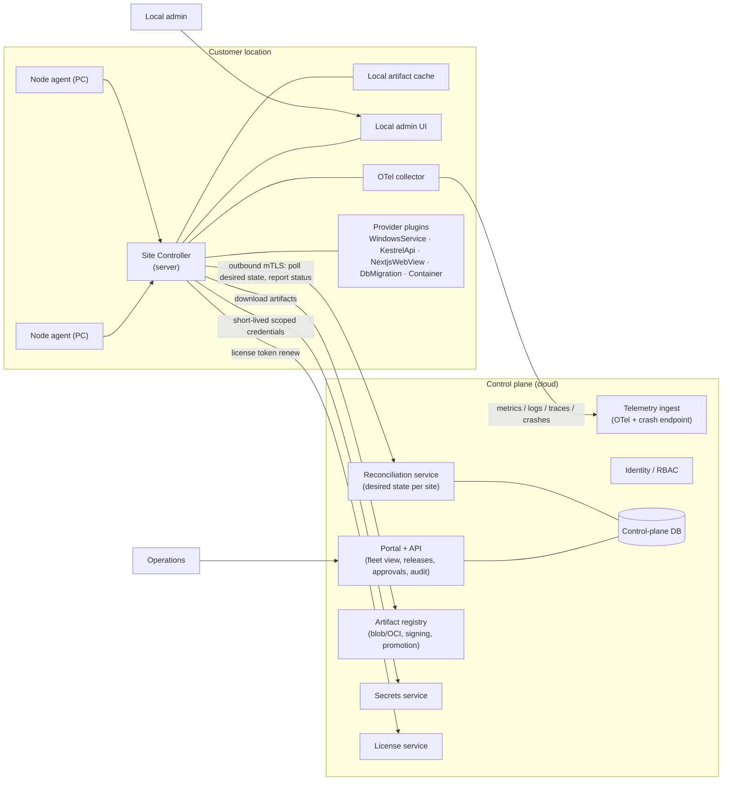

# DevOps / Operations Portal — Initial Concept

**Status:** Draft v0.1 · **Date:** 2026-10-18 · **Owner:** Architecture

---

## 1. Purpose

A platform for operating software deployed to **thousands of customer locations**. A typical location has one server (hosting the database server and backend services) and a few end-user workstations.

The platform must:

- Install and update Windows services, .NET Web APIs (Kestrel behind Nginx), WebView/Next.js applications, and future component types (Docker containers, MSI packages, etc.).
- Provide health monitoring, telemetry, crash/bug reporting and version inventory across the fleet.
- Handle licensing, secrets and inter-component dependencies.
- Support canary/ring-based rollouts with automatic health gates and rollback.
- Offer two gateways: a **release gateway** for Operations (what is allowed to ship) and a **deployment gateway** for the local administrator (when it is installed at their site).

## 2. Reference platforms

No single product covers the full scope; the concept borrows a proven pattern from each.

| Need | Reference platform | Pattern borrowed |
|---|---|---|
| Fleet of NAT-ed sites, server + few PCs | Azure Arc, AWS Systems Manager, Balena, Mender | Outbound-only agent, device registration, fleet grouping, desired-state "runs" |
| Same product deployed to many customers | Octopus Deploy (tenanted deployments) | Tenants, environments, channels/lifecycles, per-tenant variable sets, target roles |
| Desired-state configuration on Windows | PowerShell DSC, Ansible/AWX, Chocolatey/WinGet | Idempotent providers per resource type, inventory, drift detection |
| GitOps / reconciliation | Argo CD, Rancher Fleet | Declared state in control plane; agent pulls, reconciles and reports |
| Telemetry and health | OpenTelemetry Collector, Grafana stack, Datadog | One collector per site, central ingest, SLO-based health |
| Crash and bug reporting | Sentry | Release-tagged events, symbol (PDB/sourcemap) upload, crash grouping |
| Secrets | HashiCorp Vault / OpenBao, Azure Key Vault | Short-lived leases, per-tenant policies, envelope encryption |
| Artifacts | Artifactory, ProGet, OCI registries | Immutable signed artifacts, promotion between feeds |
| Licensing | Keygen, Cryptolens | Signed license tokens, machine fingerprint, offline grace period |

**Adopted mental model:** Octopus-style tenants + Arc/Mender-style pull agents + Argo-style reconciliation.

## 3. Key architectural decisions

| # | Decision | Rationale |
|---|---|---|
| AD-1 | **Pull, not push.** Agents open outbound mTLS (HTTPS/gRPC) to the control plane; no inbound ports at any site. | Works through NAT, firewalls and customer proxies; scales to thousands of sites. |
| AD-2 | **Desired-state manifests.** Operators change desired state (bundle X v1.4 → ring "canary"); agents reconcile and report actual state. | Drift, partial failures and offline sites become first-class states, not exceptions. |
| AD-3 | **Site Controller on the server.** A heavyweight agent per site caches artifacts, orchestrates workstations, hosts the local admin UI, runs the OTel collector and holds the site key. Workstations run a thin agent that talks only to the Site Controller. | Minimises cloud chatter, works during outages, single local point of control. |
| AD-4 | **Provider plugins per component type.** Each provider implements `Plan / Apply / Verify / Rollback / HealthCheck`. | New software types are new providers; the core never changes. |
| AD-5 | **Rings with health gates.** Rollouts progress `internal → pilot → 5% → 25% → all`; promotion requires passing gates; regression triggers auto-rollback. | Safe canary at fleet scale without manual babysitting. |
| AD-6 | **Two gateways, two personas.** Release gateway (Operations): artifact → signed → promoted `dev → qa → stable`; only `stable` is visible to sites. Deployment gateway (Local admin): sees what is offered, picks a maintenance window, approves/defers/rolls back within policy limits. | Separates "is it allowed to ship" from "when does it land here". |
| AD-7 | **Atomic, side-by-side installs.** Install new version beside the old, flip service/Nginx upstream, keep N previous versions. | Fast rollback, no half-installed state. |
| AD-8 | **Secret references, never values.** Config carries `secret://...` references resolved by the agent at apply time. | Secrets never sit in manifests, logs or the database. |

## 4. Domain model

| Entity | Description |
|---|---|
| **Tenant / Location** | A customer site. Attributes, tags, region, contract, license. |
| **Node** | Server or workstation. Role, OS, hardware fingerprint, agent version, last seen. |
| **Component** | A deployable unit type (provider) with a configuration schema. |
| **Artifact** | Immutable, versioned, signed binary + SBOM. |
| **Bundle / Release** | Composition of artifacts with dependency constraints, resolved at planning time. |
| **Channel / Ring** | Which tenants receive which releases and when. |
| **Deployment** | Assignment of desired state (bundle → tenant/ring) with policy: window, approval, rollback rule. |
| **Policy** | Who may approve, deferral limits, compliance deadlines ("must be on ≥ 2.x by date"). |
| **License** | Signed token bound to tenant + machine fingerprint; features, limits, expiry, offline grace. |
| **Health status** | Derived per component → node → site → fleet. |

### 4.1 Dependency expression (example)

```yaml
bundle: erp-suite
version: 2.3.0
components:
  - name: erp-api
    provider: KestrelApi
    artifact: erp-api:2.3.0
    requires:
      dotnet-runtime: ">=8.0.0 <9.0.0"
      nginx: ">=1.24"
      db-schema: ">=41"
  - name: erp-db-migration
    provider: DbMigration
    artifact: erp-db:41
    runs-before: [erp-api]
  - name: erp-client
    provider: NextjsWebView
    artifact: erp-client:2.3.0
    targets: [workstation]
    requires:
      erp-api: ">=2.3.0"
```

## 5. Component architecture



### 5.1 Control plane

| Component | Responsibilities |
|---|---|
| **Portal + API** | Fleet view, release management, deployment planning, approvals, policies, audit log. |
| **Reconciliation service** | Computes desired state per site, serves it to agents, tracks convergence and drift. |
| **Artifact registry** | Immutable storage (blob/OCI), metadata, signing, feed promotion workflow, CDN fronting. |
| **Telemetry ingest** | OTel-native metrics/logs/traces plus a Sentry-compatible crash endpoint (reuses .NET and JS SDKs). |
| **Health model** | Per-component checks → site status → fleet dashboards and alerting. |
| **Secrets service** | Central vault; issues short-lived, tenant-scoped credentials to agents. |
| **License service** | Issues and renews signed tokens; apps validate offline. |
| **Identity / RBAC** | SSO for Operations; separate per-tenant local-admin identities; tenant-scoped roles. |

### 5.2 Site side

| Component | Responsibilities |
|---|---|
| **Site Controller** (Windows service on the server) | Outbound channel; resumable/chunked artifact download and local cache; reconciler; provider plugins; local admin web UI; OTel collector; orchestration of workstation agents; version inventory; crash collection; site secret key (DPAPI-protected). |
| **Node agent** (workstations) | Registers with Site Controller, executes provider actions, reports health. Never talks to the cloud directly. |
| **Agent self-update** | Both agents self-update with rollback. This is the first deployment to get right. |
| **Local safety** | Pre-flight checks (disk, active sessions, DB backup before migration), atomic install, keep N versions, rollback. |

## 6. Cross-cutting concerns

### 6.1 Health monitoring
- Provider-level checks: HTTP probe, service status, DB connectivity, disk, certificate expiry, queue depth.
- Aggregation: component → node → site → fleet; "unknown" is a real state (site offline).
- Feeds the rollout health gates (AD-5).

### 6.2 Telemetry and bug reporting
- OpenTelemetry SDKs in all components; Site Controller runs the collector (batching, buffering while offline, PII scrubbing).
- Crash reports tagged with release, tenant, node; symbols uploaded at build time.
- Retention and data-residency policies configurable per tenant/region.

### 6.3 Version monitoring
- Inventory reported on every reconcile: agent version, component versions, runtimes (.NET, Node, Nginx), OS, DB server version, DB schema version.
- Fleet views: "which sites are on < 2.x", "which sites have drift", compliance deadlines.

### 6.4 License handling
- Signed JWT-style token bound to tenant and machine fingerprint; features and limits inside the token.
- Renewed by the Site Controller; apps validate offline; configurable grace period for disconnected sites.

### 6.5 Canary deployment
- Rings defined centrally; tenants assigned by tag, region or explicit list.
- Gates: crash rate, health status, custom KPIs, soak time. Promotion automatic or manual per policy.
- Regression → automatic halt and rollback of the ring.

### 6.6 Release gateway (Operations)
- Build pipeline publishes to `dev`; QA promotes to `qa`; release manager promotes to `stable` with signature and SBOM.
- Sites only see `stable` (or a tenant-specific channel for pilots).

### 6.7 Deployment gateway (Local admin)
- Local UI shows offered releases, release notes, impact (restart required, DB migration).
- Admin selects maintenance window, approves or defers within policy; can roll back inside the retention window.
- Works while the control plane is unreachable (cached artifacts and manifests).

### 6.8 Secrets handling
- Central vault with tenant-scoped policies; agent receives short-lived leases.
- Site-local secrets encrypted with the site key (DPAPI); config holds references only.
- Rotation driven centrally, applied by providers (e.g. connection strings).

### 6.9 Dependency handling
- Bundles declare semver constraints on components, runtimes and DB schema.
- Resolution happens in the control plane at planning time; sites receive only resolvable plans.
- Ordered execution (`runs-before`), expand/contract DB migrations recommended to decouple app and schema versions.

## 7. Security baseline

- mTLS for every agent connection; per-node client certificates issued at registration.
- All artifacts signed (Authenticode + registry signature); agents verify before install.
- RBAC with tenant scoping; full audit trail of approvals and deployments.
- No inbound ports at sites; control plane exposes only authenticated HTTPS/gRPC.
- Telemetry PII scrubbing at the collector; configurable residency.

## 8. Delivery roadmap

| Phase | Scope | Outcome |
|---|---|---|
| **1** | Agent + registration + inventory + self-update | Fleet visible, agents safely updatable |
| **2** | Artifact registry + one provider (`KestrelApi` or `WindowsService`) + manual deployment to one site | End-to-end install/rollback proven |
| **3** | Health, telemetry, crash ingestion | Fleet health dashboards |
| **4** | Rings, policies, local admin gateway | Safe canary rollouts at scale |
| **5** | Secrets, licenses, dependency resolution, additional providers (Next.js, DbMigration, Container) | Full scope |

## 9. Open questions

1. **Connectivity** — always online, intermittent, or fully offline sites? Typical bandwidth? Drives caching, delta updates and site autonomy.
2. **Machine ownership** — company-owned or customer IT? Can we require admin rights, domain join, OS versions? Any conflicting management (Intune, GPO)?
3. **Database** — engine, who runs migrations today, lockstep vs backward-compatible schema changes?
4. **Multi-tenancy shape** — one product with per-site config, or materially different bundles per customer? Degree of per-site customisation?
5. **Control-plane hosting** — cloud provider or on-prem; data-residency constraints on telemetry leaving a site?
6. **Local admin profile** — technical level; browser approval vs installer wizard; must it work offline?
7. **Scale** — sites now vs 3 years, nodes per site, release cadence, artifact sizes.
8. **Compliance** — required certifications (ISO 27001, SOC 2, sector-specific), signing requirements, customer audits.
9. **Build vs buy** — build the control plane, or compose Octopus / Arc / SSM with custom site-side parts?
10. **Existing estate** — current installer technology, telemetry and licensing that must remain compatible during migration.

## 10. Glossary

| Term | Meaning |
|---|---|
| Site Controller | Agent on the site server that orchestrates the location |
| Node agent | Thin agent on workstations |
| Provider | Plugin implementing install/verify/rollback for one component type |
| Bundle | Versioned set of components with dependency constraints |
| Ring | Rollout stage grouping a subset of tenants |
| Desired state | Target configuration a site should converge to |
| Drift | Difference between desired and actual state |
