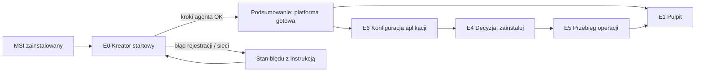

# 2. Przypadki użycia i przepływy użytkownika

Konwencje: **IT** = informatyk urzędu (U1 lub U2), **AG** = Site Agent, **P** = panel lokalny, **IS** = InfoSystem (źródło artefaktów i odbiornik raportów), **SRW** = serwis. Identyfikatory ekranów (E0–E11) odsyłają do `03-mapa-ekranow-i-nawigacja.md`. Kolumna „Ślad” odsyła do wymagań Site Agenta.

## 2.1 Przegląd

| # | Przypadek użycia | Aktor | Priorytet MVP | Ekrany |
|---|---|---|---|---|
| UC1 | Pierwsze uruchomienie po instalacji MSI | IT | Krytyczny | E0, E6, E1 |
| UC2 | Przegląd stanu placówki („czy wszystko działa, co wymaga decyzji”) | IT | Krytyczny | E1, E2 |
| UC3 | Akceptacja aktualizacji: zainstaluj teraz (bramka 2) | IT | Krytyczny | E4, E5 |
| UC4 | Zaplanowanie aktualizacji w oknie | IT | Krytyczny | E4, E5 |
| UC5 | Odrzucenie aktualizacji z powodem | IT | Krytyczny | E4 |
| UC6 | Obserwacja przebiegu operacji i reakcja na automatyczne wycofanie | IT | Krytyczny | E5, E3 |
| UC7 | Cofnięcie do poprzedniej wersji na żądanie | IT | Wysoki | E3, E5 |
| UC8 | Konfiguracja aplikacji (formularz nad bazą CI, hasła do magazynu) | IT (U1), SRW | Krytyczny | E6 |
| UC9 | Import pakietu konfiguracji przygotowanego przez serwis | IT (U2) | Wysoki | E7, E6 |
| UC10 | Włączenie polityki „instaluj automatycznie w oknie” | IT | Średni | E3, E10 |
| UC11 | Diagnostyka: health, logi, połączenie z InfoSystem, sesje na bazie | IT, SRW | Wysoki | E9 |
| UC12 | Samoaktualizacja agenta przez tę samą bramkę | IT | Wysoki | E1, E4, E5 |
| UC13 | Przełączenie placówki z IIS: wysyłka do MC i port nginx | IT, SRW | Wysoki (60 placówek) | E6, E10 |
| UC14 | Przegląd historii i dziennika audytu | IT, SRW, U7 | Średni | E8 |

Przypadki oznaczone jako zdolność po MVP, z zarezerwowanym miejscem w UI: import pakietu aplikacji z pliku (D5), środowisko testowe obok produkcji (A10), wiele maszyn w placówce (D6).

---

## UC1. Pierwsze uruchomienie po instalacji MSI

| | |
|---|---|
| **Aktor** | IT (po otrzymaniu od serwisu MSI, klucza placówki i tokenu) |
| **Wyzwalacz** | MSI zainstalowany (`msiexec /i agent.msi /qn SITEKEY=… TOKEN=…`), usługa agenta wystartowała, informatyk otwiera `http://127.0.0.1:<port>` (skrót na pulpicie serwera utworzony przez MSI, **propozycja**) |
| **Warunki wstępne** | Konto usługi z uprawnieniami administratora; wychodzący HTTPS do FQDN InfoSystem (Z1, Z2) |
| **Rezultat** | Placówka zarejestrowana, pakiet „platforma” (nginx, certyfikat) zainstalowany, 4 aplikacje pobrane i czekają na konfigurację i zgodę; informatyk wie, co dalej |
| **Ślad** | D1, I1, I2, I5–I8, K1 |

**Przebieg główny**

1. P (E0) pokazuje kreator startowy z listą kroków wykonywanych przez AG, każdy ze stanem: rejestracja placówki w InfoSystem → pobranie listy udostępnionych aplikacji → pobranie i weryfikacja pakietu „platforma” → instalacja nginx (port 8443, bo 443 zajęty przez IIS) → wygenerowanie certyfikatu TLS → utworzenie bazy CI → pobranie i weryfikacja 4 aplikacji.
2. Kroki wykonują się bez udziału IT; P odświeża stan co 2 s. IT widzi nazwę placówki z rejestracji („Urząd Gminy …”), co potwierdza, że klucz był właściwy.
3. Po zakończeniu P pokazuje podsumowanie: „Platforma gotowa. 4 aplikacje czekają na konfigurację i Twoją zgodę na instalację” oraz adres, pod którym będą dostępne (`https://srv-urzad:8443/`), z ostrzeżeniem, że adres zadziała po instalacji pierwszej aplikacji.
4. Przycisk **Przejdź do konfiguracji** prowadzi do E6 dla pierwszej aplikacji (lub do E1, jeśli IT woli najpierw się rozejrzeć).
5. IT uzupełnia konfigurację (UC8 lub UC9) i instaluje aplikacje (UC3) jedną po drugiej lub przyciskiem **Zainstaluj wszystkie skonfigurowane** na E1 (**propozycja**: kolejkuje instalacje jedna po drugiej, A4).

**Wyjątki**

| Sytuacja | Zachowanie |
|---|---|
| Token nieważny (72 h) lub klucz placówki nieznany | E0 krok 1 w stanie błędu: „InfoSystem nie rozpoznał klucza lub token wygasł. Poproś serwis o nowy token.” Przycisk **Spróbuj ponownie z nowym tokenem** otwiera pole na token (**propozycja**, bez reinstalacji MSI) |
| Brak połączenia z InfoSystem (DNS, zapora) | E0 krok 1 w stanie błędu z wynikiem testu (`FQDN nie rozwiązuje się` / `połączenie odrzucone na porcie …`) i listą hostów do allow‑listy; przycisk **Sprawdź ponownie** |
| Port 443 i 8443 zajęte | AG wybiera następny wolny z zakresu; E0 pokazuje wybrany port i „możesz go zmienić w Ustawieniach” |
| Brak uprawnień konta usługi | Krok instalacji nginx w stanie błędu: „Konto usługi nie może rejestrować usług Windows. Sprawdź, czy jest w grupie Administratorzy.” Bez prób obejścia (I9) |
| Pakiet z nieprawidłowym podpisem | Krok pobrania w stanie błędu: „Pakiet … odrzucony: podpis nieprawidłowy. Serwis został powiadomiony.” Aplikacja nie pojawia się na liście (K2) |



---

## UC2. Przegląd stanu placówki

| | |
|---|---|
| **Aktor** | IT |
| **Wyzwalacz** | IT loguje się na serwer (RDP) i otwiera panel; zwykle raz na tydzień lub po telefonie od serwisu |
| **Rezultat** | W 10 sekund IT wie: czy aplikacje działają, czy coś czeka na decyzję, czy agent ma kontakt z InfoSystem, czy coś wycofano |
| **Ślad** | P2, M1, M3 |

**Przebieg główny**

1. P (E1) pokazuje pasek stanu placówki: połączenie z InfoSystem (ostatni kontakt), nginx i port, adres dla operatorów, wolne miejsce na dysku, wersja agenta.
2. Sekcja **Wymaga Twojej decyzji** listuje oczekujące aktualizacje (aplikacja, wersja z → do, wpływ, od kiedy czeka) z przyciskiem **Zdecyduj** (→ E4).
3. Sekcja **Aplikacje** pokazuje per aplikacja: stan usługi (działa / zatrzymana / uruchamianie / błąd), wersję, wynik ostatniego `health`, politykę auto.
4. Sekcja **Ostatnie operacje** pokazuje 5 ostatnich z wynikiem i linkiem do E5.
5. Jeśli nic nie czeka i wszystko działa, E1 mówi to wprost: „Wszystko działa. Brak oczekujących decyzji.”

**Wyjątki**

| Sytuacja | Zachowanie |
|---|---|
| Agent nie ma kontaktu z IS dłużej niż 2 cykle odpytywania | Pasek stanu żółty: „Brak połączenia z InfoSystem od …; aplikacje działają; raporty zostaną wysłane po przywróceniu łączności” (N6 agenta) |
| Usługa aplikacji pada i jest restartowana | Karta aplikacji czerwona: „Usługa uruchamiana ponownie (3. raz w ciągu godziny)”; link do E9 |
| Ostatnia operacja wycofana automatycznie | Baner na górze E1 do zamknięcia: „Aktualizacja KSeF 3.2.0 została wycofana: … Serwis został powiadomiony.” |

---

## UC3. Akceptacja aktualizacji: zainstaluj teraz (bramka 2)

| | |
|---|---|
| **Aktor** | IT |
| **Wyzwalacz** | Na E1 pojawiła się pozycja „Wymaga Twojej decyzji” (AG pobrał i zweryfikował pakiet udostępniony przez serwis, bramka 1) |
| **Warunki wstępne** | Pakiet zweryfikowany; konfiguracja aplikacji kompletna; manifest nie wymaga nowszego agenta (A7) |
| **Rezultat** | Nowa wersja działa, `health` zdrowy, raport wysłany; albo automatyczne wycofanie z przyczyną |
| **Ślad** | A1, A2, A4, A5, A6, I9, T‑Z3 |

**Przebieg główny**

1. IT klika **Zdecyduj** na E1 (lub otwiera E3 → karta „Wersje” → **Zdecyduj**). P pokazuje E4.
2. E4 sekcja **Co się zmieni**: aplikacja, wersja zainstalowana → udostępniona, kanał, data wydania, notatki wydania (z manifestu), wpływ jako lista ptaszków: „wymaga restartu usługi (przerwa ok. 1 min)”, „bez zmian w bazie” lub „migracja bazy: serwis wykona ręcznie przed instalacją”, „pilne: zmiana prawa”.
3. E4 sekcja **Sprawdzenia przed instalacją** (AG wykonuje przy otwarciu ekranu, I9): miejsce na dysku (potrzebne / wolne), aktywne sesje na bazie aplikacji (liczba + lista użytkowników z `MON$ATTACHMENTS`), port loopback, uprawnienia konta, wersja agenta wystarczająca. Każde ze stanem ✓ / ⚠ / ✗.
4. E4 sekcja **Co zrobi agent**: lista kroków (zatrzymanie usługi → przełączenie na nową wersję → start → aktualizacja nginx jeśli trzeba → sprawdzenie zdrowia) oraz zdanie: „Jeśli sprawdzenie zdrowia nie powiedzie się, agent sam przywróci wersję X i powiadomi serwis.”
5. IT klika **Zainstaluj teraz**. Jeśli są aktywne sesje, P pyta w oknie potwierdzenia: „Na bazie pracuje 3 użytkowników (lista). Przerwa ok. 1 min. Zainstalować mimo to?” z przyciskami **Instaluj** / **Zaplanuj na później** / **Anuluj**.
6. P przechodzi do E5; AG wykonuje kroki; log odświeża się na żywo.
7. Wynik sukces: E5 pokazuje „CRU 2.4.0 działa”, wynik `health`, czas trwania, przycisk **Wróć do pulpitu** oraz **Cofnij do 2.3.1** (gdyby IT po chwili zauważył problem).

**Wyjątki**

| Sytuacja | Zachowanie |
|---|---|
| Sprawdzenie ✗ (brak miejsca, brak uprawnień, zbyt stary agent) | Przycisk **Zainstaluj teraz** nieaktywny z wyjaśnieniem przy sprawdzeniu; dla „zbyt stary agent”: link do decyzji o aktualizacji agenta (UC12) |
| Konfiguracja aplikacji niekompletna (pierwsza instalacja) | Sekcja „Konfiguracja” na E4 w stanie ⚠ z listą brakujących pól i przyciskiem **Uzupełnij konfigurację** (→ E6); instalacja zablokowana |
| Inna operacja w toku (A4) | Przycisk **Zainstaluj teraz** zastąpiony przez **Dodaj do kolejki**; komunikat: „Trwa aktualizacja mObywatel. Ta instalacja rozpocznie się po jej zakończeniu.” |
| Health niezdrowy lub brak odpowiedzi | Patrz UC6 |
| IT zamyka przeglądarkę w trakcie | Operacja trwa w AG; po powrocie E1 pokazuje baner z wynikiem; E5 dostępne z historii |

```mermaid
sequenceDiagram
  participant IT as Informatyk
  participant P as Panel (E4/E5)
  participant AG as Site Agent
  participant APP as Usługa aplikacji
  participant IS as InfoSystem
  IT->>P: Otwiera decyzję dla CRU 2.4.0
  P->>AG: GET /api/apps/cru/pending, GET /api/apps/cru/preflight
  AG-->>P: manifest, notatki, wpływ; sprawdzenia (dysk ✓, sesje ⚠ 3, port ✓, agent ✓)
  IT->>P: Zainstaluj teraz
  P->>IT: Potwierdzenie: 3 aktywne sesje, przerwa ~1 min
  IT->>P: Instaluj
  P->>AG: POST /api/apps/cru/install
  AG-->>P: operationId
  P->>AG: GET /api/operations/{id}/events (SSE)
  AG->>APP: stop → current=2.4.0 → start
  AG->>AG: nginx -t, reload (jeśli zmiana portu/prefiksu)
  AG->>APP: GET /health (limit 60 s)
  alt zdrowa
    AG-->>P: krok „Sprawdzenie zdrowia” ✓, operacja zakończona
    AG->>IS: POST /v1/sites/{id}/state
  else niezdrowa
    AG->>APP: stop → current=2.3.1 → start → health
    AG-->>P: operacja „wycofana”, przyczyna, link do logów
    AG->>IS: POST state (rollback + przyczyna)
  end
```

---

## UC4. Zaplanowanie aktualizacji w oknie

| | |
|---|---|
| **Aktor** | IT |
| **Wyzwalacz** | Jak UC3, ale IT nie chce przerwy teraz (aktywne sesje, godziny pracy) |
| **Rezultat** | AG wykona instalację o wskazanej godzinie bez obecności IT; stan „zaplanowano” widoczny dla serwisu |
| **Ślad** | A2, O‑U1, O‑U2 |

**Przebieg główny**

1. Na E4 IT klika **Zaplanuj**. Okno dialogowe: data (domyślnie najbliższa sobota), godzina (domyślnie 06:00), podpowiedzi „jutro 06:00”, „sobota 06:00”; informacja „czas serwera: …” (N10 agenta: zegar lokalny oznaczony jako lokalny).
2. Pole wyboru (domyślnie zaznaczone): „Jeśli o tej porze na bazie będą aktywne sesje, odłóż o 30 minut, maksymalnie 3 razy” (**propozycja**).
3. Pole wyboru (domyślnie zaznaczone): „Przy niezdrowym stanie po instalacji przywróć poprzednią wersję” (zawsze włączone, pokazane dla jasności, nieedytowalne w MVP).
4. IT klika **Zaplanuj**. P wraca do E1; pozycja przechodzi z „Wymaga decyzji” do „Zaplanowane: CRU 2.4.0, sobota 24.10 06:00” z przyciskami **Zmień termin** i **Anuluj plan**.
5. O wskazanej godzinie AG wykonuje operację jak w UC3 kroki 6–7; wynik czeka na E1 jako baner.

**Wyjątki**

| Sytuacja | Zachowanie |
|---|---|
| Data w przeszłości | Walidacja: „Termin musi być w przyszłości” |
| W zaplanowanym terminie brak pakietu (serwis wycofał wersję) | AG anuluje plan i zapisuje w historii: „Wersja 2.4.0 nie jest już udostępniona”; baner na E1 |
| Odłożenie 3 razy z powodu sesji | AG rezygnuje, zapisuje „Nie wykonano: aktywne sesje o 06:00, 06:30, 07:00”; pozycja wraca do „Wymaga decyzji” |
| Serwer wyłączony o tej godzinie | AG wykonuje przy najbliższym starcie, jeśli opóźnienie poniżej 12 h (**propozycja**); inaczej wraca do „Wymaga decyzji” |

---

## UC5. Odrzucenie aktualizacji z powodem

| | |
|---|---|
| **Aktor** | IT |
| **Rezultat** | Wersja znika z „Wymaga decyzji”; powód trafia do serwisu; można wrócić do niej z historii |
| **Ślad** | A2, K3, R5 |

**Przebieg główny**

1. Na E4 IT klika **Odrzuć**. Okno dialogowe: powód z listy („Nie teraz, wrócę do tego później”, „Czekam na potwierdzenie z serwisu”, „Wersja powoduje problemy w innej placówce”, „Nie potrzebujemy tej zmiany”, „Inny powód”) i pole tekstowe (wymagane przy „Inny powód”, maks. 500 znaków).
2. Pole wyboru: „Przypomnij mi za 7 dni” (domyślnie zaznaczone dla „Nie teraz”).
3. IT klika **Odrzuć**. Pozycja przechodzi do E3 karta „Wersje” jako „Odrzucona 19.10 przez SRV\adam: Nie teraz” z przyciskiem **Rozważ ponownie** (wraca do „Wymaga decyzji”).
4. AG raportuje odrzucenie z powodem do IS.

**Wyjątki**: wersja oznaczona jako „pilne” (`urgent`): dialog dodaje ostrzeżenie „Serwis oznaczył tę wersję jako pilną (zmiana prawa). Odrzucenie zostanie przekazane serwisowi.” Odrzucenie nadal możliwe (brak wymuszania, R5).

---

## UC6. Obserwacja przebiegu operacji i reakcja na automatyczne wycofanie

| | |
|---|---|
| **Aktor** | IT (obserwuje), AG (wykonuje) |
| **Rezultat** | IT rozumie, co się stało i co dalej; po wycofaniu aplikacja działa w poprzedniej wersji |
| **Ślad** | A5, A6, M6, K2 |

**Przebieg główny (E5)**

1. Nagłówek: aplikacja, operacja (instalacja / aktualizacja / wycofanie / samoaktualizacja agenta), wersja z → do, kto uruchomił (konto Windows lub „harmonogram” lub „polityka auto”), czas startu.
2. Lista kroków z ikonami stanu (oczekuje / w toku / ✓ / ✗ / pominięty) i czasem trwania: sprawdzenia wstępne → pobranie i weryfikacja (jeśli nie było) → zatrzymanie usługi → przełączenie wersji → start usługi → aktualizacja nginx → sprawdzenie zdrowia → raport do InfoSystem.
3. Pod krokami: log tekstowy odświeżany na żywo (SSE), z przełącznikiem „tylko błędy i ostrzeżenia”, przyciskiem **Kopiuj log** i **Pobierz log**.
4. Wynik sukces: zielony pasek „Zakończono: CRU 2.4.0 działa (zdrowa, schemat 41/41, baza osiągalna)”.
5. Wynik wycofanie: czerwony pasek „Wycofano: nowa wersja nie przeszła sprawdzenia zdrowia (schemat bazy 41, oczekiwany 42). Przywrócono 2.3.1, aplikacja działa. Serwis został powiadomiony.” Sekcja **Co możesz zrobić**: „Skontaktuj się z serwisem (nr zgłoszenia w raporcie: …)”, „Zobacz logi aplikacji”, „Spróbuj ponownie” (wraca do E4; dostępne tylko, gdy przyczyna nie jest trwała, **propozycja**).

**Wyjątki**

| Sytuacja | Zachowanie |
|---|---|
| Wycofanie też się nie powiodło (poprzednia wersja nie startuje) | Pasek czerwony „Aplikacja nie działa. Agent nie zdołał przywrócić 2.3.1: …” z przyciskami **Uruchom ponownie usługę**, **Zobacz logi**, „Zadzwoń do serwisu: …” (numer z ustawień placówki, **propozycja**) |
| Restart serwera w trakcie | AG wznawia lub kończy operację po starcie (N5); E5 pokazuje krok „Wznowiono po restarcie serwera” |
| Utrata połączenia panelu z agentem (usługa agenta zatrzymana) | E5 stan błędu: „Brak połączenia z usługą agenta. Sprawdź, czy usługa »InfoSystem Site Agent« działa.” z przyciskiem **Spróbuj ponownie** |

---

## UC7. Cofnięcie do poprzedniej wersji na żądanie

| | |
|---|---|
| **Aktor** | IT |
| **Wyzwalacz** | Po udanej aktualizacji operatorzy zgłaszają problem; IT chce wrócić |
| **Rezultat** | Poprzednia wersja działa; zdarzenie w historii i raporcie |
| **Ślad** | A2, I4, T‑A15 |

**Przebieg główny**

1. E3 (karta „Wersje”) pokazuje listę wersji na dysku: bieżąca, poprzednie (N=2) z datą instalacji; przy poprzednich przycisk **Cofnij do tej wersji**.
2. Okno potwierdzenia: „Cofnięcie CRU z 2.4.0 do 2.3.1. Przerwa ok. 1 min. Zmiany w bazie wykonane przez 2.4.0 nie zostaną cofnięte; jeśli 2.4.0 zmieniła schemat bazy, 2.3.1 może nie działać. Aktywne sesje: 2.” Pole „powód” (opcjonalne, trafia do serwisu). Przyciski **Cofnij** / **Anuluj**.
3. Przebieg jak E5; po sukcesie wersja 2.4.0 zostaje na dysku i wraca do „Wymaga decyzji” jako „Udostępniona (wcześniej wycofana przez Ciebie)” z adnotacją.

**Wyjątki**: brak poprzedniej wersji na dysku (pierwsza instalacja): przycisk ukryty, tekst „Brak poprzedniej wersji”. Manifest bieżącej wersji miał `schemaMigration: true`: dialog dodaje mocniejsze ostrzeżenie i zaleca kontakt z serwisem.

---

## UC8. Konfiguracja aplikacji

| | |
|---|---|
| **Aktor** | IT (U1 wpisuje wszystko sam), SRW przy serwerze |
| **Wyzwalacz** | Pierwsza instalacja; zmiana instancji Firebirda; zmiana parametru aplikacji (dziś SQL‑em) |
| **Rezultat** | Parametry nie‑sekretne zapisane w bazie CI, hasła w magazynie sekretów; aplikacja zrestartowana, jeśli trzeba |
| **Ślad** | P3, T‑K4, T‑K5, S2, S4, C5, C6 |

**Przebieg główny (E6)**

1. Formularz generowany ze schematu konfiguracji aplikacji (wersjonowanego, dostarczonego w pakiecie). Sekcje: **Baza danych** (host FQDN, port, ścieżka bazy, użytkownik, hasło), **Usługi zewnętrzne** (np. FQDN API MC, identyfikator jednostki, secret jednostki), **Parametry aplikacji** (pola specyficzne: listy wyboru, ptaszki, liczby), **Praca w tle** (np. „wysyłka do MC włączona”).
2. Pola sekretne: maskowane, po zapisie pokazują „ustawione (zmieniono 19.10)” bez wartości; przycisk **Zmień**; wartości nigdy nie wracają z API (S2).
3. Przycisk **Testuj połączenie z bazą** (AG otwiera połączenie i czyta wersję Firebirda i dialekt; wynik: „Firebird 3.0.11, dialekt 3, baza osiągalna” lub błąd po polsku).
4. Walidacja kompletności na żywo: pasek postępu „8 z 10 wymaganych pól”; lista brakujących; **Zapisz** aktywny tylko, gdy wszystkie wymagane pola są poprawne (zapis częściowy jako „szkic” możliwy przyciskiem **Zapisz szkic**, **propozycja**).
5. Zapis: AG zapisuje do bazy CI i magazynu; jeśli aplikacja działa i parametr wymaga restartu, P pyta „Zrestartować CRU teraz (przerwa ok. 30 s, 2 aktywne sesje)?” / „Zastosuj przy następnym restarcie”.
6. **Propozycja**: przycisk „Użyj tych samych danych bazy co w mObywatel” kopiuje host, port, użytkownika (nie hasło) z innej aplikacji.

**Wyjątki**

| Sytuacja | Zachowanie |
|---|---|
| Adres IP zamiast FQDN | Walidacja: „Podaj nazwę serwera (FQDN), nie adres IP” (T‑A13) |
| Test połączenia: dialekt 1 lub Firebird 2.5 | Ostrzeżenie: „Aplikacja wymaga Firebird 3 i dialektu 3. Skontaktuj się z serwisem w sprawie migracji.” Zapis dozwolony, instalacja zablokowana (**propozycja**) |
| Baza CI nieosiągalna | E6 stan błędu z przyciskiem **Spróbuj ponownie** i linkiem do E9 |
| Schemat konfiguracji w nowej wersji aplikacji ma nowe pola wymagane | Na E4 sekcja „Konfiguracja” ⚠: „Nowa wersja wymaga 2 nowych parametrów” z linkiem do E6 w trybie „uzupełnij dla wersji 2.4.0” |

---

## UC9. Import pakietu konfiguracji przygotowanego przez serwis

| | |
|---|---|
| **Aktor** | IT (U2) |
| **Wyzwalacz** | Serwis przysłał plik `.iscfg` i jednorazowy klucz (osobnym kanałem) |
| **Rezultat** | Konfiguracja wczytana jako szablon, pola „do uzupełnienia” wypełnione przez IT, zapis jak w UC8 |
| **Ślad** | P4, T‑K5 |

**Przebieg główny (E7 → E6)**

1. E7: wybór pliku (przeciągnij lub wskaż), pole „Klucz jednorazowy” (format `XXXX-XXXX-XXXX-XXXX`), przycisk **Odszyfruj i pokaż**.
2. AG odszyfrowuje lokalnie; P pokazuje podgląd: dla jakiej placówki i aplikacji (lub kilku) przygotowano pakiet, kto i kiedy (z podpisu serwisu), lista pól: wartość z pakietu / „do uzupełnienia przez Ciebie” / „pozostanie bez zmian”.
3. Pola sekretne z pakietu pokazane jako „ustawione przez serwis” (bez wartości); pola sekretne oznaczone „do uzupełnienia” wymagają wpisania.
4. IT klika **Zastosuj do formularza**; P otwiera E6 z wartościami wczytanymi, polami do uzupełnienia podświetlonymi i komunikatem „Nic nie zostało jeszcze zapisane”.
5. Dalej jak UC8 kroki 3–5.

**Wyjątki**

| Sytuacja | Zachowanie |
|---|---|
| Zły klucz | „Nie udało się odszyfrować. Sprawdź klucz; po 5 nieudanych próbach pakiet trzeba wygenerować ponownie” |
| Pakiet dla innej placówki | „Ten pakiet przygotowano dla placówki …, a to jest …. Nie można go użyć.” |
| Pakiet dla wersji aplikacji innej niż udostępniona | Ostrzeżenie: „Pakiet dotyczy schematu konfiguracji 2.4; zainstalowana 2.3.1 używa 2.3. Pola niepasujące zostaną pominięte: …” |

---

## UC10. Włączenie polityki „instaluj automatycznie w oknie”

| | |
|---|---|
| **Aktor** | IT |
| **Rezultat** | Dla wybranej aplikacji AG instaluje udostępnione wersje w oknie bez pytania; polityka widoczna dla serwisu |
| **Ślad** | A3, 7.9 |

**Przebieg główny**: E3 karta „Przegląd” (lub E10 sekcja „Polityki”) → przełącznik „Instaluj automatycznie w oknie” → dialog: okno (dni tygodnia, godzina od–do), „pomiń, gdy są aktywne sesje”, „nie dotyczy wersji z migracją bazy” (zawsze zaznaczone w MVP, nieedytowalne), tekst: „Serwis zobaczy, że ta placówka włączyła automatyczne instalacje dla CRU. Możesz to wyłączyć w każdej chwili.” → **Włącz**. Zdarzenie audytu i raport.

**Wyjątki**: polityka nie obejmuje samoaktualizacji agenta, dopóki IT nie włączy jej osobno (E10). Przy aktywnej polityce E1 pokazuje w karcie aplikacji „auto: sob 06:00–08:00”.

---

## UC11. Diagnostyka

| | |
|---|---|
| **Aktor** | IT, SRW przy serwerze |
| **Wyzwalacz** | Operatorzy zgłaszają, że aplikacja nie działa; serwis prosi o sprawdzenie; IT chce potwierdzić łączność po zmianie zapory |
| **Ślad** | P5, M2, M6, N1 (agent) |

**Przebieg główny (E9)**

1. **Połączenie z InfoSystem**: FQDN i port, ostatni kontakt, ostatni wysłany raport, liczba raportów w buforze; przycisk **Testuj teraz** → wynik krokowy (DNS → TCP → TLS i certyfikat przypięty → uwierzytelnienie agenta).
2. **Zdrowie aplikacji**: tabela: aplikacja, stan usługi, `health` (zdrowa / obniżona / niezdrowa / brak odpowiedzi), wersja aplikacji, schemat bieżący/oczekiwany, baza osiągalna i opóźnienie, zadania w tle (nazwa, żyje, ostatnie uruchomienie), czas startu; przycisk **Sprawdź teraz** per aplikacja.
3. **Sesje na bazach**: per instancja Firebirda z konfiguracji: liczba sesji, lista (użytkownik, komputer, od kiedy); tylko odczyt `MON$ATTACHMENTS`.
4. **Logi**: zakładki agent / nginx / per aplikacja; ostatnie 15 min (wybór 5/15/60), filtr poziomu, szukaj, **Kopiuj**, **Pobierz**; informacja „logi nie zawierają haseł ani danych osobowych”.
5. **Zasoby**: dysk (katalog InfoSystem i wolne miejsce), RAM agenta i aplikacji, porty zajęte przez platformę.
6. **Adres dla operatorów** z przyciskiem **Kopiuj** i **Otwórz w przeglądarce**; stan certyfikatu TLS (wystawca, ważny do, czy zaufany na tym serwerze).

**Wyjątki**: usługa aplikacji zatrzymana: przycisk **Uruchom usługę**; po 3 nieudanych restartach: komunikat z linkiem do logów i zaleceniem cofnięcia wersji (UC7).

---

## UC12. Samoaktualizacja agenta

| | |
|---|---|
| **Aktor** | IT |
| **Rezultat** | Nowa wersja agenta działa; panel wraca po restarcie usługi; przy nieudanym starcie agent wraca do poprzedniej wersji |
| **Ślad** | A9, K7 |

**Przebieg główny**: pozycja „Site Agent 1.0.3 → 1.0.4” w „Wymaga Twojej decyzji” na E1, oznaczona jako „składnik platformy”. E4 w wariancie dla agenta: wpływ „panel będzie niedostępny ok. 30 s; aplikacje działają bez przerwy”. Po kliknięciu **Zainstaluj teraz** E5 pokazuje kroki; przy kroku „restart usługi agenta” P traci połączenie i pokazuje „Agent restartuje się… łączenie ponownie” z automatycznym odświeżaniem; po powrocie E5 dokończony z nowej wersji.

**Wyjątki**: nowa wersja nie startuje: stara wraca automatycznie; E1 baner „Aktualizacja agenta wycofana. Serwis powiadomiony.” Pakiet aplikacji wymaga nowszego agenta (A7): na E4 aplikacji sprawdzenie „wersja agenta” ✗ z linkiem do decyzji o agencie.

---

## UC13. Przełączenie placówki z IIS

| | |
|---|---|
| **Aktor** | IT z SRW (telefonicznie lub przy serwerze) |
| **Kontekst** | 60 placówek ma stare API na IIS (port 443) wysyłające do MC 24/7; nowa usługa startuje bez wysyłki, żeby nie dublować |
| **Ślad** | 7.11, I6 |

**Przebieg główny**

1. Po instalacji mObywatel/e‑Opłaty E6 ma w sekcji „Praca w tle” przełącznik „Wysyłka do Ministerstwa Cyfryzacji” domyślnie **wyłączony** z opisem: „Włącz dopiero po wyłączeniu wysyłki w starej instalacji IIS, inaczej dane zostaną wysłane dwukrotnie.”
2. IT (z serwisem) wyłącza wysyłkę w IIS, potem włącza przełącznik w E6; AG restartuje usługę; E9 pokazuje zadanie w tle „mc-sync: żyje, ostatnie uruchomienie …”.
3. Po okresie obserwacji IT wyłącza witryny w IIS. E10 sekcja „Port i adres” pokazuje: „Port 443 jest wolny. Przełączyć nginx na 443? Adres dla operatorów zmieni się z `https://srv-urzad:8443/` na `https://srv-urzad/`.” Przyciski **Przełącz na 443** / **Zostaw 8443**.
4. Po przełączeniu E1 pokazuje nowy adres i przypomnienie „poinformuj operatorów o nowym adresie”.

---

## UC14. Przegląd historii i dziennika audytu

| | |
|---|---|
| **Aktor** | IT, SRW, U7 |
| **Ślad** | M5, F6 |

**Przebieg główny (E8)**: lista operacji i zdarzeń (instalacja, aktualizacja, wycofanie automatyczne, cofnięcie ręczne, odrzucenie, zaplanowanie, zmiana konfiguracji, zmiana polityki, zmiana ustawień, import pakietu, odrzucony pakiet z błędnym podpisem), każda z: kiedy (czas serwera, oznaczony jako lokalny), kto (konto Windows / harmonogram / polityka auto / agent), aplikacja, wersja, wynik, czy raport dotarł do InfoSystem. Filtry: aplikacja, typ, wynik, zakres dat. Eksport CSV (**propozycja**). Kliknięcie otwiera E5 (dla operacji) lub szczegóły zdarzenia.

---

## 2.2 Macierz przypadków użycia i wymagań

| Wymaganie | UC |
|---|---|
| A1 brak instalacji bez zgody | UC3, UC4, UC10, UC12 |
| A2 zainstaluj / zaplanuj / odrzuć / cofnij | UC3, UC4, UC5, UC7 |
| A3 polityka auto opt‑in | UC10 |
| A4 jedna aplikacja naraz | UC3 (kolejka), UC6 |
| A6 automatyczne wycofanie | UC6 |
| A7 wpływ z manifestu, min. wersja agenta | UC3, UC12 |
| A9 samoaktualizacja | UC12 |
| I9 sprawdzenia wstępne | UC3 |
| P2 stan per aplikacja | UC2 |
| P3 formularz konfiguracji, sekrety niewidoczne | UC8 |
| P4 import pakietu konfiguracji | UC9 |
| P5 diagnostyka | UC11 |
| M5 audyt z kontem Windows | UC14 i każdy UC z akcją |
| M6 logi w panelu | UC6, UC11 |
| 7.11 współistnienie z IIS | UC13 |
| K1 instalacja poniżej 10 minut | UC1 |
