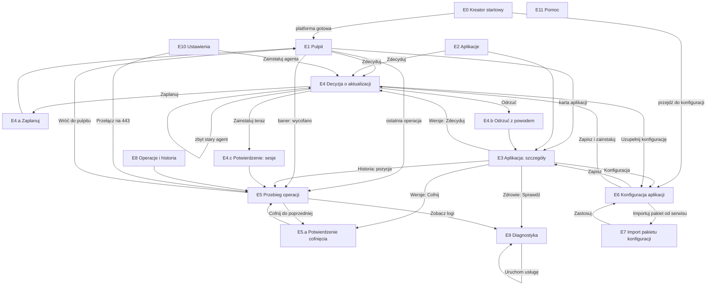

# 3. Mapa ekranów i nawigacja

## 3.1 Model nawigacji

Panel to aplikacja jednostronicowa z stałym układem:

| Obszar | Zawartość |
|---|---|
| **Pasek górny** | Nazwa placówki i serwera; wskaźnik połączenia z InfoSystem (zielony „połączono, ostatni kontakt 2 min temu” / żółty „brak połączenia od …”); konto Windows bieżącej sesji z dopiskiem „zapisywane w dzienniku”; wersja agenta |
| **Nawigacja boczna** | Pulpit · Aplikacje (plakietka z liczbą oczekujących decyzji) · Operacje · Diagnostyka · Ustawienia · Pomoc |
| **Treść** | Ekran bieżący z nagłówkiem, ścieżką powrotu („← Aplikacje / CRU”) i akcjami głównymi po prawej |
| **Baner globalny** | Nad treścią, gdy wystąpiło zdarzenie wymagające uwagi: wycofanie automatyczne, brak połączenia, nieudany restart usługi, zbyt stary agent dla czekającego pakietu |
| **Powiadomienia** | Krótkie komunikaty w rogu po akcjach (zapisano, zaplanowano, skopiowano) |

Zasady:

- **Wzorzec z benchmarku**: pulpit jako tablica stanu (aplikacja × wersja × stan), strona wydania z notatkami i podglądem skutków, log zadania krok po kroku, zatwierdzenie lub odrzucenie z powodem, wdrożenie zaplanowane, powrót do poprzedniego wydania, dziennik audytu.
- Decyzja o instalacji jest zawsze osobnym ekranem (E4), nigdy przyciskiem na liście. Lista ma tylko **Zdecyduj**.
- Każda akcja zmieniająca stan ma okno potwierdzenia z opisem skutków (przerwa, sesje, co się stanie przy błędzie).
- Ekran operacji (E5) jest ten sam dla instalacji, aktualizacji, wycofania, cofnięcia i samoaktualizacji.
- Układ działa od 1024 px szerokości (okno RDP); poniżej nawigacja boczna zwija się do ikon.

## 3.2 Drzewo ekranów

```
E0  Pierwsze uruchomienie (kreator startowy)              #/start
E1  Pulpit                                                 #/pulpit
E2  Aplikacje (lista)                                      #/aplikacje
E3  Aplikacja: szczegóły                                   #/aplikacje/:app
    E3.1 karta Przegląd                                    ?karta=przeglad
    E3.2 karta Wersje                                      ?karta=wersje
    E3.3 karta Konfiguracja  (= E6 osadzone)               ?karta=konfiguracja
    E3.4 karta Zdrowie i logi                              ?karta=zdrowie
    E3.5 karta Historia                                    ?karta=historia
E4  Decyzja o aktualizacji (bramka 2)                      #/aplikacje/:app/decyzja/:wersja
    E4.a okno Zaplanuj
    E4.b okno Odrzuć
    E4.c okno Potwierdzenie instalacji (aktywne sesje)
E5  Przebieg operacji                                      #/operacje/:id
    E5.a okno Cofnij do poprzedniej wersji
E6  Konfiguracja aplikacji                                 #/aplikacje/:app/konfiguracja
E7  Import pakietu konfiguracji                            #/aplikacje/:app/konfiguracja/import
E8  Operacje i historia                                    #/operacje
E9  Diagnostyka                                            #/diagnostyka
    E9.1 Połączenie z InfoSystem · E9.2 Zdrowie aplikacji · E9.3 Sesje na bazach · E9.4 Logi · E9.5 Zasoby i adres
E10 Ustawienia placówki                                    #/ustawienia
    E10.1 Port i adres · E10.2 Certyfikat TLS · E10.3 Polityki automatycznej instalacji · E10.4 Agent · E10.5 Zaawansowane
E11 Pomoc: co robi agent na tym serwerze                   #/pomoc
```

Ekrany zarezerwowane po MVP (miejsce w nawigacji, bez implementacji): „Importuj pakiet aplikacji z pliku” (D5) w E2; „Uruchom wersję testową obok” (A10) w E3.2; „Maszyny w tej placówce” (D6) w E10.

## 3.3 Diagram przejść



## 3.4 Trasy i parametry

| Trasa | Ekran | Parametry | Uwagi |
|---|---|---|---|
| `#/start` | E0 | – | Domyślna, gdy placówka nie ma zainstalowanej żadnej aplikacji i kreator nie został zamknięty; później dostępna z E11 jako „Pokaż stan platformy” |
| `#/pulpit` | E1 | – | Domyślna po pierwszej instalacji |
| `#/aplikacje` | E2 | `?filtr=oczekujace` | Plakietka w nawigacji liczy oczekujące decyzje (aplikacje + agent) |
| `#/aplikacje/:app` | E3 | `?karta=przeglad\|wersje\|konfiguracja\|zdrowie\|historia` | `:app` = `name` z manifestu (`skarbowy`, `cru`, `ksef`, `eauta`) lub `agent` dla składnika platformy |
| `#/aplikacje/:app/decyzja/:wersja` | E4 | – | Gdy wersja nie czeka już na decyzję (zainstalowana, odrzucona, wycofana przez serwis): E4 w stanie „ta decyzja została już podjęta” z linkiem do E3 |
| `#/aplikacje/:app/konfiguracja` | E6 | `?dla=2.4.0` (tryb „uzupełnij dla wersji”), `?import=1` | |
| `#/aplikacje/:app/konfiguracja/import` | E7 | – | |
| `#/operacje` | E8 | `?app=&typ=&wynik=&od=&do=` | |
| `#/operacje/:id` | E5 | – | Dla operacji w toku: strumień zdarzeń |
| `#/diagnostyka` | E9 | `?sekcja=polaczenie\|zdrowie\|sesje\|logi\|zasoby`, `?log=agent\|nginx\|<app>` | |
| `#/ustawienia` | E10 | `?sekcja=` | |
| `#/pomoc` | E11 | – | |

## 3.5 Stany globalne widoczne na każdym ekranie

| Stan | Jak pokazany | Źródło |
|---|---|---|
| Połączono z InfoSystem | Zielona kropka, „ostatni kontakt 2 min temu” | `GET /api/site` (`infoSystem.lastContact`) |
| Brak połączenia z InfoSystem | Żółta kropka, baner informacyjny do zamknięcia (wraca po 24 h) | jw. |
| Operacja w toku | Pulsująca ikona przy „Operacje” w nawigacji; na E1 karta aplikacji w stanie „aktualizacja w toku” | `GET /api/operations?status=running` |
| Brak połączenia z usługą agenta | Pełnoekranowy stan błędu: „Nie można połączyć się z usługą agenta” z instrukcją `services.msc` i przyciskiem **Spróbuj ponownie**; automatyczne ponawianie co 5 s | błąd sieci na dowolnym żądaniu |
| Agent restartuje się (samoaktualizacja) | Nakładka „Agent uruchamia się ponownie…” z licznikiem | SSE zamknięte po kroku `agent.restart` |
